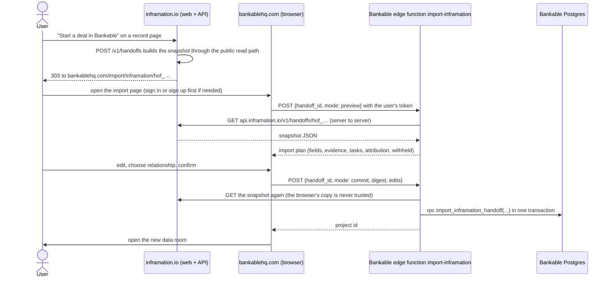

# The Bankable bridge: from a prospect on the map to a deal in Bankable

**Superseded as the plan, 2026-10-22 (owner):** "Build a deal" is built natively in Inframation, and bankablehq is the
reference design, not an integration target (decisions log, 2026-10-22; the native spec is `docs/19-build-a-deal.md`).
This document stays as the record of what Bankable has (§1, the method and content the native build reuses) and as a
contingency design if Bankable is kept as a separate product. Bankable holds test and demo data only (owner, 2026-10-22).

Status: **specification, 2026-10-22, rewritten from Bankable's source code.** It replaces the same-day draft that
was inferred from the app's browser bundle. Nothing here is built. Decision rows of 2026-10-22 in
`docs/00-PLAN.md` ("Bankable is the origination and syndication half"; "The site is organised by development
phase").

**Two things block go-live:**

- **The posture conflict in §5.1**, which the owner decides.
- **Privately held security issues.** A security review of Bankable's access rules and server functions
  (2026-10-22) found issues that are held privately with the owner. The bridge and the private My-projects layer
  (§3.6) do not go live until they are fixed.

**Evidence.** The owner's repository `bankablehq` at commit `04f58e0`, read only. It holds 61 migrations, 28 edge
functions and the React app. Paths in this document are relative to that repository's root unless they start with
`docs/`, `services/`, `api/`, `web/` or `data/`, which are this repository. A migration is cited by its timestamp,
because file names are `<timestamp>_<uuid>.sql`. Nothing in this document came from calling Bankable's live
backend.

## 1. What Bankable has (read from the code)

### 1.1 Stack and surfaces

- **Stack.** A Lovable React app (`src/`) on Supabase: Postgres, file storage, and **28** Deno edge functions
  (`supabase/functions/`), not the two the draft saw. AI features call the Lovable AI gateway, billing is Stripe,
  and email is Resend. Sign-in is email and password (`src/pages/Login.tsx`).
- **Routes (`src/App.tsx`).**
  - **Public:** `/`, `/login`, `/signup`, `/forgot-password`, `/assessment`, `/schedule`, `/partner-application`,
    `/services`, `/membership`, `/white-label`, `/methodology`, `/about`, `/contact`, `/privacy`, `/terms`,
    `/invite/:token`, and two record pages: `/project/:id` (a listed project's profile) and `/roadshow/:id`.
  - **Signed in:** `/dashboard` (the data room; `?project=<id>` opens a given room of the user's), `/show`
    (marketplace, called the showroom, plus roadshows on `?tab=events`), `/engage` (conversations, RFPs,
    directory), `/manage`, `/fund` (the funder pipeline), `/settings/profile`, `/settings/company`, `/admin`,
    `/notifications`.
  - **Redirects:** `/projects`, `/marketplace` and `/showroom` go to `/show`, `/pipeline` to `/fund`, `/rfp` to
    `/engage?tab=rfp`, and `/roadshow` to `/show?tab=events`.

  **There is no `/projects/new`.** The redirects drop the query string, so the draft's
  `bankablehq.com/projects/new?from=inframation&handoff=…` would lose the hand-off.
- **Where projects are created.**
  - `src/hooks/useDataRooms.ts` `createDataRoom` creates a project from the dashboard.
  - `src/hooks/useOnboarding.ts` `completeOnboarding` creates one at the end of the sponsor path of `/assessment`
    ("Get started"). Its title is the company name, and its sector is the joined Assessment sectors.
  - `src/components/pipeline/BulkDealImport.tsx` creates projects already listed on the marketplace.
- **The project limit.** It is `profiles.max_deal_rooms` (default 3 since `20260402173048`).

### 1.2 Schema of the tables a hand-off touches (final state after all 61 migrations)

`src/integrations/supabase/types.ts` lists the same 39 tables, and its `projects` columns match the migrations.

**`projects`**

| Column | Type, default, constraint | Added in |
|---|---|---|
| `id` | uuid PK, `gen_random_uuid()` | `20260203080302` |
| `developer_id` | uuid NOT NULL → `profiles.id` ON DELETE CASCADE (the profile, not the auth user) | `20260203080302` |
| `title` | text NOT NULL | `20260203080302` |
| `sector`, `location`, `description` | text, free (**`location` is free text: there are no coordinates**) | `20260203080302` |
| `total_capex` | **text** (for example "$45M"; parsed by regex in the UI) | `20260203080302` |
| `current_status` | enum `project_status` (`pre_bankable`, `bankable`, `funded`), default `pre_bankable` | `20260203080302` |
| `bankability_score` | integer, default 0 | `20260203080302` |
| `created_at`, `updated_at` | timestamptz NOT NULL, `now()`; trigger `update_projects_updated_at` | `20260203080302` |
| `is_archived` | boolean, default false | `20260204193850` |
| `archived_at` | timestamptz | `20260204193850` |
| `metadata` | jsonb, default `{}` | `20260209221831` |
| `website` | text | `20260210023505` |
| `is_marketplace_listed` | boolean NOT NULL, default false | `20260217033204` |
| `slug` | text UNIQUE; set from `title` by trigger `set_project_slug` | `20260320023512` |
| `fundamentals` | jsonb, default `{}` | `20260320224238` |
| `pillar_scores` | jsonb, default `{}` | `20260323050123` |
| `nda_required` | boolean NOT NULL, default true | `20260323092653` |
| `custom_nda_text` | text | `20260323092653` |

- **`metadata`** holds the data room's interface state and analysis results (`src/hooks/useDataRooms.ts`
  `DataRoomMetadata`) and content for the profile page. The import adds one key, `inframation` (§3.3.4), and
  leaves the rest untouched.
- **`fundamentals` keys in use.** `src/components/dashboard/FundamentalsForm.tsx` writes `dscr`, `irr`, `ltv`,
  `cap_rate`, `investment_type` (Greenfield, Brownfield, Expansion, Refinancing, Acquisition, Other) and
  `investment_stage` (Pre-Development, Development, Construction, Operational, Other). The profile page's "Key
  Fundamentals" also renders `capacity`, `technology`, `project_type`, `offtaker`, `land_status` and other keys.
  No writer of those keys was found. `src/lib/funderScore.ts` reads `financing_structure`, `investment_type` and
  `investment_stage`.

**The checklist and tasks**

- **`project_documents` is the checklist** (`20260203080302`, `20260326010851`). Columns: `id`, `project_id`
  (→ projects, cascade), `category` text NOT NULL, `name` text NOT NULL, `description`, `file_url`, `file_name`,
  `status` enum `document_status` (`pending`, `verified`, `rejected`, default `pending`), `uploaded_at`,
  `updated_at`, and `maturity` (graph styling only). A checklist row is one of the 32 templates in
  `src/lib/initialMilestones.ts`, saved as a `project_documents` row (`src/hooks/useDocumentStorage.ts`
  `saveDocument`), or a custom row. The category `Reference` holds supporting files that sit outside the
  checklist.
- **Status mapping.** `useDocumentStorage.ts` reads `verified` as Ready ("bankable"), `pending` as Final,
  `rejected` and null as Draft. A template row saved without a file is written as `pending`. Ready is reserved for
  admins.
- **`milestones` is legacy.** It was created in `20260203080302`. Nothing in `src/` or the functions writes it,
  and only one AI function reads it. A hand-off must not use it.
- **`project_tasks`** (`20260321195630`) is the task board. Columns: `id`, `project_id`, `text` NOT NULL,
  `priority` (default `medium`), `category` (default `custom`), `status` (default `pending`), `assigned_to`,
  `due_date`, `source` (default `manual`; the AI plan writes `ai_plan`), `ai_rationale`, `goal`, `sort_order`,
  `created_at` and `completed_at`.

**Companies, RFPs, funders and the rest**

- **`project_companies`** (`20260210022135`, `20260210022427`): `project_id`, `name` NOT NULL, `role`,
  `website_url`, `company_type`. The counterparties pillar counts these rows. **`companies`** is the user's own
  firm, linked from the profile, not to projects.
- **`rfp_listings`** (`20260217054203`, `20260217063534`): `id`, `project_id` NOT NULL (→ projects), `creator_id`
  NOT NULL (→ profiles), `title` NOT NULL, `description`, `partner_type` enum (`offtaker`, `supplier`,
  `technology`, `other`), `requirements`, `budget_range` (text), `deadline`, `status` enum (`open`, `closed`,
  `awarded`), timestamps. A listing is created by the owner of a project. **A Bankable RFP is a project owner asking
  for partners for their project:** the reverse of a utility or government solicitation, which is what
  Inframation holds.
- **`rfp_responses`**: `rfp_id`, `responder_id` (→ profiles), `message`, `status` (default `interested`),
  UNIQUE `(rfp_id, responder_id)`.
- **`funder_profiles`** (`20260323040629`): `sectors[]`, `geographies[]`, deal-size bounds, `investment_types[]`,
  `investment_stages[]`, `risk_tolerance`, DSCR, IRR and LTV thresholds, and `custom_weights` (pillar multipliers
  from 0.5 to 1.5). Onboarding creates one for the "provider" role.
- **`pipeline_deals`**: `funder_id`, `project_id`, `compatibility_score`, `match_rationale`, `status` (the code
  uses `new`, `routed`, `watching`, `accepted`, `passed`), `routed_from`, `notes`.
- **`deal_routes`**: `project_id`, `from_funder_id`, `to_funder_id`, `compatibility_score`, `rationale`,
  `status`.
- **`marketplace_interests`**: "express interest", with status `interested`, `in_review`, `in_discussion`,
  `passed`, `closed`.
- **`executed_agreements`**: click-through NDAs.
- **Roadshows** (`20260218033547` and later): `roadshows` (status `requested`, `draft`, `live`, `completed`,
  `archived`), `roadshow_events`, `roadshow_rsvps`, `roadshow_questions`, `roadshow_offers` (indicative ticket
  size and structure) and `event_invitations`.
- **`tenants`** (`20260218213657`): branding per subdomain or custom domain (§1.7).

### 1.3 How the score is computed, and what Inframation facts could feed

The app computes two scores from the checklist, the project fields, the user's profile and the project's
companies (`src/lib/bankabilityScore.ts`, called from `src/pages/Dashboard.tsx`):

- **`projects.bankability_score`** stores the legacy document score: points per checklist row with a file (Draft 1,
  Final 2, Ready 3) divided by three points per row. The marketplace sorts by it, and link previews show it as
  the "Bankmark™ Score".
- **`projects.pillar_scores`** stores the five-pillar heuristic, with weights completeness 0.35, fundamentals 0.25,
  counterparties 0.15, regulatory and site 0.15, sponsor 0.10. Its tiers are ≥67 "certified" and ≥50
  "in-diligence".
  - **Completeness**: files uploaded among checklist rows (50%), status quality (30%) and folder coverage (20%).
  - **Fundamentals**: whether the sector's required metrics are present (`dscr`, `irr` and `investment_type` for
    energy, renewable energy, infrastructure and the default), plus a description longer than 20 characters and a
    non-empty `total_capex`, each an equal share.
  - **Counterparties**: number of `project_companies` (up to 3), roles assigned, and contract documents uploaded.
  - **Regulatory and site**: permit and site rows that have a file (50%; matched by the "Permits and Licenses"
    category or keywords such as permit, zoning, land, site or easement), the share of those that are Final or
    Ready (30%), and **whether `location` is non-empty (20%)**.
  - **Sponsor**: completeness of the user's profile.

**No pillar reads a site, grid, permit or resource fact.** Distance to a substation, flood status, irradiance and
queue position do not enter either score. An import can move the heuristic score only through fields any user
can type:

| Field filled by the import | Effect on the heuristic score |
|---|---|
| `description` | +5 points overall |
| `location` | +3 points overall |
| `investment_type`, only if the user picks one | +5 points overall |

That is at most 13 of 100. The import adds no document points.

If the owner wants site facts to count, the honest form is a separate "site screening" panel beside the score, not
a sub-factor inside a readiness score. Putting screening values into the score would change what "certified"
means. This is the owner's product decision, and §3.3 does not depend on it.

**The AI analysis.** The data room's "analyse" action runs three steps:

1. **It re-files** every row that has a file.
2. **It analyses the data room.** It reads the project's title, sector, location, capex, description and each
   row's name, category and description. It reads text-format files (txt, csv, json, md, xml, html, yaml, toml)
   only when their stored link has a particular form. Files uploaded through the checklist appear to be skipped,
   a functional issue for the owner's developer. It writes document features, links, edges and conflicts.
3. **It proposes tasks** for the task board.

For the bridge this means **the imported description and the evidence lines in row descriptions are what the
analysis will read.**

**The 32 checklist templates** (`src/lib/initialMilestones.ts`) fall into six categories:

- **Project Agreements**: PPA, Purchase/Offtake Agreement, Supply/Feedstock Agreement, EPC Contract, O&M
  Agreement.
- **Finance Documents**: four agreements.
- **Security Documents**: three documents.
- **Permits and Licenses**: Environmental Approvals/Licenses, Land-Use Rights/Land Lease Agreement, Land Use
  Permit, Air Quality Permit, **Interconnection Agreement**, Construction/Building Permits, **Grid Connection
  Agreement**, LOI to Purchase Asset.
- **Project Economics**: nine studies, including Financial Model, FEED, Independent Technical Report and Market
  Studies.
- **Legal & Corporate**: three documents.

§3.3.5 says which templates a public record can carry evidence for. Interconnection, grid connection, air permit
and environmental approval can. Land rights, land use, construction permits, offtake and PPA never can.

### 1.4 Sector vocabularies: four lists that do not agree

| Where | Values | What reads it |
|---|---|---|
| Data room editor `src/components/dashboard/ProjectOverviewSection.tsx` | Energy, Renewable Energy, Infrastructure, Real Estate, CRE, Trade Finance, Agriculture, Technology, Healthcare, Manufacturing, Other | `projects.sector`; the score's sector settings (energy, renewable energy and infrastructure all match the default) |
| Show and RFP filters `src/pages/Marketplace.tsx`, `src/pages/Rfp.tsx` | Solar, Wind, Hydro, Battery Storage, Biomass, Hydrogen, Waste-to-Energy, Transport, Water, Digital Infrastructure | exact match on `projects.sector` (`src/hooks/useMarketplace.ts`) |
| Funder preferences `src/components/pipeline/FunderPreferencesDialog.tsx` | Solar, Wind, Hydro, Biomass, CRE, Infrastructure, Mining, Oil & Gas, Agriculture, Technology, Healthcare, Manufacturing | substring match both ways on `projects.sector` (`src/lib/funderScore.ts` `passesFilters`) |
| Onboarding `src/pages/Assessment.tsx` | Natural Resources, Agriculture, Power & Energy, Infrastructure, Manufacturing, Data Center, Real Estate, Other | joined with ", " into the first project's `sector` |

A project whose sector is "Renewable Energy" never matches the Show filter "Solar", nor a funder who chose
"Solar". Funder geographies are continents ("North America"), and they match `location` by substring, so "Pecos
County, Texas, United States" does not match them either. §3.3.4 picks a mapping that works with today's lists.
Choosing one canonical list is the owner's call (§5).

### 1.5 Access rules, as far as the bridge depends on them

What follows is the intended design, which is what the bridge depends on:

- **Projects.** A project is created and edited by its owner.
- **Data-room contents.** Documents, tasks, features and the member list are meant for the owner and the members
  they invite.
- **Listed projects.** These are meant to be shown on Bankable's public pages: the landing page, `/project/:id`
  and its link previews.
- **Funders.** Funders see listed projects on `/show` and in their pipeline.

A security review of Bankable's access rules and server functions (2026-10-22) found issues that are held
privately with the owner. The bridge and the My-projects layer (§3.6) do not go live until they are fixed.
**Neither design relies on access rules alone to decide what is the user's.** Each names the user's own rows
explicitly, and every write runs on the server under checks of its own (§3.3.3, §3.6).

### 1.6 Server functions, and the natural home for an import

The 28 functions group by purpose:

- **Data-room AI:** analysis, categorisation, extraction, chat, overview, mind map, plans and templates.
- **Deal routing** to funders.
- **Notifications** in the app and by email.
- **Billing:** checkout, portal, subscription check and the Stripe webhook.
- **Tenant branding.**
- **Link previews.**
- **The member directory.**

**No function accepts an import today.** A new function, `import-inframation`, is the natural home (§3.3.3). Its
design rules hold whatever the other functions do:

- it verifies the signed-in user from the bearer token in code;
- it checks what that user may do before any read or write;
- it uses the service role only to call one database function that is executable by nothing else;
- it never takes an owner id from the request body.

Functions read their secrets from the Supabase environment, and no secret appears in this document.

### 1.7 Multi-tenancy

Tenancy is **branding only**. `src/contexts/TenantContext.tsx` resolves a tenant from the host name (a
`*.bankablehq.com` subdomain or a custom domain) through a branding lookup and injects colours and a logo. No data
table carries a tenant id. **An imported project needs no tenant.** The hand-off link always targets the main
domain `bankablehq.com`, so an import never lands under another firm's branding.

### 1.8 The draft's claims against the code

| Draft (2026-10-22, from the bundle) | Code |
|---|---|
| Two server functions (deal routing and notifications) | **Refuted:** 28 functions (§1.6) |
| The route list | **Partly refuted:** the canonical routes are `/show`, `/engage`, `/manage`, `/fund`; `/projects`, `/marketplace`, `/showroom`, `/pipeline`, `/rfp`, `/roadshow` redirect; `/project/:id` and `/roadshow/:id` are public pages |
| `projects` columns | **Confirmed, incomplete:** also `current_status`, `website`, `nda_required`, `custom_nda_text`, `archived_at` (§1.2) |
| The five pillars and their weights | **Confirmed** (`src/lib/bankabilityScore.ts`, `src/lib/funderScore.ts`); the stored `bankability_score` is a different, document-only score |
| `pipeline_deals` statuses, and routing when a funder passes | **Confirmed** (`src/hooks/usePipeline.ts`); routing picks the top three funders by pillar-weighted score of at least 20 and notifies them |
| `executed_agreements` are NDAs or engagement letters | **Confirmed as NDAs** |
| `/rfp` might take Inframation's RFP feed | **Not as built:** Bankable RFPs run the other way (§1.2, §3.4) |
| "A plan limits active projects" | **Confirmed:** `profiles.max_deal_rooms`; the import also enforces it on the server |

## 2. How the phases map

| Phase | Where it lives | What exists (code) | What the bridge adds |
|---|---|---|---|
| Prospect | Inframation | Base map (every lifecycle state, operating and retiring included), site finder, prospect score, resource layers, lists | A "Start a deal in Bankable" action on a proposal, site, finder corridor or opportunity; a private "My projects" layer for a signed-in Bankable user (§3.6) |
| Originate | Bankable `/dashboard` | Data room: a 32-template checklist in six folders, document upload, AI analysis, the five-pillar score, task board, team and invitations | A data room that starts from public facts with their provenance, evidence notes on the matching checklist rows, and suggested tasks |
| Syndicate | Bankable `/show`, `/fund`, `/engage` | Showroom (marketplace), roadshows with indicative offers, funder pipeline and routing, engagements, NDAs, Bankable's own RFPs | Nothing. Inframation never lists a deal or links to one (§4) |
| Operate | Inframation | The same base map at later lifecycle states | Later, and only with the deal owner's explicit consent (the `CLAUDE.md` guardrail: nothing from a private data room feeds Inframation's public pages, matching, alerts or outreach without it): a Bankable project marked `funded` could inform the lifecycle on Inframation. The first cut moves public facts one way, from Inframation to Bankable. The §3.6 layer shows a user's own rooms only to that user, in their browser |

## 3. The hand-off

### 3.1 Shape

**It is a pull, not a push.** Inframation never writes to Bankable's database and holds no Bankable credentials.
Bankable fetches one frozen, public-data snapshot by an unguessable id, server side, and saves it only after the
signed-in user has seen it and confirmed.



### 3.2 Inframation side

**Operations** (to add to `api/openapi.yaml`; the plural paths follow the `docs/23` convention):

| Operation | Purpose | Auth and limits | Responses |
|---|---|---|---|
| `POST /v1/handoffs` | Freeze a snapshot of one record for Bankable. Body: `{subject_type, subject_id}`, where `subject_type` is `proposal` (`prop_…`), `site` (`site_…`), `corridor` (once the finder ships; its id scheme is set then) or `opportunity` (`opp_…`) | none needed; 20 per hour per client address on the existing token buckets | `201 {id, expires_at, bankable_url}`; `404` for an unknown or non-public subject; `422` when the subject type is not offered |
| `GET /v1/handoffs/{id}` | Return the frozen snapshot | none: the id is a capability; 60 reads per hour per id; `Cache-Control: no-store`; `X-Robots-Tag: noindex`; **no CORS headers**, because only Bankable's server reads it | `200` snapshot; `404` unknown; `410 Gone` after expiry, with the `subject.url` extension so Bankable can send the user back; RFC 9457 problem details as elsewhere |

- **The id.** `hof_` followed by 26 Crockford base32 characters drawn from 128 random bits, pattern
  `^hof_[0-9A-HJKMNP-TV-Z]{26}$`. It is not a ULID, because a ULID embeds its creation time.
- **Expiry.** Seven days after creation, long enough to sign up and confirm an email. After that the response is
  `410` for seven more days, then the retention job deletes the row.
- **What is stored.** No user, account or address is stored: the snapshot holds public data only, so a leaked id
  exposes nothing private.

**The crossing rule.** A value goes into the snapshot only if all of these hold:

1. **It is visible to an anonymous reader at creation time.** The builder calls the same serialisers and the
   visibility predicate (`services/api/visibility.py`) that serve `GET /v1/proposals/{id}`, `/v1/sites/{id}` and
   `/v1/opportunities/{id}`, and **never reads the store directly**. That is the requirement of
   `docs/26-platform-posture.md` §3 (iii). Today the public tier admits the same rows as the `api` entitlement,
   since no tier lag remains.
2. **Every source behind it is reuse class `open` or `attribution`, under either posture.** This is the rule social
   posts already follow (`services/social/editorial.py` `SOCIAL_REUSE_CLASSES`), and the `CLAUDE.md` guardrail
   "`noncommercial` rows never flow to Bankable or any commercial use". Under the deployed `noncommercial` posture
   the predicate alone would admit `noncommercial` rows; the snapshot drops them. §5.1 is about whether the bridge
   may exist at all under that posture.
3. **The source's publication class allows the form** (`docs/21` §8). A `derived_only` source (CAISO, NYISO, CT
   DEEP, NJ BPU) gives normalised fields and county or state placement only, never a raw row, `status_raw` or
   exact coordinates. A source whose terms are not recorded in `data/sources.yaml` gives nothing.
4. **It contains no personal data.** Organisations only, and `services/api/withheld_names.py` applies.
5. **Screening values are labelled `grade: screening`.** The prospect score crosses only once it is public on
   Inframation, after its back-test (decision row 2026-10-22).
6. **Anything dropped is listed in `withheld` with its reason,** so Bankable can say what is missing and why.

**Payload** (`schema: inframation.handoff/1`; at most 64 KB). Every fact names its sources by key, and each key
resolves to the full provenance quartet plus licence and credit (the `ProvenanceQuartet` shape in
`api/openapi.yaml`).

```json
{
  "schema": "inframation.handoff/1",
  "id": "hof_7Q3M0K2W9X4T8B1N5R6C2D7F0H",
  "created_at": "2026-10-22T15:04:05Z",
  "expires_at": "2026-10-29T15:04:05Z",
  "terms_url": "https://inframation.io/terms",
  "subject": {"type": "proposal", "public_id": "prop_01JBQ7Z8KD",
              "url": "https://inframation.io/proposals/…", "as_of": "2026-10-22T06:10:00Z"},
  "facts": {
    "name":            {"value": "…", "grade": "register", "sources": ["s1"]},
    "technology":      {"value": "solar_storage", "label": "Solar + storage", "grade": "register", "sources": ["s1"]},
    "capacity_mw":     {"value": 690, "basis": "requested interconnection capacity", "grade": "register", "sources": ["s1"]},
    "lifecycle_state": {"value": "studied", "grade": "derived", "method": "docs/21 §7.1 status mapping", "sources": ["s1"]},
    "queue":           {"value": {"operator": "ERCOT", "queue_id": "…", "requested_in_service": "2027-06-01",
                                  "interconnection_point": "…"}, "grade": "register", "sources": ["s1"]},
    "location":        {"value": {"county": "Pecos County", "state": "TX", "country": "US",
                                  "precision": "county_centroid",
                                  "map_point": {"lat": 30.88, "lon": -102.72}}, "grade": "derived", "sources": ["s1"]},
    "sponsor_organization": {"value": {"name": "…", "public_id": "org_…"}, "grade": "register", "sources": ["s1"]},
    "nearest_substation":   {"value": {"name": "…", "voltage_kv": 345, "distance_km": 3.2},
                             "grade": "derived", "method": "great-circle distance from the project point", "sources": ["s2"]},
    "flood":           {"value": "unavailable", "grade": "register", "sources": ["s3"]}
  },
  "display": [
    {"label": "Nearest substation", "text": "… 345 kV, 3.2 km (computed)", "fact": "nearest_substation"}
  ],
  "evidence": [
    {"template": "Interconnection Agreement", "category": "Permits and Licenses",
     "statement": "ERCOT queue … status as stated by ERCOT: …. This is a queue record, not an interconnection agreement.",
     "url": "https://…", "sources": ["s1"]}
  ],
  "suggested_tasks": [
    {"key": "ask_utility", "text": "Ask the transmission owner for an interconnection pre-application report at …", "sources": ["s2"]},
    {"key": "flood_check", "text": "FEMA has no digital flood map here: check the county's paper panel or commission a survey", "sources": ["s3"]}
  ],
  "sources": {
    "s1": {"source_id": "us.iso.ercot.gen_queue", "source_name": "…", "source_url": "https://…",
           "retrieved_at": "2026-10-22T06:00:00Z", "licence_id": "…", "reuse_class": "open",
           "attribution_text": null, "licence_url": "https://…"}
  },
  "attribution": ["…verbatim attribution_text of every source used…"],
  "withheld": [{"field": "location.map_point", "reason": "licence_precision", "source_id": "us.iso.caiso.gen_queue"}]
}
```

**`location.map_point`** is the point Inframation itself draws for the record, and `precision` says what kind it
is:

- `exact`: from a `raw_ok` source's coordinates.
- `county_centroid` or `state_centroid`: Inframation's own centroid, which is not the source's coordinate, so
  crossing rule 3 allows it for `derived_only` sources too.
- For a corridor, the corridor's computed centre.

It is what fills the room's map position in Bankable (§3.6).

**Facts by record type.** A fact is included only when Inframation holds it publicly.

| Type | Facts |
|---|---|
| `proposal` | name, technology, `capacity_mw`, `storage_mwh`, lifecycle state (and the status as stated, for `raw_ok` sources), queue operator, queue id, requested in-service date, interconnection point, location, sponsor organisation, site id; nearest substation and line; flood; resource values; energy-community status |
| `site` | the lead proposal's facts, plus member count, total MW and the member relations |
| `corridor` (with the finder) | the criteria used (voltage floor, distances); the centre point and county; the nearest substation and line with voltage and distance; flood status; the prospect score and its factors once public; the named blind spots (spare capacity, zoning, parcels, water) as text |
| `opportunity` | title, kind, issuer organisation, jurisdiction, technologies, `capacity_sought_mw`, budget, open and due dates, status, links to the issuer and Inframation; summary text only from `raw_ok` sources |

**Attribution for computed values.** OpenStreetMap-derived distances carry "© OpenStreetMap contributors".
Whether such a distance is a Produced Work, for which attribution suffices under ODbL, is the legal lane's open
item from the 2026-10-22 substations row.

**The action.** "Start a deal in Bankable" appears on proposal, site and opportunity pages, and on finder results
once the finder ships.

- **Mechanics.** It is a plain form POST in `web/`, with no JavaScript. The web route calls `POST /v1/handoffs`
  and answers `303` to `https://bankablehq.com/import/inframation/{id}`.
- **The line under the button:** "Opens bankablehq.com, a separate app. Sends only the public facts shown here;
  you review them before anything is saved."
- **When nothing may cross** (every value fails the crossing rule), the snapshot carries only the subject URL,
  and the user names the project in Bankable.
- **Behind a flag.** The action sits behind a flag, off until §5.1 is decided and the privately held issues are
  fixed.
- **Not a tab.** It is an action, not a navigation section (decision row 2026-10-22). Only aggregate click counts
  are kept (`/v1/ui-events`).

**Inframation build list** (for the coordinator's lanes):

- `services/api/handoffs.py`, its tests, and the two operations in `api/openapi.yaml`.
- A migration adding a `handoff` table: `id`, `subject_type`, `subject_public_id`, `payload`, `payload_sha256`,
  `created_at`, `expires_at`.
- The purge in `services/retention/`.
- The button and route in `web/`, with tests.
- Rows in `docs/23`.

### 3.3 Bankable side

#### 3.3.1 Entry, sign-in and onboarding

Checked against `src/App.tsx`, `src/pages/Login.tsx`, `src/pages/Signup.tsx`, `src/pages/Assessment.tsx` and
`src/hooks/useOnboarding.ts`:

- **`/assessment` serves new users only.** It is the right landing point for a new user: sign-up goes to
  `/assessment`, and its sponsor path creates the first project. It is not a landing point for anyone already
  onboarded, because it sends them straight to `/dashboard`.
- **Sign-in loses the destination.** Login always lands on `/dashboard`, and the email-confirmation link returns
  to the site root.

The entry is therefore a new public route, **`/import/inframation/:handoffId`**. The page handles the three
states itself:

| Visitor | What happens |
|---|---|
| Not signed in | Store `{handoffId, savedAt}` in `localStorage` under `bankable.pendingImport` (wrapped in try/catch; dropped after seven days). `localStorage`, not `sessionStorage`, because the confirmation email opens a new tab. Explain what this is, and offer "Create account" (`/signup`) and "Sign in" (`/login`) |
| Signed in, onboarding not complete | Go to `/assessment` with the pending import noted. The sponsor path runs as today, but `completeOnboarding` **skips creating the empty first project** when an import is pending. Then the user returns to `/import/inframation/:id`. Without this, a new user ends with two projects, one empty |
| Signed in and onboarded | Show the confirmation page. `Login.tsx` also checks `bankable.pendingImport` after sign-in and goes there instead of `/dashboard` |

#### 3.3.2 The confirmation page (`src/pages/ImportInframation.tsx`)

The page calls the function in `preview` mode and shows:

- **The record.** Its type, title, Inframation link and "as of" date.
- **The fields, editable before saving:** title, sector (the §3.3.4 list), location, map position (§3.6),
  technology, capacity and investment stage. Investment type is left blank with a suggestion, because choosing it
  adds 5 points and that should be the user's act.
- **"Your relationship to this record", required:**
  - I am its developer or sponsor
  - I am evaluating, acquiring or partnering on it
  - I am preparing a bid or application (opportunities)
  - This is a site I am prospecting (corridors)

  A queued project often belongs to someone else, and Bankable cannot tell.
- **The checklist rows that will carry evidence,** each labelled "Public record. Not verified."
- **The suggested tasks,** as ticked checkboxes.
- **What did not come across, and why,** in plain words from `withheld`.
- **The attribution lines.**
- **The project count:** "You have N of M active projects."
- **The confirmation text:** "Nothing is listed on Show. The NDA requirement stays on."

The two actions are **Create project** and **Cancel**. On success the page sets the new project active and opens
`/dashboard`.

#### 3.3.3 The edge function `supabase/functions/import-inframation`

- **Caller.** It takes `POST` only. It verifies the bearer token in code with `auth.getUser(token)` and refuses
  with `401` unless it identifies a signed-in user. `supabase/config.toml` sets `verify_jwt = true` for it
  explicitly.
- **CORS.** An allow-list in `ALLOWED_ORIGINS` (`bankablehq.com`, `www.bankablehq.com`, `*.bankablehq.com`, the
  Lovable app and preview hosts). Auth is a bearer token, not a cookie, so the allow-list is hygiene, not the
  security boundary.
- **Input.** `{handoff_id, mode: "preview"}`, or `{handoff_id, mode: "commit", digest, edits}`.
  - `handoff_id` must match the regex before anything is fetched. It is the only variable in a fixed URL.
  - `edits` may change only the user-editable fields in §3.3.2, each with a length cap. The sector must be in the
    allowed list, the relationship in its enum, and coordinates within range.
- **Fetch.**
  - The URL is `${INFRAMATION_API_BASE}/v1/handoffs/{id}`, with the base defaulting to `https://api.inframation.io`
    (`api/openapi.yaml` servers).
  - Redirects are refused, the timeout is 5 seconds, the body may not exceed 256 KB, and the response must be JSON.
  - No Bankable credential or user token is sent to Inframation. Payloads and tokens are never logged; the id and
    the outcome are.
- **Validation** (a pinned schema library such as zod):
  - **Envelope:** `schema` equals `inframation.handoff/1`; `expires_at` is in the future; `subject.url` is on
    `inframation.io`.
  - **Provenance:** every fact references a source in `sources`, and every source's `reuse_class` is `open` or
    `attribution`. Bankable checks this again, so the rule holds even if Inframation erred.
  - **URLs and size:** every URL is `https`; strings are length-capped.
  - **On failure:** a fact that fails is dropped and listed as withheld; a missing title is a `422`.
- **`preview`.** Returns the import plan (§3.3.4 to §3.3.6), the SHA-256 digest of the payload and the user's
  project count. It writes nothing.
- **`commit`.** Fetches again and compares the digest. It then calls `public.import_inframation_handoff` with the
  service role, which is the function's only service-role use. `developer_id` is always derived from the verified
  user, never taken from the body.
- **Rate.** At most 20 commits per user per hour.

The database function performs the whole import as one transaction. A sketch of the new migration:

```sql
create table public.inframation_imports (
  id uuid primary key default gen_random_uuid(),
  project_id uuid not null references public.projects(id) on delete cascade,
  imported_by uuid not null references auth.users(id) on delete cascade,
  handoff_id text not null check (handoff_id ~ '^hof_[0-9A-HJKMNP-TV-Z]{26}$'),
  subject_type text not null check (subject_type in ('proposal','site','corridor','opportunity')),
  subject_public_id text not null,
  subject_url text not null,
  schema_version text not null,
  payload jsonb not null,            -- the frozen snapshot as fetched
  payload_sha256 text not null,
  relationship text not null check (relationship in ('sponsor','evaluating','bidding','prospecting')),
  document_ids uuid[] not null default '{}',
  task_ids uuid[] not null default '{}',
  imported_at timestamptz not null default now(),
  unique (imported_by, handoff_id)
);
alter table public.inframation_imports enable row level security;
create policy "Owner and members read imports" on public.inframation_imports for select to authenticated
  using (is_project_owner(auth.uid(), project_id) or is_project_member(auth.uid(), project_id)
         or has_role(auth.uid(), 'admin'));
-- no insert/update/delete policies: only the service role writes, so the audit copy is tamper-evident

create function public.import_inframation_handoff(
  _user_id uuid, _handoff_id text, _project jsonb, _documents jsonb, _tasks jsonb, _import jsonb)
returns uuid language plpgsql security definer set search_path = public as $$ /* steps below */ $$;
revoke all on function public.import_inframation_handoff(uuid, text, jsonb, jsonb, jsonb, jsonb)
  from public, anon, authenticated;
grant execute on function public.import_inframation_handoff(uuid, text, jsonb, jsonb, jsonb, jsonb) to service_role;
```

The steps inside `import_inframation_handoff`:

1. Find the caller's `profiles` row. If none exists, return `profile_missing`.
2. If `(imported_by, handoff_id)` already exists, return that project. The import is idempotent.
3. Take `pg_advisory_xact_lock` on the user. If the user's non-archived projects number at least
   `coalesce(max_deal_rooms, 3)`, return `project_limit`.
4. Insert the project (§3.3.4).
5. Insert the checklist rows (§3.3.5).
6. Insert the tasks (§3.3.6).
7. Write `metadata.inframation`, with the evidence keyed by the new document ids.
8. Insert the `inframation_imports` row.
9. Insert an `activity_log` row: `action 'project_imported'`, `entity_type 'project'`,
   `details {source: 'inframation', handoff_id, subject_url}`.
10. Set `profiles.last_active_project_id` to the new project.

#### 3.3.4 Column mapping: `projects`

| Column | Value | Rule |
|---|---|---|
| `developer_id` | the caller's `profiles.id` | from the verified token only |
| `title` | proposal or site: the name; corridor: "Site near {substation} ({kV} kV), {County}, {ST}"; opportunity: "Bid: {title}" | the user can edit it; at most 200 characters; the slug trigger handles collisions |
| `description` | one paragraph from a fixed template, no AI, ending "Generated from public records on Inframation, {date}. Not verified." | at most 1,000 characters; the user can edit it; facts in the payload only |
| `sector` | see the sector mapping below | the user can change it |
| `location` | "{County}, {State name}, {Country name}", or "{State name}, {Country name}" when placement is state-grade | full words, so the Show text search and funder substring matching can hit |
| `latitude`, `longitude`, `location_precision` (new, §3.6) | `location.map_point` and its `precision` | the user can move the point; `precision` becomes `user` if they do |
| `total_capex` | **null** | Inframation does not know it, and a guess would mislead a funder |
| `website` | null | the Inframation link goes in `metadata`, not here |
| `fundamentals` | merged: `technology` (label), `capacity` ("690 MW, requested interconnection capacity"), `investment_stage` from lifecycle (see below), and `investment_type` only if the user picked one | these keys already render on the profile page and in the form |
| `metadata` | `{inframation: {...}}`, defined below | merged; the app's other keys are untouched |
| `is_marketplace_listed` | **false**, set explicitly | the import never lists; contrast `BulkDealImport.tsx` |
| `current_status`, `bankability_score`, `pillar_scores`, `nda_required`, `slug` | defaults | the dashboard recomputes scores on first open |

**Sector mapping.** Use the Show and funder value where one exists, because those are what Show filters and funder
preferences match on. Scoring is unaffected: those values fall back to the default sector settings, which equal
the energy settings. `ProjectOverviewSection.tsx` gains these values so the editor can show them.

| Inframation technology | `sector` |
|---|---|
| `solar`, `solar_storage`, `solar_thermal` | Solar |
| `wind`, `wind_offshore`, `wind_storage` | Wind |
| `hydro`, `pumped_storage` | Hydro |
| `storage` | Battery Storage |
| `biomass` | Biomass |
| `waste` | Waste-to-Energy |
| `hydrogen` | Hydrogen |
| `load` (data centres, large loads) | Digital Infrastructure |
| `transmission` | Infrastructure |
| `gas_*`, `coal`, `oil`, `nuclear`, `geothermal`, `fuel_cell`, `marine`, `other`, `unknown` | Energy |

**Investment stage from lifecycle.**

| Lifecycle state | `investment_stage` |
|---|---|
| `announced`, corridor, opportunity | Pre-Development |
| `filed`, `studied`, `permitted`, `contracted` | Development |
| `under_construction` | Construction |
| `built` | Operational |
| `withdrawn`, `cancelled` | not set; the page warns "This queue request was withdrawn on {date}" |

**`metadata.inframation`** is the display copy. The owner can edit it like any project field; the audit copy is
`inframation_imports.payload`.

```json
{"handoff_id": "hof_…", "subject": {"type": "proposal", "public_id": "prop_…", "url": "https://inframation.io/…"},
 "as_of": "…", "imported_at": "…", "relationship": "evaluating",
 "fields": {"title": {"value": "…", "sources": ["s1"]}, "location": {"value": "…", "sources": ["s1"]},
            "fundamentals.capacity": {"value": "…", "sources": ["s1"]}},
 "facts": [{"label": "Nearest substation", "text": "… 345 kV, 3.2 km (computed)", "grade": "derived", "sources": ["s2"]}],
 "evidence": {"<project_documents.id>": {"statement": "…", "url": "…", "sources": ["s1"]}},
 "sources": {"s1": {"source_name": "…", "source_url": "…", "retrieved_at": "…", "licence_id": "…",
                    "reuse_class": "open", "attribution_text": "…", "licence_url": "…"}},
 "attribution": ["…"], "withheld": [{"field": "…", "reason": "…"}]}
```

`fields` records what the import wrote, so the UI can mark a value "from public record" while it is unchanged and
"edited" once the user changes it.

**`project_companies`: none.** A sponsor named in a queue is not a counterparty of the user's deal, and adding it
would raise the counterparties pillar. It is shown among the facts, and the user can add it.

#### 3.3.5 Checklist evidence: `project_documents`

Each row is written exactly as the app writes a template row (`useDocumentStorage.ts` `saveDocument`):

- `name` and `category` come from `src/lib/initialMilestones.ts`, so the existing deduplication and the "Added"
  marker in the template dialog keep working.
- `status` is `pending`; `file_url` and `file_name` are null.
- `description` is the template's own text plus one line: "Public record, not verified: {statement} ({source
  name}, retrieved {date}). {url}". The line shows in today's UI with no code change, and the analysis reads it.

The structured copy goes into `metadata.inframation.evidence`, which the UI uses for the "Public record. Not
verified." marker.

**What this does to the score.** Nothing is ticked as verified, and nothing earns points. A row without a file
counts as not uploaded in both scores; it only enlarges the checklist the user must complete. One fix is needed:
`MilestoneItem.tsx` shows a stored row with no file as "Final" or "Draft", because `mapDocStatusToMilestone`
always returns a status. It should show "No document" whenever there is no file. That is a one-line change, and
it also corrects today's template rows.

| Evidence in the snapshot | Template row | Statement (shape) |
|---|---|---|
| A queue position at an ISO, RTO or utility (lifecycle `filed` or later) | Interconnection Agreement | "{Operator} queue {id}, status as stated: {…}, {MW} at {point}. A queue record, not an interconnection agreement." |
| The source states an executed interconnection agreement | Interconnection Agreement | "{Source} reports an executed interconnection agreement (as of {date}). Upload the agreement to evidence it." |
| A GB TEC register entry | Grid Connection Agreement | "NESO TEC register lists a connection agreement: {MW} at {site}, connection date {date}." |
| An air permit record (the data-centre lane, `docs/25` §3) | Air Quality Permit | "Air permit {id}, {agency}, {date} (public record)." |
| A federal permitting or NEPA record, or a FERC docket | Environmental Approvals/Licenses | "{Agency} record {id}, status {…}." |
| Anything else | none | Land rights, land-use and construction permits, offtake, PPA, EPC, finance, security and legal are never given evidence: no public register Inframation reads proves them |

Flood, grid distances, resource values and energy-community status go in the "Public record facts" card, not the
checklist. They are site screening, not documents.

#### 3.3.6 Tasks, provenance display and failure modes

**Tasks.** Each ticked `suggested_tasks` entry becomes a `project_tasks` row:

- `text`: the entry's text.
- `priority`: `high` when an opportunity is due within 30 days, `medium` otherwise.
- `category`: `custom`. The value `documents` triggers the gap styling in `TaskItemCard.tsx`.
- `source`: `inframation`.
- `goal`: null.
- `due_date`: the opportunity's due date where there is one.

**Where provenance shows:**

1. **In the data room.** A "Public record facts" card in the project overview (`PublicRecordFacts.tsx`). Each fact
   shows its value, "as stated by {source}" or "computed by Inframation from {sources}", the retrieval date, the
   grade (screening values say so), the licence and credit, and links to the source and the Inframation record.
   Fields the user has since changed are marked "edited". An "as of" line links to the live record, so nobody
   mistakes the snapshot for current data.
2. **On checklist rows.** The evidence marker.
3. **On the public profile.** If the project is ever listed, `/project/:id` renders the `attribution` lines under
   "Key Fundamentals". The source licences require the credit, and so does Inframation's API terms §2.3
   (`docs/13-legal-customer-terms.md`).

**Failure modes**

| Failure | Detected by | Behaviour; what is written |
|---|---|---|
| Not signed in | no session | park the id; sign in or up; resume (§3.3.1); nothing written |
| Malformed id | regex | `400 invalid_handoff`; no fetch |
| Unknown id | Inframation `404` | "This link is not valid"; nothing written |
| Expired | Inframation `410`, or `expires_at` in the past | "This hand-off has expired. Start again from Inframation", with `subject.url` |
| Inframation down or slow | 5 s timeout, `5xx` | `502 upstream_unavailable`; try again; nothing written. Bankable works as before |
| Unknown schema version | `schema` | `422 unsupported_schema` |
| A fact without provenance, or with a class not allowed | validator | the fact is dropped and listed as withheld; a missing title is a `422` |
| Snapshot changed between preview and commit | digest | `409 changed`; show the new preview |
| Project limit reached | count against `max_deal_rooms` under a lock | `409 project_limit`, with "archive a project or upgrade" |
| Same hand-off committed twice | unique `(imported_by, handoff_id)` | `200` with the existing project |
| Same subject imported earlier from another hand-off | lookup by `subject_public_id` | the preview warns "You already created {project} from this record"; commit is allowed |
| Profile row missing | lookup | `409 profile_missing` |
| Any insert fails | single transaction | everything rolls back; nothing is left half-written |
| The user deletes the imported project | owner delete | the import row, documents and tasks cascade. A project that has been routed to funders or carries an NDA may not delete cleanly, because those tables lack a cascade; that is pre-existing and for the owner's developer |
| Too many commits | per-user limit | `429` |

### 3.4 Optional second feed: Inframation RFPs and funding into Bankable

**Do not write into `rfp_listings`.** The table cannot hold an outside solicitation without distortion:

- `project_id` and `creator_id` are NOT NULL, and a listing belongs to a project's owner. A utility RFP has
  neither, so a placeholder project and a system profile would be needed. Fake projects would then appear among
  real ones.
- `rfp_responses` would let users "respond" inside Bankable to an issuer who never sees it.
- `partner_type` describes whom a project owner seeks, which runs the opposite way to a utility's RFP.

**Recommended instead:** a read-only table `external_solicitations`, shown as its own section of the RFP tab
("Utility RFPs and funding: public notices"). Each row links to the issuer and to Inframation, and offers "Start a
deal from this", which links to the Inframation page where the hand-off starts.

| Column | From `GET /v1/opportunities` | Note |
|---|---|---|
| `inframation_public_id` (unique) | `public_id` | `opp_…` |
| `kind` | `kind` | `rfp`, `foa`, `tender`, `auction`, `loan_program`, `procurement_notice`, `program` |
| `title`, `issuer_name`, `jurisdiction`, `technologies[]`, `capacity_sought_mw` | same names; `issuer.name` | derived fields, allowed from `derived_only` sources |
| `open_at`, `due_at` | same | maps to Bankable `deadline` if ever merged |
| `status` | `open` and `reinstated` → open; `awarded` → awarded; `closed`, `cancelled` and `frozen` → closed | `announced` and `unknown` are not synced |
| `summary`, `budget_amount`, `budget_currency` | same | **only from `raw_ok` sources**; null otherwise |
| `inframation_url`, `source_url`, `source_id`, `licence_id`, `reuse_class`, `attribution_text`, `licence_url`, `retrieved_at` | `url`, `provenance[]` | the credit is rendered verbatim beside the row |
| `synced_at` | | rows unseen for 7 days are re-checked one by one; a `404` or `410` deletes them |

- **Licence filter.** Sync a row only if its `min_reuse_class` is `open` or `attribution` (`docs/21` §3.1: the most
  restrictive class across its sources), and only in the form its source's publication class allows. In today's
  manifest that admits:
  - NJ BPU (`open`) and CT DEEP (`attribution`), derived fields only;
  - grants.gov, SAM.gov, the DOE portals, USDA RD and USAspending (`open`, `raw_ok`);
  - Find a Tender (OGL v3.0), EU TED and the World Bank notices (`attribution`, `raw_ok`).

  It **excludes** the four AEP issuers (`noncommercial`), every link-out, manual-only and excluded issuer in
  `docs/28`, and every source with `unknown` or `restricted` terms.
- **Volume.** On 2026-10-21 the store held 16 utility RFP records, none open (decision row 2026-10-22). The feed
  would be mostly federal funding and international tenders, so it should apply the energy-relevant default
  (U-7).
- **Sync.** A function `sync-inframation-opportunities` runs daily on a schedule, authenticated by a dedicated
  secret. It pages `GET /v1/opportunities` with `status` and `updated_since`. Inframation's API terms §2.5 require
  stored copies to be refreshed at least every 30 days, with corrections and takedowns applied; daily meets that.
- **Access.** Signed-in users may read the table; only the sync writes.

### 3.5 Bankable code changes (for a branch of `bankablehq`, reviewed by the owner)

The work goes on a branch such as `inframation-import`. The owner's developer, or this team with access, opens a
pull request; the owner merges, and Lovable syncs from `main`. Tests sit next to the code: Deno tests for the
function, and Vitest (`vitest.config.ts`) for the page.

**Before go-live:** the fixes from the privately held security review. They are listed there, not here.

**The bridge**

| File | Change |
|---|---|
| `supabase/migrations/<ts>_inframation_imports.sql` | The table, policy and function in §3.3.3, with the grants revoked from `public`, `anon` and `authenticated` |
| `supabase/functions/import-inframation/index.ts` | The function in §3.3.3 |
| `supabase/functions/import-inframation/handoff.ts` and `handoff_test.ts` | The payload schema, the crossing re-check and the mapping in §3.3.4 to §3.3.6, as pure functions with tests |
| `supabase/functions/import-inframation/fixtures/*.json` | One snapshot per record type, plus failing cases (expired, no provenance, `noncommercial` class, oversize) |
| `supabase/config.toml` | `[functions.import-inframation]` with `verify_jwt = true`, stated explicitly |
| `src/App.tsx` | Route `/import/inframation/:handoffId`, public; the page handles auth |
| `src/pages/ImportInframation.tsx` and `.test.tsx` | The confirmation page (§3.3.2) |
| `src/hooks/useInframationImport.ts` | The preview and commit calls; the `bankable.pendingImport` helpers, wrapped in try/catch |
| `src/pages/Login.tsx`, `src/pages/Signup.tsx` | After sign-in, go to the pending import instead of `/dashboard` |
| `src/pages/Assessment.tsx`, `src/hooks/useOnboarding.ts` | With an import pending, skip creating the empty first project, then return to the import page |
| `src/components/dashboard/PublicRecordFacts.tsx` | The provenance card (§3.3.6) |
| `src/components/dashboard/ProjectOverviewSection.tsx` | Render the card; add the §3.3.4 sector values to `SECTORS` |
| `src/components/dashboard/MilestoneItem.tsx`, `src/pages/Dashboard.tsx` | Show "No document" when a row has no file; show the evidence marker from `metadata.inframation.evidence` |
| `src/pages/ProjectProfile.tsx` | Render the attribution lines when `metadata.inframation` exists |
| `src/integrations/supabase/types.ts` | Regenerate |

**Optional second feed**

| File | Change |
|---|---|
| `supabase/migrations/<ts>_external_solicitations.sql` | The table and its access rules |
| `supabase/functions/sync-inframation-opportunities/index.ts` | The daily sync |
| `src/pages/Rfp.tsx` (or a new `src/components/engage/ExternalSolicitations.tsx`) | The read-only section, with credits |

The §3.6 layer has its own file list (§3.6.5).

### 3.6 Private overlay: my data rooms on the map

The owner asked for a private "My projects" layer on Inframation's map. It shows a dot for each Bankable data room
the signed-in user created or was given access to, and only that user ever sees it.

#### 3.6.1 Which projects qualify

A project qualifies when all of these hold:

- the user owns it (`projects.developer_id` is the user's `profiles.id`), **or** the user is in its
  `project_members`;
- it is not archived;
- it has a map position (§3.6.2).

Rooms without a position are not drawn. They are counted: "2 of your projects have no map position. Add one in
Bankable".

**The filter is explicit, not left to access rules.** Marketplace-listed projects are meant to be readable by
other users, so a query that relied on what the user may read would draw other people's listed projects as
"yours". Bankable provides one database function that returns
only the user's own rooms and only the fields the layer shows. Inframation's page never receives a description,
capex, documents or member list:

```sql
create function public.my_project_pins()
returns table (project_id uuid, title text, stage text, bankability_score integer,
               latitude numeric, longitude numeric, location_precision text, relation text)
language sql stable security invoker set search_path = public as $$
  select p.id, p.title,
         coalesce(p.fundamentals->>'investment_stage', initcap(replace(p.current_status::text, '_', '-'))),
         p.bankability_score, p.latitude, p.longitude, p.location_precision,
         case when pr.user_id = auth.uid() then 'owner' else 'member' end
  from projects p join profiles pr on pr.id = p.developer_id
  where coalesce(p.is_archived, false) = false
    and (pr.user_id = auth.uid()
         or exists (select 1 from project_members m where m.project_id = p.id and m.user_id = auth.uid()));
$$;
revoke all on function public.my_project_pins() from public, anon;
grant execute on function public.my_project_pins() to authenticated;
```

It runs as the user (`security invoker`), so Bankable's access rules apply as well as the explicit filter. Rows
with no position come back with null coordinates and are only counted.

**Stage** is the room's investment stage where set (Pre-Development to Operational), else its Bankable status.
**Score** is `bankability_score`, as Bankable shows it on Show.

#### 3.6.2 Where a dot's position comes from

`projects` has **no coordinates**, only the free-text `location` (§1.2). The smallest Bankable change is three
nullable columns, filled in two ways:

- **`latitude numeric(9,6)`**, between -90 and 90.
- **`longitude numeric(9,6)`**, between -180 and 180. Latitude and longitude are both set or both null.
- **`location_precision text`**, one of `user`, `exact`, `county_centroid`, `state_centroid` (Inframation's
  placement vocabulary, ADR 0008).

How they are filled:

1. **By the user.** An optional "Map position" field in the data room's overview takes a pasted "lat, lon" pair,
   validated, with `location_precision = user`. A pin picker is the better form later, but Bankable has no map
   library today, so the pasted pair is the smallest change.
2. **Automatically, when a room starts from a hand-off.** The import copies `location.map_point` and its
   `precision` (§3.2, §3.3.4).

**Nobody geocodes the text `location`.** Inframation never calls a third-party geocoder, and Bankable does not
call one on Inframation's behalf.

The overlay draws `exact` and `user` dots solid and centroid dots hollow, as Inframation does for region-grade
records.

#### 3.6.3 Data path: the browser signs in to Bankable

**Recommended: client side.**

- **What the user does.** On inframation.io, the user chooses "Sign in with Bankable".
- **How the session is made.** Bankable's Supabase client library (the publishable key plus the user's own
  session) signs them in with a magic link in the PKCE flow:
  1. The user enters their email.
  2. Bankable's auth service emails a link to `https://my.inframation.io/bankable/callback`.
  3. That page exchanges the code for a session using the verifier it stored before sending.
- **No Bankable password is typed on an Inframation page.**
- **How the dots get to the map.** The browser calls `my_project_pins()` and draws the result as a separate,
  client-only map layer. **Inframation's server never receives, stores or logs a user's rooms.**
- **Isolation.** The Bankable session lives on a dedicated origin, `my.inframation.io`, in a small page with no
  third-party scripts and a strict content security policy: `connect-src` limited to Bankable's auth and database
  host, plus subresource integrity on the one vendored script. The map page embeds that origin in a hidden frame
  and receives only pins, by `postMessage` with an exact target origin, after checking `event.origin`. So a script
  flaw on the main site cannot reach the Bankable session.
- **Storage.** `my.inframation.io` is the same site as `inframation.io`, so browser storage partitioning should
  not separate the two contexts. To confirm in Safari and Firefox.

**The Bankable auth settings this needs.** The owner sets these in the Supabase auth settings, or Lovable Cloud's
where the project is managed there:

- **Redirect URLs (allow-list):** add `https://my.inframation.io/bankable/callback`, exact, with no wildcard, and
  the staging equivalent.
- **Site URL:** unchanged, `https://bankablehq.com`. It stays the default target of Bankable's own emails and must
  not point at Inframation.
- **Email magic-link sign-in:** enabled. The link email comes from Bankable's sender, and its template can say
  "to sign in to your Bankable account on Inframation".

No CORS change is expected on Bankable's side.

**Single sign-on, within a limit.** One Bankable account, signed in once per browser, serves every Bankable
feature on inframation.io: this layer now, and later things like "Your rooms near this site". The user needs no
Inframation account for it. **It does not sign the user in to Inframation's own accounts** (alerts, saved
searches). Joining the two account systems would mean Inframation's server verifying Bankable tokens, which this
design avoids on purpose; that remains §5 item 7.

**Server-side alternative, not recommended.** Inframation's server would hold a Bankable credential (a stored
refresh token per user, or a service key), query Bankable and render the dots. It would:

- put private deal data in Inframation's server memory, logs, error reports and backups;
- make Inframation hold Bankable credentials, against the pull principle in §3.1, so a breach of Inframation
  would expose every connected user's rooms;
- leave user scoping to Inframation code, where one bug mixes users.

**Why the client side is safer.** The data travels only from Bankable to the user's own browser, scoped by
Bankable for that user's own token. Its one cost, a Bankable session in the browser on an Inframation origin, is
contained by the isolated origin above. The user can sign out of it from the layer's panel at any time.

#### 3.6.4 Privacy rules

These are enforced in code and pinned by tests. Private dots **never** enter:

- **Public counts or the in-view summary.** The floating "what is in view" panel keeps its public figures and adds
  one separate client-side line: "Your projects: N in view (only you can see these)".
- **URLs or shareable map state.** The layer's on and off state lives in the isolated origin's storage, not the
  URL. A selected private dot is never written to the hash. The share and permalink builder never includes the
  layer.
- **Analytics or server logs.**
  - The layer sends no `/v1/ui-events`.
  - No Inframation request ever carries a private room's id, title or position. Clicking a private dot opens its
    card and calls nothing on Inframation; "what is near my room" would send a position to Inframation, so it is
    a later, opt-in feature.
  - Overlay errors are not sent to error reporting.
- **Page HTML or JSON-LD.** The layer is drawn only by client script after load, never by a server template, the
  sitemap or `/v1`.
- **Social cards or screenshots.** Server-side card renderers never have the data. Any client "export image" or
  print path hides the layer first, or is disabled while it is on.
- **Matching, alerts or outreach.** Per the `CLAUDE.md` guardrail, an alert about activity near a private project
  needs the deal owner's explicit opt-in. That is a later feature; nothing in this layer creates one.

**Freshness and withdrawal.**

- Pins are fetched fresh on every page load, and nothing but the session is stored. Unsharing, archiving or
  deleting a room in Bankable therefore removes its dot on the next load.
- Signing out clears the session and the dots.

**A dot's card** shows only the title, stage, bankability score, and "Open in Bankable"
(`https://bankablehq.com/dashboard?project={id}`, a link that already exists and opens only rooms the user can
access).

#### 3.6.5 Bankable-side changes

| File or setting | Change |
|---|---|
| `supabase/migrations/<ts>_project_map_position.sql` | `latitude`, `longitude`, `location_precision` on `projects`, with the range, both-or-neither and vocabulary checks |
| `supabase/migrations/<ts>_my_project_pins.sql` | The function in §3.6.1; `execute` for `authenticated` only |
| `src/components/dashboard/ProjectOverviewSection.tsx` | Optional "Map position" field (paste "lat, lon"), validated, saved with precision `user`; a note that only the user sees it, on Inframation |
| `src/hooks/useDataRooms.ts` | The new fields in `DataRoom` and `updateRoom` |
| `supabase/functions/import-inframation/handoff.ts` | Map `location.map_point` and `precision` into the new columns (§3.3.4) |
| `src/integrations/supabase/types.ts` | Regenerate |
| Auth settings (no file) | Callback URL on the redirect allow-list; Site URL unchanged; magic-link sign-in on (§3.6.3) |

On the Inframation side, the coordinator's lanes would build:

- the `my.inframation.io` origin, with its callback and its isolated page and policy;
- the overlay module on the map page;
- the in-view summary line;
- the share-builder exclusion;
- the tests that pin §3.6.4.

#### 3.6.6 Gate

The layer is an integration with Bankable's commercial service, so **going live waits on the same decision as
the bridge** (§5.1, decision row of 2026-10-22 and the six `noncommercial` sources), and on the privately held
fixes. It carries no Inframation data to Bankable, and Bankable data reaches only the user's own browser, so the
`CLAUDE.md` guardrail on private data-room information is met. It can be built and tested on a branch now, against
a non-production Bankable project.

## 4. Syndication and the law (flag, not advice)

### 4.1 What Bankable presents publicly

These pages can be seen by anyone visiting bankablehq.com, without signing in:

- **The landing page** shows the top three listed projects, with title, sector, location, capex and score
  (`src/components/landing/NetworkSection.tsx`).
- **`/project/:id`** shows a listed project's profile: description, key fundamentals, funding details, pillar
  scores and scheduled events (`src/pages/ProjectProfile.tsx`). Crawlers get preview cards.
- **Roadshow pages** describe live roadshows and invite indicative offers.

Signed-in users, and registration is open, see listed projects on `/show`. **Bankable's current access rules do
not confine deal information to invited funders. Until they do, treat deals as publicly visible for the purposes
of this flag.**

### 4.2 Why it matters

- **General solicitation.** The public pages present projects seeking capital, with capex, target returns,
  "certified" and "Ready" labels and an invitation to submit indicative offers. If any listed project is a
  securities offering (equity or debt in a project company, for example), public presentation is the general
  solicitation that Rule 506(b) of Regulation D does not allow. Rule 506(c) allows it only when every purchaser
  is an accredited investor verified by reasonable steps.
- **Broker rules.** A platform that matches issuers with investors may need broker-dealer registration if it is
  paid in connection with a purchase or sale. The Securities Act §4(b) exemption for Rule 506 platforms requires
  no such compensation. I found no transaction-based fee in the code: the Stripe products are subscription plans
  and one event product. Counsel should check the commercial terms.
- **The labels.** Before "certified", "Ready" and "verified" appear on public pages, the owner should be able to
  say what independent review stands behind each. That is a misrepresentation question separate from securities
  rules.

The coordinator is not counsel. These are questions for counsel, not conclusions.

### 4.3 What the bridge does about it

- **Inframation never lists a deal seeking investment and never links to a Bankable listing.** This is unchanged.
- **The import never lists, never sets a status and never creates a roadshow.** The relationship the user states
  is stored. The recommendation is that Bankable refuse, on the server, to list a project whose importer said
  they are not its sponsor (§5 item 4).
- **The hand-off and the §3.6 layer do not go live until the privately held issues are fixed.**
- **Once on Bankable's public pages, Inframation-sourced values carry their credits** (CC BY, OGL v3.0, ODbL, and
  Inframation's API terms §2.3).

## 5. What is needed from the owner

Resolved since the draft: the source code (the `bankablehq` repository, read only), the field meanings (read from
the code, §1.2), and the sector list (there are four, §1.4). Still open:

1. **The posture conflict (§5.1).** It blocks the data hand-off and the §3.6 layer. A plain link can ship under
   option (a).
2. **The private security review.**
   - Read it, and approve its fixes. They come before the bridge or the layer go live.
   - Say who builds them, and the bridge: the owner's developer, or this team on a `bankablehq` branch for the
     owner to review and merge.
   - Provide a non-production Supabase project or branch for testing. This team will not test against the live
     backend.
3. **The canonical sector list.** Until it is chosen, §3.3.4 maps to the Show and funder values.
4. **Whether a project imported by someone who is not its sponsor may ever be listed on Show.** The
   recommendation is no, enforced on the server from the stored relationship.
5. **The RFP feed (§3.4).** Build it now or later; recommended as a separate table, not `rfp_listings`.
6. **Counsel.**
   - The §4.2 flags.
   - Whether an imported snapshot is the user's own dated record, or a stored copy that Inframation's API terms
     §2.5 require to be refreshed every 30 days. If the latter, the import needs a monthly refresh job.
   - The ODbL reading for OpenStreetMap-derived distances.
7. **Later: shared accounts between the two sites (single sign-on).** §3.6.3 gives one Bankable sign-in per
   browser for Bankable features on Inframation; joining the two account systems is a separate, later decision.
8. **For §3.6:** the auth settings in §3.6.3, and the `my.inframation.io` subdomain.

### 5.1 The posture conflict: the bridge against `docs/26` §3 (iii) (the owner decides)

`docs/26-platform-posture.md` §3 (iii), the "firewall" table, says of the Bankable deal workflow: "If one is
built, it must consume the `api` entitlement through the predicate, never the store — and under the
`noncommercial` posture it must not be built at all." The deployed posture is `PLATFORM_POSTURE=noncommercial`.
Six of the 136 manifest sources are `noncommercial` only: `us.rfp.pso`, `us.rfp.appalachian_power`,
`us.rfp.swepco`, `us.rfp.indiana_michigan_power`, `us.tx.rrc.class_vi` and `us.tx.rrc.datasets`. The 2026-10-22
decision to hand deals to Bankable meets that row head on. This document does not resolve it. (`CLAUDE.md` now
also says "`noncommercial` rows never flow to Bankable or any commercial use"; the design meets that, but the
guardrail does not settle whether the bridge may exist under the posture.)

The hand-off in §3 already never carries a `noncommercial` value, and it reads through the public API and the
visibility predicate, never the store. So the open question is not whether those six sources' rows would cross:
they would not. It is whether Inframation may integrate with a commercial deal workflow at all while it claims
noncommercial status. **The §3.6 layer is such an integration too, so it follows the same gate:** under (a) it
does not ship.

| Option | What ships | What it costs |
|---|---|---|
| **(a) Stay noncommercial: a plain link, or no bridge** | At most a link to bankablehq.com carrying no record data, so no snapshot, no `/v1/handoffs` and no §3.6 layer | Originate gets no pre-filled data room: the user retypes the facts and there is no provenance. The 2026-10-22 decision ("data goes from the map into deal builder") is not delivered. All six sources and free alerts stay. Even a link from a noncommercial platform to a commercial deal app bears on the owner's own reading of "not primarily intended for or directed towards commercial advantage" (`docs/26` §3 (ii), the precondition the owner withdrew); that is flagged here, not settled |
| **(b) Flip to `commercial` when the bridge ships** (the `docs/26` §5 runbook) | The full bridge in §3 and the §3.6 layer, unchanged | The six sources go dark on every non-admin surface. Four of the six issuers the US RFP connector reads go, leaving CT DEEP and NJ BPU as the whole automated utility RFP tranche, along with the Texas RRC Class VI applications and well data in the CCS layer. The runbook then requires a purge-or-relicence decision per source. Free alerts for new sign-ups stop at the flip (`docs/26` §5, "Free alerts at the switch back"), reversing the 2026-10-21 "free for early credibility" decision unless that part is reworked. Paid tiers become offerable again |
| **(c) Ask the six sources for commercial-reuse permission first** (extend `docs/39`) | (a) meanwhile; then (b) without losing the rows that are granted | `docs/39` drafts twelve letters to other issuers, none to AEP or the Texas RRC. The owner sends each personally, and answers take weeks to months and may not come (`docs/39` §4.2). The bridge waits or runs as (a) until then. Each grant needs a new licence row and a reclassification (`docs/26` §5 step 4, the relicence path). The four AEP companies share one terms page (`docs/28` §4, https://www.aep.com/terms/). Inference, to verify: one request to AEP may cover all four |

Under every option the design keeps reading through the public API and the visibility predicate, never the store,
and keeps `noncommercial` values out of every snapshot.

## 6. Assumptions

| # | Assumption | Status |
|---|---|---|
| A1 | (draft) Bankable's access rules keep other users' data rooms private | **Not confirmed.** The private security review holds the findings; §1.5 states the intended design the bridge relies on, and the bridge and §3.6 go live only after the fixes |
| A2 | (draft) The owner owns or controls the Bankable app and may change it | **Not contradicted.** The owner shared the repository. Who reviews and merges is open (§5 item 2) |
| A3 | The migrations in the repository are the deployed schema | **Supported, not verified.** `types.ts` lists the same 39 tables and the same `projects` columns. Not checked against the live database, and it must not be |
| A4 | The `milestones` table is legacy | **Confirmed by search.** No writer in `src/` or `supabase/functions/`; one reader, an AI function |
| A5 | The data-room analysis skips files uploaded through the checklist | **Inference** from how the two pieces of code store and read file links. Not run |
| A6 | Inframation's API base is `https://api.inframation.io` | From `api/openapi.yaml` servers and `docs/60` |
| A7 | Seven days is long enough to sign up, confirm an email and confirm the import | Assumption; measure on the first imports |
| A8 | OpenStreetMap-derived distances in a snapshot are Produced Works needing attribution only | **Open**, for the legal lane |
| A9 | Mapping sector to the Show and funder values improves matches without changing scores | Follows from the code (exact filter, substring matching, default sector settings). Not measured with users |
| A10 | No transaction-based fee exists | **Supported by the code only** (Stripe products); the commercial terms were not read |
| A11 | A magic-link PKCE sign-in to Bankable's auth works from `my.inframation.io` with only the redirect allow-list changed | **Inference** from Supabase's documented PKCE and redirect behaviour. To prove on a non-production project, including Safari's storage rules for the hidden frame |
| A12 | `projects` has no coordinates | **Confirmed:** no coordinate column in any migration; `location` is free text |
