# Information architecture and flows

**Status:** Sprint 1 deliverable, v1 · 2026-09-12 · owner: product-designer · reviewed by: owner (pending)
**Authority:** `docs/04-standards.md` §2.2–2.3 (D-8…D-18); `docs/30-design-references.md` §4–§9 (typography, scales,
map model, motion, banned patterns) are the design inputs this doc builds screens against.
**Inputs:** `CLAUDE.md`; `.claude/agents/product-designer.md`; `docs/10-prd-mvp.md` §4 (US-101…US-1003);
`docs/23-api-spec-outline.md` §3–§4; `docs/21-data-model.md` §8.
**Product name used in this doc:** Inframation (owner, 2026-10-16; `docs/12-naming-shortlist.md` §12).

## 1. Three surfaces, one grammar

**Changed 2026-10-23 (§11; design, with the owner's confirmations pending in §11.13):** the six flat links give way to
a 48px top bar of three sections, **Market · My pipeline · Funding** (My pipeline only once signed in), with search,
Alerts and the account, over a section bar for the current section's pages (§11.2–§11.3). "RFPs & funding" splits into
**RFPs** (Market) and **Grants & loans** (Funding), and the masthead line goes. The rest of §1 and §2 describes the
navigation as built until §11's lanes land.

D-16 fixes the shape: Public (`inframation.io`, no key), Pro (same host, entitlement-gated routes),
Admin (`admin.` host, role `operator`/`owner`). D-4 and D-17 fix the rule governing every screen below: one filter
vocabulary, one URL grammar (`docs/23` §7), shared across list, map and feed, on every tier — a tier changes what
a query returns, never its shape. Primary nav is identical across public and Pro. ~~**Proposals · Opportunities ·
Map · Feed · Alerts · API**~~, then ~~**Map · Proposals · Opportunities · Assets · Grid connection points · Companies ·
About & sources · Pricing · Alerts · Sign in**~~ (as built 2026-10-07, audit UX-7) — **as built 2026-10-21
(`docs/16` §3.1, U-6): Map · Projects · Companies · RFPs & funding · Infrastructure · Alerts**, then Pricing (only
under the `commercial` posture, below), Sign in and the search box. Routes are unchanged: `/`, `/proposals`,
`/organizations`, `/opportunities`, `/assets`, `/alerts`. **Changed 2026-10-22 (§2.1–§2.8, owner's phase decision):**
these six are the first phase, **Find** (the owner's "Prospect"), of a site organised by development phase. **Site
finder** (`/site-finder`) becomes the second link on the day its page ships with results, giving seven. The two later
phases, **Build a deal** and **Get funded** (the owner's "Originate" and "Syndicate"), happen in Bankable and are not
nav items: Build a deal is an action on eligible records, and Get funded is not linked from Inframation at all.
Operations is not a section: operating, retiring and retired assets are the later lifecycle states on the one base map
and in the lists (§2.5). **Infrastructure** is one H1, "Existing infrastructure",
over two tabs that are plain links to their own URLs, *Plants, pipelines & lines* (`/assets`) and *Grid connection
points* (`/interconnection-points`), in a `<nav aria-label="Infrastructure sections">`, not a `role="tablist"`
(`docs/16` §3.2). The link to the current page carries `aria-current="page"`; the link to the section holding it (a
record page, the other Infrastructure tab) carries `aria-current="true"`; weight and an underline are the visible echo.
**About & sources** is reference, not a destination: a utility link in the masthead beside the freshness line, in the
Menu panel below 720px (where the masthead is hidden), and in the footer. The names were the coordinator's
recommendation pending the owner's ratification (`docs/16` §7 question 1); **the owner ratified them on 2026-10-22**
(`docs/00-PLAN.md`, "The section names stand"). They live in one place, `web/labels.py` `SECTION_LABELS`, read by
`web/templates/partials/_sections.html` (nav, masthead, footer, list headers) and by the routes' JSON-LD: a rename is
one line.
Feed and API are not nav items: every list's "View as" switch carries its RSS twin, and the footer links **API and
feeds** (`/docs/api`). Depth ≤ 3 clicks to any record (D-16); breadcrumbs on every record page. The five list pages
carry none (from 2026-10-21; `/proposals` and `/opportunities` never did): the nav marks where the reader is, and the
space goes to data (U-17: the first row now starts under 450px at 1440 on all five, against 488–689px in `docs/16`
§1.2). **As built, 2026-10-10 (pre-beta, owner: paid tiers stay
off and must not distract the beta):** under the `noncommercial` posture "Pricing" is left out of the primary nav on
every page (`web/page.py::paid_tiers_offered`, read from `GET /v1/health` `posture` once per request and registered on
all four environments that render `base.html`); `/pricing` still answers by URL with its posture notice. The footer
never carried it. Under the same posture no page offers "Alerts and API in Pro" or "Live in Pro" (even when the API
does not report the free-alert offer), `/docs/api` says API keys belong to the paid tiers that are not offered instead
of pointing at Pricing, the alerts pages drop "See what the plans include", and `/about` drops its "The paid tier is
workflow" line. Under `commercial` all of it is as before (`web/test_paid_tiers_posture.py`).

**Names (2026-10-07, audit UX-7; sections renamed 2026-10-21, `docs/16` §3.1).** One reader-facing term per concept,
in nav, H1, breadcrumbs, column heads and search headings. Where this doc did not settle a term, the choice and its
reason are recorded here. Section names (nav, list H1s, tab labels) are read from
`web/templates/partials/_sections.html`, never spelled in a page template.

| Concept | Term on public pages | Not used | Note |
|---|---|---|---|
| Proposal (docs/21 `proposal`), the supply side | **Project(s)**: nav "Projects", list H1 "Projects in development", standfirst "Supply side: …" | Proposal(s) as a section name | 2026-10-21, `docs/16` §3.1: "project" is the developers', investors' and utilities' word, and "Proposals" beside "Opportunities" read as synonyms. Pending the owner's ratification (§7 question 1). Routes, API and data model keep `proposal`. As built in the nav, the list H1 and title, and the footer; record-page breadcrumbs, the company and connection-point list headings (`web/list_subject.py`), counts, column heads and JSON-LD names still say "Proposals" and follow in the lanes that own them. |
| Opportunity (docs/21 `opportunity`), the demand side | **RFPs & funding** (nav); list H1 "RFPs, tenders and funding", standfirst "Demand side: …" | Opportunities as a section name | Same date, reason and status as the row above: it says what the rows are (RFPs, tenders, grants). Record-page breadcrumbs and JSON-LD names still say "Opportunities". |
| Existing assets and grid connection points, together | **Infrastructure** (nav); H1 "Existing infrastructure"; tabs *Plants, pipelines & lines* (`/assets`) · *Grid connection points* (`/interconnection-points`) | Assets as a section name | Same date and status. One home for what already exists; "asset" stays the word for one plant, pipeline or line (row counts, record pages, the type chips' "Assets by type"). |
| Organisation (docs/21 `organization`) | **Company / Companies** | Organisation(s), Organization | §3.2 already named the nav item and index "Companies". A public body that issues tenders is still listed under it. Admin keeps the API's word, "Organization". Third in the nav from 2026-10-21 (`docs/16` §3.1: the join between projects, RFPs and assets). |
| Interconnection point (docs/21 §3.24) | **Grid connection point(s)** | Grid points, Grid interconnection points, Interconnection points | This doc never named it; the nav said "Grid points" and the page "Grid interconnection points". Chosen as plain words that fit the nav; the URL `/interconnection-points` and the entity name are unchanged, and the proposal field "Connects at" already uses the verb. From 2026-10-21 the second Infrastructure tab; the list's empty state still says "interconnection points" (`partials/_interconnection_point_rows.html`). |
| Lifecycle state | **Status** (the filter), with the legend's groups: Announced · In process · Contracted · Built or operating · Withdrawn or cancelled · Status unknown | Lifecycle (on public pages) | Groups, not the eleven tokens, as the map legend already does (docs/31 §1.2). |
| Location | Open | — | "Jurisdiction" (proposals), "State" (asset filter), "Location" (asset list) still all hold `US-TX`; not settled in this lane. |
| Development phase (added 2026-10-22, §2.2) | **Find · Build a deal · Get funded**, on About (`/about#deals`) and in the record action; never a nav item while only one phase has a page on Inframation | Prospect, Originate, Syndicate (on public pages) | The owner's words stay the internal names: decision rows, `docs/18`, code keys (`prospect`, `originate`, `syndicate`). Reader words in `web/labels.py` `PHASE_LABELS`. Reason and desk test in §2.2. |
| The finder and its results (added 2026-10-22) | **Site finder** (nav, H1); a result is a **candidate site** | Sites (for finder results), Powered land finder | "Site" already names `/sites/{id}`, the records that sit at one physical site (docs/21 §3.25). A finder result is a corridor band, not a parcel and not a site record, so it is a *candidate* site. The finder lane names its own page parts. |
| The hand-off to Bankable (added 2026-10-22) | Heading **Build a deal**; link **Start a deal in Bankable ↗** | Originate, Send to deal builder | Names the destination, because the link leaves the site (§2.6). |

### 1.1 Public sitemap

**Updated 2026-10-23 (§11).** The site grouped by the top bar's three sections, with the reference pages beside them.
Routes are as built on 2026-10-23 plus those §11.10 adds (marked *new*); a tab is a path segment under its record
(§11.5); an asterisk marks a page or tab that shows only once it has content. Dashed edges need a signed-in user.

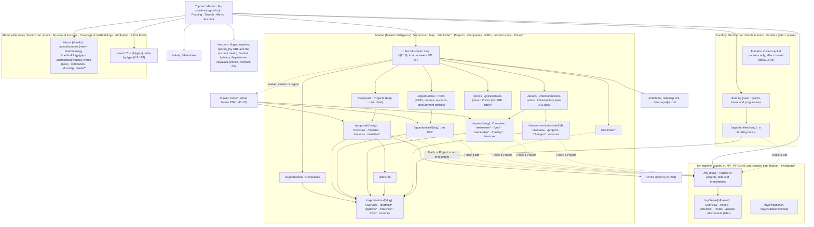

What changed from the 2026-10-22 diagram (folded below): the nodes are grouped by the top bar's sections instead of by
phase; Funding is a section with `/funding`; My pipeline is a section with the Tracker, and "Track" on records replaces
the Bankable edges (Build a deal is native since 2026-10-22, `docs/19`); record pages show their tabs; Prices, the
About split and the methodology tabs are new; Alerts, search and the account hang from the top bar. Every 2026-10-22
route still answers (§11.10).

<details><summary>Superseded 2026-10-23: the 2026-10-22 sitemap, grouped by phase</summary>

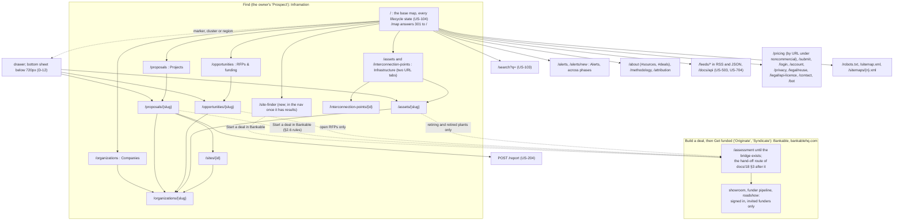

What changed in the 2026-10-22 diagram from the 2026-09-12 one (updated 2026-09-19), which is in git history: the nodes are grouped by
phase; `/interconnection-points`, `/sites/{id}`, `/methodology`, `/attribution`, `/about`, `/alerts` and the utility
pages are drawn as built (they were missing); `/plans` is `/pricing` and `/legal/privacy` is `/privacy`, as built;
the drawer is a bottom sheet below 720px (`docs/17` M-4, built 2026-10-22); `/site-finder` and the Bankable edges are
new. The 2026-09-12 diagram is kept below, folded and superseded, only so its user-story references stay findable.

</details>

<details><summary>Superseded: the 2026-09-12 sitemap</summary>

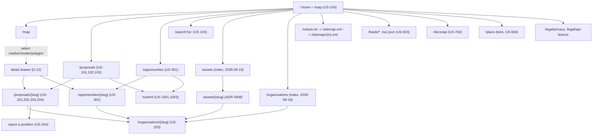

</details>

Every node is reachable from `/` in ≤ 3 clicks; `/` (the map) is the landing surface per the owner's map-first
decision (`docs/00-PLAN.md`, US-104), with `/proposals` and `/search` as co-equal entries into the same filtered result
set (D-4) — the map is not "browse" with search as a separate mode, it is one more view of the same query. From
2026-10-22 the map is also the one base map of the Find phase: projects in every lifecycle state and the existing
infrastructure they connect to, so operating, retiring and retired assets are reached on it and in the lists, not in a
section of their own (§2.5).

### 1.2 Pro (live) sitemap

Adds an entitlement-gated layer over the same routes (more fields and more shapes — not fresher data, `docs/23` §3.2):

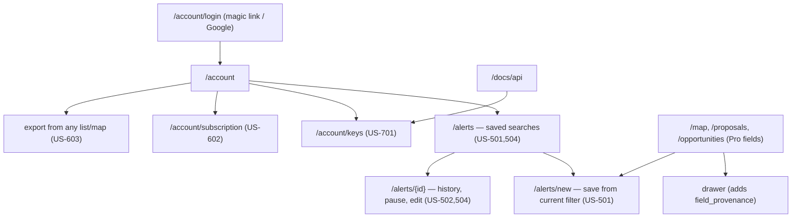

Pro reuses every public route; the only new top-level surfaces are `/account` and `/alerts`. A Pro user's `/map`
is the identical URL a public visitor sees, with `lag_days = 0` in the envelope (`docs/23` §10) — no separate
"Pro map" page exists, per D-4.

### 1.3 Admin sitemap

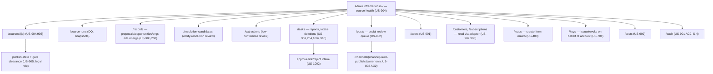

Admin nav order follows `docs/23` §4's grouping exactly: Sources → Records → Resolution/Extraction → Tasks →
Posts → Users/Customers → Keys/Costs/Audit. Every admin write is an audited event (S-4); nothing here is reachable
without `operator`/`owner` role and the `admin.` host's second factor (S-2).

## 2. Navigation model: map and search as co-equal entries

D-8…D-14 govern this. The nav bar is not "Proposals, Opportunities, **Map**" with Map as a third list — Map is
the home route (`/`), carrying the same filter rail `/proposals` and `/search` render inline. List ↔ map ↔ feed
preserve `?kind=&technology=&lifecycle_state=&jurisdiction=&bbox=…` verbatim (D-17, US-104 AC2); a "View as: Map ·
List · Feed" control sits beside the filter bar, not in a menu (US-104 AC1–AC2). **Changed 2026-10-22 (decision rows
"The home map drops its In view side panel" and "The home map keeps 'what is in view'"; being built by the home map
panel lane):** the home map loses its "View as" row; its RSS link moves into "Save this search as an alert", and the
list pages keep their switch and their feed link. The map is also the one base map of the Find phase, and the site
finder (`/site-finder`) is a second map-shaped entry beside it, with search (§2.1, §2.3).

Placement precedence (D-8, US-104 AC1): `exact` → marker; `county_centroid` → centroid marker, visibly labelled;
state-only → state aggregate marker plus a side-list row; no geography → "Unplaced (N)", never dropped. Validated
as a shipped pattern by Interconnection.fyi's county/state toggle (`docs/30-design-references` §2.3). **Changed
2026-10-22:** the side list is gone from the home map; "what is in view" is one floating panel that summarises at
national and multi-state zooms and lists projects once zoomed in (a bar under the map on phones). Where that panel
shows the unplaced count is the home map panel lane's choice; the rule that an unplaced record is never dropped
stands, and the Projects list carries every record.

Restricted-precision (D-9, US-104 AC3): a record whose only geometry provenance is `restricted`/`unknown` never
renders an exact point on public or Pro surfaces regardless of source precision — county centroid, drawer states
"location shown at county level (source licence)" (`docs/30-design-references` §7, §2.13).

Clustering (D-10, US-104 AC4): ≤500 visible records → individual focusable markers; above it, server clusters
from `/v1/proposals/geo?bbox&zoom` carrying `{count, lifecycle_state_counts, technology_counts, capacity_mw_sum}`.
Glyph = size (count) + chip colour/label (dominant lifecycle family) + shared icon (dominant technology,
consolidated per Flightradar24, `docs/30-design-references` §2.12) — never a bespoke icon per fine-grained value.

Selection (D-12): marker, cluster-row or polygon opens a drawer, not a navigation — `role="dialog"`, focus trap,
fields, chip, Sources, last three events, D-3 line, link to the full record; `Escape`/close returns focus. **Changed
2026-10-22 (`docs/17` M-2, M-4; built):** below 720px the drawer is a bottom sheet (`docs/31` §5.8), and one tap does
one thing (one click dispatcher with a priority order; a region tap no longer leaves the map).

Keyboard/screen-reader path (D-14, US-104 AC5): a synchronised "in view" list, reachable by skip link — arrow
keys pan, `+`/`-` zoom, `Enter` opens the focused marker, roving tabindex ≤500 rendered, `aria-live="polite"`
announces "N proposals, M opportunities in view" debounced 500ms; above 500, the list is the primary path.
**Retired 2026-10-22 (owner: "Lets not optimize on keyboard users for now. Lets assume all users have a mouse or are
on mobile"):** D-14's in-view list and its keyboard-path tests are retired, not skipped. The Projects list is the
text equivalent of the map, and the map's label points to it. The floating panel that returns "what is in view" is
built for mouse and phone users; keyboard-only and screen-reader optimisation stays deferred, to revisit before any
public-sector or utility procurement.

### 2.1 Phases: the site by stage of development (added 2026-10-22)

**Amended the same day (owner, decisions log 2026-10-22, "The site has two modes"):** above the phases sit two modes,
**Market | My pipeline**. Market is the flat Find nav below and all a signed-out visitor sees; My pipeline (Build a
deal, later Get funded) appears once signed in, as a two-way switch at the top of the header. The nav table and
wireframes in §2.3 show Market; the implementation lane adds the switch.
**Copy rule (owner, same day):** "Market intelligence" wherever there is room (page titles, meta descriptions, About,
the signed-out header line, pricing, social cards, JSON-LD, the first mention in prose); "Market" in the switch,
breadcrumbs and any 360px row; never "Marketplace".

**Asked by the owner, verbatim:** "Could we split the site into each phase of development? from Prospecting (Map of
prospective development sites and what makes them valuable), Origination (Bankable style; data goes from the map into
deal builder), Syndication (built deals in bankable style now showcased), Operation (actively tracking sites under
development, operating, decommissioning or repowering)", then "consider putting operations under the prosposector or
just as one base map". With it, the owner's priorities for this design: "Leave the highest priority to be a good
experience for the average user not the marginal disabled user"; mouse and phone users first; early credibility, so
no empty sections.

**Decision rows this section applies** (`docs/00-PLAN.md`, all 2026-10-22 unless dated): "The site is organised by
development phase: Prospect, Originate, Syndicate. Operations is not a fourth section" (a section shows in the
navigation only once it has something in it; until the hand-off exists, Originate is an action on records, not a
tab); "Bankable is the origination and syndication half"; "Prospecting layers"; "Powered-land site finding is a
product goal"; "The site finder ranks corridors by a prospect score"; "The home map keeps 'what is in view', as one
floating panel"; "The section names stand"; "The responsive floor is 360px"; and, from 2026-10-21, "Company matching
and subscriptions are free" (the owner: "I need something to give me early credibility") and "Matching targets
developers first".

**Status: confirmed by the owner, 2026-10-22** (decisions log), **except row 5**: the "Start a deal in Bankable" block is
held until the six `noncommercial` sources have granted commercial reuse or been withdrawn, and a legal read of the
link (decisions log, 2026-10-22, "The Bankable bridge waits on the six noncommercial-only sources").

| # | Proposal | Where argued |
|---|---|---|
| 1 | The phases are shown to readers as **Find · Build a deal · Get funded**. "Prospect, Originate, Syndicate" stay the internal names. | §2.2 |
| 2 | The nav stays flat and holds only the sections that have pages on Inframation, all of them Find's: **Map · Site finder · Projects · Companies · RFPs & funding · Infrastructure · Alerts**, then Sign in and search. Site finder joins on the day its page has results. No phase labels in the nav while only one phase has pages here. | §2.3 |
| 3 | RFPs & funding is a Find list. An open RFP's page is one of the doorways to Build a deal. | §2.4 |
| 4 | Operations is the later lifecycle states on the one base map and in the lists: the map's Status control covers projects and existing infrastructure; Infrastructure gains a Status control. No section, no URL. | §2.5 |
| 5 | Build a deal, before the bridge: a short "Build a deal" block with **Start a deal in Bankable ↗** on candidate sites, retiring and retired plants, projects and open RFPs, only where every source is open- or attribution-class. It opens Bankable's own start page and says that nothing is carried across yet. Get funded: not linked from Inframation at all. | §2.6 |
| 6 | Every current URL keeps working. New: `/site-finder`, the `#deals` section of `/about`. No phase URLs and no new redirects. | §2.7 |
| 7 | Four lanes. The navigation lane goes first; it touches none of the files the home map, site finder and wave 2 lanes hold. | §2.8 |

### 2.2 The phase words: a desk test

The reader is a first-time visitor: a developer or IPP first (2026-10-21), then infrastructure investors
(`docs/51`), utilities, landowners and the press. Nielsen Norman Group's rule for category names is the test:
"Descriptive category names that people understand are better than made-up words or internal jargon", and categories
must not overlap (Loranger and Dykes, "5 Tips for Avoiding Confusing Category Names", 2013, reviewed 2024,
https://www.nngroup.com/articles/category-names-suck/).

| Criterion | Prospect · Originate · Syndicate (owner's) | Find · Build a deal · Fund | **Find · Build a deal · Get funded** (chosen) | Explore · Deals · Capital |
|---|---|---|---|---|
| Plain to a first-time visitor | Low. "Originate" and "syndicate" are finance words; to many readers a "prospect" is a sales lead | High | High | Medium. "Explore" says nothing a nav does not already say |
| One meaning to developers and to investors | No. At a developer or IPP, "origination" is offtake sales: a "Head of PPA Origination" at a renewables IPP is responsible for "Originating, structuring and negotiating long-term PPAs" (https://climatechangejobs.com/jobs/444042150-head-of-ppa-origination-renewables-ipp, retrieved 2026-10-22; other PPA originator postings found the same day read alike, a sample, not a survey). In lending, a syndicated loan is "an arrangement whereby a group of lenders (the syndicate) … provide funds to a borrower" (Ropes & Gray, "Legal Lingo: What Is A Syndicated Loan?", 18 January 2023, https://www.mondaq.com/uk/project-financeppp-amp-pfi/1272364/legal-lingo-what-is-a-syndicated-loan). Neither is "build a deal in Bankable" or "show finished deals to capital partners" | Mostly. "Fund" reads three ways: an investor's "fund this", a developer's "get funding", and the noun "a fund" | Yes. Both later words name the developer's step, and developers are the first customer | "Deals" yes; "Capital" is a thing, not a step |
| Distinct from the section names | Yes | No. "Fund" sits beside "RFPs & funding", whose grants and loans are Find records | Mostly. "Get funded" brushes "funding"; the About section separates public funding notices (listed here) from private capital (in Bankable) in one sentence | Yes |
| Continuity with Bankable | Bankable never prints these words. Its own copy says Analyze, Certify, Route, Fund and "Get Bankable. Get Funded." (Bankable repository, github.com/Tobombadil/bankablehq, `src/components/landing/HeroSection.tsx` and `src/pages/Signup.tsx`, read 2026-10-22) | "Fund" is Bankable's last step | "Get funded" is Bankable's tagline, so the hand-off reads as one journey across two sites | None |
| Tone, given `docs/18` §4 (general solicitation) | "Syndicate" suggests offering participations | Neutral | Neutral. It names the developer's goal, not an offer to investors | Neutral |

**Chosen: Find · Build a deal · Get funded.** The owner's words stay right as internal names: the decisions log,
`docs/18` and code keys keep `prospect`, `originate`, `syndicate`; public pages print `PHASE_LABELS`. **Confidence:
medium.** This is a desk test against stated criteria, not a test with readers. The cheap check is a first-click test
with the beta testers (`docs/65`): show the About section and a record's Build a deal block and ask "where would you go
to put a deal together for this site?". A change is one line in `web/labels.py`.

### 2.3 The navigation at 1440px and at 360px

**Amended 2026-10-23 (§11.2–§11.3, §11.8):** the flat row below becomes a top bar of three sections over a section
bar, phase words stay out of the bars, and the masthead line goes. This section stays the record of the 2026-10-22
design and its measurements until §11's shell lane (V1) lands.

**Which items.** The rule is the decision row's: a section is in the nav only once its page has something in it.

- **Find** has pages here: Map, Site finder (once it has results), Projects, Companies, RFPs & funding, Infrastructure.
- **Build a deal** has no page on Inframation, before or after the bridge: the deal lives in Bankable. It is an action
  on records (§2.6). A nav link to Bankable's start page would be the same link with no record behind it.
- **Get funded** is Bankable's showroom, funder pipeline and roadshow: signed in and by invitation. A link would take
  almost every visitor to a sign-in wall, and it would read as a public listing of deals seeking investment, which
  `docs/18` §4 rules out until counsel has read it. Not linked.
- **Alerts** tracks records in any phase (the owner's "actively tracking sites under development, operating,
  decommissioning or repowering"), so it follows the Find sections rather than sitting in one.
- **No phase labels.** With one phase in the nav, a label over it adds a word and no choice. A flat row of named
  top-level sections is the pattern `docs/30-design-references` adapts from Stripe's docs (D-16). A three-step
  "Find › Build a deal › Get funded" strip in the header was considered and rejected: two of its three steps would
  leave the site or end at a sign-in, it costs a row on every page, and a step strip above a working screen is a
  marketing device (D-7).

**Order: Map · Site finder · Projects · Companies · RFPs & funding · Infrastructure · Alerts**, then Pricing (only
under `commercial`), Sign in and search, as today. The order of the six is the one the owner let stand on
2026-10-22 ("do what will create the best product"); `docs/16` §3.1's reasons for it (Companies third, as the join
between projects, RFPs and assets) do not change with phases. Site finder goes second because it is the other
map-shaped Find tool, and powered land for large loads is the use the owner will sell first.

**Words.** The six keep their names. The new one is **Site finder** (names table, §1).

**At 1440px**, measured (method below). The header stays 103px; the nav is 723px wide (633px today) and stays on one
row with the search box.

```
┌──────────────────────────────────────────────────────────────────────────────────────────────────────────────────┐
│ INFRAMATION REGISTER · PUBLIC EDITION             ALL N SCHEDULED SOURCES FETCHED ON SCHEDULE    ABOUT & SOURCES │
├──────────────────────────────────────────────────────────────────────────────────────────────────────────────────┤
│ Inframation  Map  Site finder  Projects  Companies  RFPs & funding  Infrastructure  Alerts  Sign in  [Search…]   │
│                   ━━━━━━━━━━━ the current section: weight and underline (aria-current)                           │
└──────────────────────────────────────────────────────────────────────────────────────────────────────────────────┘
  Find (Prospect): Map … Infrastructure · across phases: Alerts · Build a deal and Get funded: not in the nav
```

**At 360px.** The links sit behind Menu, as today (`docs/31` §3). The open panel is the seven links, Sign in, the
search box and About & sources, in that order. Only Site finder is new. The home page keeps its one-line source
freshness link above the bar (`masthead--keep`).

```
┌──────────────────────────────────┐    ┌──────────────────────────────────┐
│ (home only) SOURCE FRESHNESS LINK│    │ (home only) SOURCE FRESHNESS LINK│
├──────────────────────────────────┤    ├──────────────────────────────────┤
│ Inframation              [Menu]  │    │ Inframation              [Menu]  │
└──────────────────────────────────┘    ├──────────────────────────────────┤
  closed: bar 65px                      │ Map                     41→44 px │
                                        │ Site finder                      │
                                        │ Projects                         │
                                        │ Companies                        │
                                        │ RFPs & funding                   │
                                        │ Infrastructure                   │
                                        │ Alerts                           │
                                        │ Sign in                          │
                                        │ [Search by name, sponsor…][Go]   │
                                        │ About & sources                  │
                                        └──────────────────────────────────┘
                                          open: panel 474px (433px today)
```

**Measured.** Headless Chromium 141 rendering `/login` from this branch through the in-process app, with
`web/static` served as built and no API (so the masthead reads "Source fetch dates"); the Site finder link injected
second; one run per width. Header height in px; the "One row from" row brackets the width from which the header
is a single row.

| Width | Six links (today) | Seven (with Site finder) | Seven, plus a later "Your deals" link in the bar |
|---|---:|---:|---:|
| 1440 | 103 | 103 | 103 |
| 1280 | 103 | 103 | 168 |
| One row from | 1150–1180 | 1230–1260 | 1300–1340 |
| 1080, 1024 | 168 | 168 | 168 |
| 720 | 225 (links one row) | 274 (links two rows) | 274 |
| 390 and 360, Menu open | panel 433 | panel 474 | panel 515 |

What that costs: the fold budgets hold (map top ≤ 450px at 1440×900 and ≤ 600px at 1024×768, `web/test_e2e.py`),
because neither width changes. From about 1165 to 1240px the search box drops to its own row (+65px), and from 720 to
about 770px the links take two rows (+49px). Both are accepted: those desktop and tablet widths are a minority beside
1280, 1366, 1440 and 1536, and hiding the links behind Menu at tablet widths would cost more than the height, because
hidden navigation gets used less on desktop as well as on phones (Pernice and Budiu, "How to Make Navigation (Even a
Hamburger) Discoverable on Mobile", 2016, https://www.nngroup.com/articles/find-navigation-mobile-even-hamburger/).
The frontend lane may narrow the search field at 1080–1279px if the header then stays one row from 1165px; measure
before and after. Phone menu rows are 41px as built; `docs/17` M-10 asks for 44px, which makes the open panel about
498px, ending near 563px on an 800px screen. A later "Your deals" link (§2.6) goes in the masthead's utility row
beside About & sources, not in the bar, because in the bar it moves the one-row threshold to about 1320px.

### 2.4 Where each page sits

**Amended 2026-10-23 (§11.2, §11.4):** RFPs & funding splits into RFPs (Market) and Grants & loans (Funding,
`/funding`); every page's one question and primary action are in §11.4.

| Page | URL | Phase | Reached from | Change |
|---|---|---|---|---|
| Map (home) | `/` (`/map` answers 301) | Find: the one base map, every lifecycle state | Nav "Map", wordmark | Status control covers existing infrastructure (§2.5, C1) |
| Site finder | `/site-finder` | Find | Nav "Site finder", second, once it has results | New (site finder lane). Its results are candidate sites, each with Build a deal (§2.6) |
| Projects | `/proposals`, `/proposals/{slug}`, `/sites/{id}` | Find | Nav "Projects"; record pages mark it `aria-current="true"` | Project pages gain Build a deal (§2.6) |
| Companies | `/organizations`, `/organizations/{slug}` | Find | Nav "Companies" | None. A company is not a deal |
| RFPs & funding | `/opportunities`, `/opportunities/{slug}` | Find | Nav "RFPs & funding" | Open notices gain Build a deal (§2.6) |
| Infrastructure | `/assets`, `/interconnection-points`, their records | Find, including the operating and end-of-life states | Nav "Infrastructure"; two URL tabs | Status control on `/assets` (§2.5, C2); retiring and retired plants gain Build a deal |
| Alerts | `/alerts`, `/alerts/new` | Across phases | Nav "Alerts"; "Follow" and "Save this search" | None |
| Search | `/search` | Across phases | Header search box | None |
| About & sources | `/about` | Reference | Masthead, Menu panel, footer | New section `#deals`: the three phases in plain words (§2.6) |
| Methodology, attribution, reuse, API and feeds, privacy, contact, bot, pricing, submit, sign-in and account | as today | Utility | Footer and page links | None |
| Bankable | `bankablehq.com/assessment` (until the bridge) | Build a deal; Get funded beyond it | The Build a deal block only | Off-site |

**RFPs & funding is a Find list, not the doorway to Originate.** Four reasons. (1) It lists public records discovered
from registers, filtered and sorted like Projects; reading and screening them is prospecting, and the decision row
already names "RFPs & funding" among Prospect's lists. (2) A nav group "Build a deal" whose only item was a list would
promise a deal builder and deliver a table. (3) Funding notices (grants, loans, programmes) are also screening
inputs, beside the incentive layers the "Prospecting layers" row adds. (4) The doorway is the record, not the list:
an open RFP's page is where a developer decides to respond, so that is where Build a deal sits. Bankable's own RFP tab
(`/engage?tab=rfp`, signed in) may later be fed from this list through the bridge (`docs/18` §1); that changes
nothing here.

### 2.5 Operations: the later lifecycle states on the one base map

**What the data holds.** A project's lifecycle runs unknown, announced, filed, studied, permitted, contracted, under
construction, built, withdrawn, cancelled (`data/vocabulary/lifecycle_states.yaml`); there is no "operating",
"retiring" or "repowering" project state. Operating and end-of-life states belong to existing assets: EIA-860M gives
operating 25,625, standby 2,221, retiring 531 and retired 7,324 generator records (`us.eia.860m.retirements`, verified
2026-10-07 in `data/sources.yaml`). Repowering has no state anywhere: it is a new queue request at an existing plant,
which the site rules mark (`expansion_marker`, `services/sites/rules.py`; `docs/21` §3.25). "Decommissioning" is
EIA's retiring and retired; the site uses EIA's words.

**How a visitor reaches each state.**

| State | Record | On the map | In a list | On a record page |
|---|---|---|---|---|
| Under construction | Project | Status: In process (on by default) | Projects, Status | Status chip and timeline |
| Built | Project | Status: Built or operating (off by default) | Projects, Status | Status chip |
| Operating, standby | Plant, pipeline, line | "Existing assets" layer (on by default); C1 moves it into Status | Infrastructure; C2 adds Status: Operating, Standby | Asset page status |
| Retiring, retired | Power plant | "Retired & retiring plants" layer (on by default); C1 moves it into Status | Infrastructure, C2: Retiring, Retired (`/assets?asset_type=power_plant&status=retiring,retired` already answers, with no control on the page) | Asset page; Build a deal (§2.6) |
| Repowering, expansion | A new project at an existing plant | Not filterable yet | Not filterable yet | The plant's Nearby proposals; the project's "At this site" names the relationship |

**C1, the map (after the home map panel lane lands; `home_map.html`, `map.js`).** The Status disclosure becomes the
one lifecycle control. Under its project groups (Announced, In process, Contracted, Built or operating, Withdrawn or
cancelled, Status unknown, unchanged), a second group, **Existing infrastructure**, holds the two layer boxes that sit
outside it today: "Plants, pipelines and lines" (the Existing assets layer) and "Retiring and retired plants". The
summary reads, for the default, "Status: active projects, existing, retiring". The URL grammar does not change: the
project rows write `lifecycle_state`, the infrastructure rows `layer_plants`, `layer_retired` and `asset_type` (D-17).
The floating panel's breakdown uses the same group names.

**C2, Infrastructure (now; `assets_list.html`, `web/assets_pages.py`).** A Status control, Operating · Standby ·
Retiring · Retired, writing the `status` parameter `/assets` already forwards (`ASSET_INDEX_FILTERS`, lane R1). Default:
all statuses, as today.

**C3, repowering (later; API lane).** A filter for projects at an existing plant (a site that holds an operating,
standby or retiring plant, or a member with `expansion_marker`). It needs an API parameter. It is a filter, not a
status and not a section.

### 2.6 Build a deal and Get funded before the Bankable bridge

**What Bankable offers a newcomer today** (its code, github.com/Tobombadil/bankablehq, branch `main`, read
2026-10-22). Its public "Get Started" button goes to `/assessment`, a sign-up flow that asks the visitor's role
(Sponsor, Funder, Counterparty, Advisor, Service) and, for a sponsor, company, sector, location and capex, then
creates the project (`src/pages/Assessment.tsx`). Signed in, its nav is Projects (`/dashboard`, `/manage`, `/show`),
Pipeline for funders (`/fund`) and Community (`/engage`, with an RFP tab). `/projects`, `/marketplace` and `/rfp`
now redirect to `/show` and `/engage` (`src/App.tsx`), so `docs/18` §1's route list and §3's proposed
`/projects/new` intake need checking against the code.

**Decision: shown before the bridge, as a link to Bankable's start page with a plain note.** Hidden was the
alternative. It is rejected because the decision row makes Originate "an action on records" until the hand-off
exists; the link leads to a working page, not an empty one; and the owner wants the loop now. The cost is that the
visitor retypes the facts, and the note says so, so no promise is broken.

**Where.** After the record's key facts (the field grid or summary strip), before the timeline, matches and Sources,
at every width. On a phone it is in the page flow, not sticky. Not in the map drawer: the drawer is a preview, and its
"Open full record" leads to the block.

**Which records.**

| Record | Shown when | First line |
|---|---|---|
| Candidate site (site finder result) | Always, once the finder is public | "Pursuing this site?" |
| Power plant (asset page) | Status retiring or retired | "A retiring plant's site and grid connection can host a new project." |
| Project (proposal page) | Any status except withdrawn and cancelled | "Is this your project?" |
| RFP or funding notice (opportunity page) | Status announced, open or reinstated | "Responding to this?" |
| Company, grid connection point, operating asset, site record (`/sites/{id}`), lists, search, map drawer | Never before the bridge | — |

**Licence rule.** The block shows only when every source behind the record is reuse class `open` or `attribution`.
It is the test the bridge will apply to each field (`docs/18` §3), so the action never appears now on a record it
could not serve later. It also keeps a link to a commercial service off pages built from `noncommercial` rows, which
is the use `docs/26` §3 (ii) and (iii) worry about ("directed towards commercial advantage"). Today it hides the block
on the four AEP utilities' RFPs (class `noncommercial`) and on records from sources whose terms are not yet recorded.

**Anatomy and words** (link mode). A ruled aside, not a card: a section heading, one paragraph, one secondary button
(`docs/31` §5.16: outlined, sentence case), one muted note. No Bankable colours or logo (D-7, D-19). The arrow and
"in Bankable" say the link leaves the site; it opens in the same tab, so Back returns.

```
── Build a deal ─────────────────────────────────────────────────────
Is this your project? Bankable turns it into a deal: a data room, a
bankability score and a route to the funders it works with. Bankable
is run by the team behind Inframation.

[ Start a deal in Bankable ↗ ]          ← 44px tall below 720px, full width

Nothing on this page is sent to Bankable yet. Paste this page's link
into your deal so funders can trace each fact to its source.
─────────────────────────────────────────────────────────────────────
```

The affiliation sentence is there because a page recommending a service run by the same people should say so; the
owner confirms the wording, and the legal lane can confirm it is enough.

**Link and settings.** `BANKABLE_START_URL`, default `https://bankablehq.com/assessment` (Bankable's own "Get
Started"), with `utm_source=inframation&utm_medium=referral&utm_campaign=build-a-deal&utm_content={record kind}`. No
record identifier and no personal data in the URL. `BANKABLE_HANDOFF` is `off` (nothing rendered anywhere), `link`
(this section, the default) or `bridge` (the `docs/18` hand-off: a form post that creates the hand-off record and
redirects to Bankable; the note line goes). In bridge mode a signed-in reader who has started a deal sees **Your deals
in Bankable ↗** in the masthead's utility row.

**About, `#deals`.** One numbered list in the filing idiom: **1. Find**, here: the map, the site finder and the lists,
every fact with its source. **2. Build a deal**, in Bankable: a data room, a bankability score and a route to
funders. **3. Get funded**, in Bankable: it shows finished deals to the funders it invites; public grants and loans are
listed here, under RFPs & funding. Then the affiliation sentence and one link to Bankable. No link to Bankable's
showroom or funder pages.

**Get funded.** Not linked from Inframation, before or after the bridge, until counsel has read `docs/18` §4. After
that, a record may say it is listed in Bankable only with the deal owner's consent (`docs/18` §2).

### 2.7 URLs

- **Every current URL keeps working and keeps its meaning.** No route is renamed or moved: `/`, `/map` (301 to `/`),
  `/proposals`, `/proposals/{slug}`, `/sites/{id}`, `/opportunities`, `/opportunities/{slug}`, `/organizations`,
  `/organizations/{ident}`, `/assets`, `/assets/{slug}`, `/assets/by-id/{public_id}`, `/interconnection-points`,
  `/interconnection-points/{id}`, `/search`, `/alerts`, `/alerts/new`, `/about`, `/methodology`, `/attribution`,
  `/docs/api`, `/feeds/{name}.{fmt}`, `/pricing`, `/submit`, `/login`, `/register`, `/account`, `/privacy`,
  `/legal/reuse`, `/legal/api-licence`, `/contact`, `/bot`, `/sitemap.xml`, `/sitemaps/{n}.xml`, `/robots.txt`.
- **New:** `/site-finder` (the site finder lane; any result permalinks are that lane's, under `/site-finder/`) and the
  `#deals` anchor on `/about`. `/site-finder` joins the sitemap when it is public.
- **Bridge mode only, later:** `POST /handoff` on the site (creates the hand-off, answers 303 to Bankable; disallowed
  in `robots.txt`) and `GET /v1/handoff/{id}` on the API (`docs/18` §3).
- **Redirects:** none new. No `/prospect`, `/originate`, `/syndicate` or `/operations`: a phase is not a page, and a
  redirect would invite links to a section that does not exist. A campaign that names a phase links to `/` or
  `/about#deals`.
- **Parameters:** none new. C1 reuses `lifecycle_state`, `layer_plants`, `layer_retired`, `asset_type`; C2 reuses
  `status`.

### 2.8 Implementation plan for the frontend lanes

**Lane A, navigation (now).** It touches none of the files named below as held by other lanes, except as noted there.

1. `web/labels.py`: add `"site_finder": "Site finder"` to `SECTION_LABELS` after `"map"`, and a new table beside it.
   The comment above `SECTION_LABELS` drops "pending the owner's ratification" and cites the 2026-10-22 row.

   ```python
   #: The development phases (docs/00-PLAN.md 2026-10-22; docs/30 §2.2): the owner's names as keys, the
   #: words a reader sees as values. Printed on /about#deals and in the Build a deal block; never in the
   #: primary nav while only one phase has pages on Inframation.
   PHASE_LABELS: dict[str, str] = {"prospect": "Find", "originate": "Build a deal", "syndicate": "Get funded"}
   ```
2. Jinja globals, registered wherever `section_labels` is today (`web/page.py` line 310, `web/auth.py` 94,
   `web/legal.py` 58, `web/pricing.py` 256, `web/admin/shell.py` 53): `phase_labels`, and `section_live(key)`, one
   helper in `web/page.py` that is true for every section except `site_finder`, which reads the site finder lane's
   switch (proposed name `SITE_FINDER_ENABLED`; the finder lane owns it and turns it on only when the page has
   results).
3. `web/templates/partials/_sections.html`: `href` gains `"site_finder": "/site-finder"`; `primary` becomes
   `["map", "site_finder", "projects", "companies", "rfps", "infrastructure", "alerts"]`; `holds` gains
   `"site_finder": ["/site-finder"]`; the header comment says the names were ratified on 2026-10-22, every primary
   section is in the Find phase, Alerts spans phases, and a section is listed only while `section_live` holds. No
   phase grouping markup.
4. `web/templates/base.html`: the primary loop becomes ``; its
   comment "Six destinations" becomes "The sections with something in them, in order (docs/30 §2.3)". No Bankable
   link anywhere in the header.
5. Breadcrumbs: no phase level (a phase has no page, and a `BreadcrumbList` item needs a URL); "Home" stays the
   first crumb. `web/templates/organization_detail.html` line 18 hard-codes `<a href="/organizations">Companies</a>`:
   read `sections.href.companies` and `sections.label.companies`. `web/organizations.py` line 839 hard-codes
   `("Companies", "/organizations")`: read `labels.SECTION_LABELS["companies"]`. A finder result page, if there is
   one, is "Home / Site finder / {name}".
6. JSON-LD `ItemList` names follow the section names (the §1 names table left them "to the lanes that own them"):
   `web/app.py` line 825 "Proposals" and line 982 "Opportunities", `web/assets_pages.py` line 233 "Assets",
   `web/interconnection_points.py` line 210 and `web/organizations.py` line 476 read `SECTION_LABELS` ("Projects",
   "RFPs & funding", "Plants, pipelines & lines", "Grid connection points", "Companies").
7. Tests that pin the nav (found by grepping `web/test_*.py` for the section names):
   - `web/test_layout_states.py` line 672 `PRIMARY` and line 720
     `test_the_primary_nav_is_six_sections_in_order_and_marks_where_the_reader_is`: run with the finder switch off
     (the six, as today) and on (seven, `/site-finder` second and marked `page` on `/site-finder`); slice by
     `len(PRIMARY)`, not 6; drop the count from the name.
   - Same file, line 748 `test_a_link_is_marked_on_its_page_and_on_every_page_its_section_holds`: add
     `("site_finder", "/site-finder", ' aria-current="page"')` and `("map", "/site-finder", "")`.
   - Same file, line 757 `test_a_section_is_named_in_one_place`: "Site finder" and the three phase words appear once
     in `labels.py` and in no template; add `organization_detail.html` to the record templates checked for
     `>Companies</a>` and `organizations.py` to the modules checked for `("Companies", "/`.
   - `web/test_e2e.py` line 2936 `SECTIONS` and line 2948 `test_nav_is_six_sections_with_…`: `SECTIONS` follows the
     switch; the `[:6]` slices at lines 2968 and 3008 become `[:len(SECTIONS)]`; add a 360px run (D-32 since
     2026-10-22) beside the 400px one.
   - `web/test_paid_tiers_posture.py` line 121, `hrefs[:6] == ["/", "/proposals", …]`: the same list with
     `/site-finder` second when the switch is on.
   - `web/test_seo.py` line 547, `item_list["name"] == "Assets"`: becomes "Plants, pipelines & lines"; add the
     `ItemList` name for `/proposals` and `/opportunities`.
   - New: no page's primary nav or masthead links to `bankablehq.com` (Build a deal is not a nav item; Get funded is
     never linked), and no Site finder link renders while the switch is off.

**Lane B, the Build a deal block (after the owner confirms the start URL and the affiliation sentence).** A partial
`web/templates/partials/_build_a_deal.html`; includes in `proposal_detail.html`, `asset_detail.html` and
`opportunity_detail.html`; the `#deals` section in `about.html`; settings and one eligibility helper in `web/page.py`
(record kind, state, the reuse classes of its sources, `BANKABLE_HANDOFF`); one rule set at the end of
`web/static/css/styles.css`. Tests: shown and hidden by record kind, state and reuse class; nothing when `off`; the
UTM parameters and no record identifier in link mode; the note line in link mode only. The site finder lane includes
the same partial in its results once both have landed.

**Lane C, operations.** C2 now (`assets_list.html`, `web/assets_pages.py`). C1 after the home map panel lane lands.
C3 waits for an API parameter.

**Lane D, the bridge** (`docs/18`), later: `POST /handoff`, `bridge` mode, "Your deals in Bankable".

**Files other lanes hold now; these lanes wait for them.**

| Lane holding them | Files | Who waits |
|---|---|---|
| Home map panel | `web/templates/home_map.html`, `web/static/js/map.js` (and probably the map rules in `web/static/css/styles.css` and `web/templates/_map_notice.html`) | C1 |
| Site finder | `web/templates/site_finder.html`, `web/static/js/site_finder.js`, its route module and switch | Lane A reads the switch by name only; the finder lane includes Lane B's partial later |
| Wave 2 pages | The companies and RFP list templates, `web/templates/organizations_list.html` and `web/templates/opportunities_list.html`, with their row partials `partials/_organization_rows.html` and `partials/_opportunity_rows.html` | Nobody touches them. Ask the coordinator whether wave 2 also holds `web/organizations.py`, `organization_detail.html` or `opportunity_detail.html`: if so, Lane A items 5 and 6 for Companies and Lane B's opportunity include wait for it |
| Shared | `web/static/css/styles.css`, `web/templates/base.html` | Lane A needs no CSS. Lane B appends one rule set. Confirm no other lane has `base.html` open before Lane A edits it |

**Docs that need matching edits, outside this lane:** `docs/04` D-16 (names six sections and calls them pending the
owner; becomes seven when the finder ships); `docs/18` §1 and §3 (Bankable's routes as the code has them; `/assessment`
as the natural place to read a hand-off); `docs/26` §3 (iii), whose Bankable row says the workflow "must not be built
at all" under the `noncommercial` posture, against the 2026-10-22 row that lets commercial-reuse fields cross.

### 2.9 Standards check (`docs/04`)

| Rule | This design |
|---|---|
| D-16 one nav on public and Pro; current section marked | Holds. A seventh section on a switch. D-16's text is out of date when the finder ships (above) |
| D-17 every filter in the URL | C1 and C2 reuse existing parameters |
| D-2, D-34 provenance on every data element | The Build a deal block carries no data. Sources panels are unchanged. Under the bridge, every value carries its source, URL, date and licence (`docs/18` §3) |
| D-3, D-28 tier notice | Unchanged; nothing is delayed on any tier since 2026-09-21 |
| D-7 banned patterns | No step strip, no card, no hero, no borrowed Bankable styling |
| D-30 WCAG 2.2 AA | The owner deferred keyboard-only and screen-reader optimisation (2026-10-22). Nothing here removes a route that exists: links stay links, Menu stays a disclosure, the new button is a link with its destination in its name |
| D-32 360px | Menu panel 474px at 360×800 with seven links; no sideways scroll at 360 or 390 on the measured page (`/login`) |

## 3. Page inventory

**Updated 2026-10-23 (§11).** Rows marked **Changed 2026-10-23** or **New 2026-10-23** follow §11; each page's one
question and one primary action are in §11.4, and the record tabs with what moves to each in §11.5.

| Page | Surface | Purpose | PRD stories | API reads | Tier-gated elements |
|---|---|---|---|---|---|
| `/map` (home) | Public/Pro | ~~Map-first browse, filters, in-view list~~ **Changed 2026-10-23:** the full-screen map under the top bar and section bar; one floating bar (find, filters, count, Map · List · Grid); one dismissable intro line; the panel's tabs Projects · Companies · Infrastructure · RFPs under the stability rules (§11.6–§11.7) | US-104, US-101, US-102 | `GET /v1/proposals/geo`, `/v1/opportunities` (polygon); from 2026-10-23 also `GET /v1/opportunities/geo` (RFPs tab) and the companies-in-view aggregate (B-1) | D-3 delay banner (public); exact points withheld for restricted sources (D-9) at any tier |
| `/site-finder` (added 2026-10-22, being built) | Public/Pro | Candidate sites for powered land: corridor bands near 69 kV-and-up lines and substations, outside the FEMA floodplain; later the prospect score. In the nav, second, once it has results (§2.3). Each result offers Build a deal (§2.6). **Changed 2026-10-23:** second in the Market section bar; each result offers Track, which creates a Project (§11.4) | None yet (decision rows of 2026-10-22) | The site finder lane's | Screening grade labelled on every value; the prospect score stays off until its back-test passes |
| `/proposals` | Public/Pro | Filtered, sorted list. **Changed 2026-10-23:** the view switch Map · List · Grid (`layout=list` or `layout=grid`) and, once the API takes it, the map's area (`bbox`, B-2) (§11.6) | US-101, US-102, US-103 | `GET /v1/proposals` | No age test on any tier since 2026-09-21 (US-101 AC3); gated-source rows never present (AC4) |
| `/proposals/{slug}` | Public/Pro | Canonical record, provenance, timeline. **Changed 2026-10-23:** URL tabs Overview · Timeline · Sources · Matches (Matches once matches publish); Track on Overview (§11.5) | US-201, US-202, US-203, US-204 | `GET /v1/proposals/{id}`, `/events`, `/sources`, `/matches` | US-201 AC4 banner states the page is live (no delay on any tier); Sources panel omits gated rows (D-27); `field_provenance` Pro+ only |
| `/opportunities` | Public/Pro | Filtered, sorted opportunity list. **Changed 2026-10-23:** RFPs only (RFPs, tenders, auctions, procurement notices), H1 "RFPs and tenders"; links naming only funding kinds answer 301 to `/funding` (§11.2) | US-301 | `GET /v1/opportunities` | Same tier rules as US-101 AC3–4 |
| `/opportunities/{slug}` | Public/Pro | Record, provenance, status timeline, matches. **Changed 2026-10-23:** its section bar and breadcrumb follow its kind (Market / RFPs or Funding / Grants & loans); Track creates a Bid; one page until a Matches tab has rows | US-302, US-402 | `GET /v1/opportunities/{id}`, `/events`, `/sources` | Linked documents = title+link only (no article bodies, `docs/02` §4) |
| `/funding` (**New 2026-10-23**) | Public/Pro | Grants, loans and programmes: the opportunity kinds that offer money, open or announced (a Grants.gov forecast is `announced`) and energy-relevant by default, soonest deadline first (§11.2) | US-301 | `GET /v1/opportunities`, filtered to the kinds `foa`, `loan_program` and `program` | Same as `/opportunities` |
| `/assets` | Public/Pro | Asset index: by-type counts, filters (type, state, name/operator), sort, paged rows | US-104, US-203 | `GET /v1/assets`, `GET /v1/assets/geo` (by-type totals only) | None; no lag |
| `/organizations` | Public/Pro | Company index: name search, what each company holds, paged rows. **Changed 2026-10-23:** the view switch; its figure links open the company's tabs (§11.10) | US-203, US-303 | `GET /v1/organizations`, `GET /v1/organizations/{id}` per row (counts) | None; no lag |
| `/organizations/{slug}` | Public/Pro | Company page: summary line by role and type, map of every asset with geometry, assets grouped by role then type, parent/subsidiaries, proposals, opportunities, sources of those records. **Changed 2026-10-23:** URL tabs Overview · Portfolio · Pipeline · Matches · RFPs · Sources, each section moved as §11.5 lists | US-203 AC1, US-303 | `GET /v1/organizations/{id}`, `/assets`, `/proposals`, `/opportunities`; `GET /v1/assets?organization=` when asset rows carry no geometry; each tab reads only its own | None beyond list-level tier rules; no lag (assets are public-domain / CC BY) |
| `/assets/{slug}` | Public/Pro | Existing-asset page (ADR 0008): fields by type, static map (SVG, MapLibre-enhanced), attributes, owners/operators, nearby exact-grade proposals with distance, sources. **Changed 2026-10-23:** URL tabs Overview · Retirement · Grid · Ownership · Nearby · Sources, each shown only with content (§11.5) | US-104, US-203 | `GET /v1/assets?slug=`, `/v1/assets/{id}/nearby-proposals` | None; no lag |
| `/interconnection-points/{id}` (row added 2026-10-23) | Public/Pro | A grid connection point. **Changed 2026-10-23:** URL tabs Overview (fields, by technology) · Projects · Changes · Sources (§11.5) | US-104 | `GET /v1/interconnection-points/{id}` and its proposals and changes | None; no lag |
| `/prices`, `/prices/states` (**New 2026-10-23**; the page is the prices lane's) | Public/Pro | Two URL tabs under "Prices": hubs and zones (statistics, a latest readout where terms allow), and average retail price by state (§11.4; `docs/29`) | None yet (decision rows of 2026-10-22) | `GET /v1/prices/hubs`, `/v1/prices/retail` | Link-out markets are named, never shown (`docs/29` §2) |
| `/search` | Public/Pro | Free-text + identifier search. **Changed 2026-10-23:** tabs by type with counts and a top hit (`type=`; `docs/16` §4.4) | US-103 | `GET /v1/proposals?q=`, `/v1/opportunities?q=` | Same as list |
| `/alerts` | Pro | Saved searches, delivery mode, history. **Changed 2026-10-23:** a utility in the top bar, no longer a section link | US-501, US-502, US-504 | `GET/POST/PATCH/DELETE /v1/saved-searches`, `/v1/alerts` | Pro-only route; entitlement check (US-602) |
| `/account` | Pro | Seats, subscription, keys, export log. **Changed 2026-10-23:** reached from the account menu | US-602, US-603, US-701 | `GET /v1/me`, `/v1/keys` | Pro/API scopes; billing read-through CRM adapter |
| `/my`, `/my/items/{id}` and its tabs (**New 2026-10-23**; replaces `docs/19` §6.2's `/my/projects` pages, not yet built) | Signed in | The Tracker of the user's projects, bids and investments, by next deadline; each item's tabs Overview · Linked records · Checklist · Notes · People · Documents (later) (§11.4–§11.5) | None (`docs/19`) | `/v1/my/…` (`docs/19` §6.1) | Private: never in a public count, page, feed or log (`docs/19` §5.2) |
| `/about`, `/about/sources` (**Changed 2026-10-23**) | Public | About splits: what Inframation is, who runs it and the phases (`#deals`); Sources & licences on its own URL (§11.4) | US-704 | `GET /v1/coverage` | None |
| `/methodology` and its tabs (**Changed 2026-10-23**) | Public | Three URL tabs: release dates (`#vintage` stays here), what is not here, status words (§11.4) | — | `GET /v1/coverage` | None |
| `/docs/api` | Public/Pro | Generated API reference | US-704 | `api/openapi.yaml` (Redoc) | Licence-acceptance gate before key creation |
| `/feeds/*` | Public | RSS/JSON Feed twins of every list | US-503 | Same list endpoints, `.rss`/`.json` | Feed title states "Public feed, live" (D-28) |

**As built, 2026-10-07 (audit UX-6).** `/docs/api` is a site page, not a rendered Redoc: it lists the three public
feeds in both formats with an example filtered feed, names this deployment's API base URL, and links the API's own
live reference (`{API}/redoc`) and OpenAPI description (`{API}/openapi.json`), where `{API}` is `PUBLIC_API_URL` or
the host beside the site (`api.`, `api-staging.`). It is in the footer ("API and feeds") and the sitemap. Each list
links its feed twin with the same filters, the lifecycle or status choice spelt out because a feed has no default
view of its own: "View as: Map · List · RSS feed" on `/` and `/proposals` (below 720px the "View as" text is
visually hidden, the control keeps it as its accessible name, so the three links fit beside "Save this search as an
alert" and the map stays above the fold at 400×800), a link above the rows on
`/opportunities`, and `<link rel="alternate" type="application/rss+xml">` in each page's head. In production Caddy
sends `/feeds/*` to the API; the site's own `/feeds/*` route only relays it where no proxy stands in front
(`dev_up`, the in-process client). Rendering `api/openapi.yaml` itself on the site stays open.
| `admin/sources` | Admin | Source health, cadence, gate | US-904, US-905 | `GET/PATCH /admin/v1/sources`, `/source-runs` | `legal` role required to clear a gate flag |
| `admin/records` | Admin | Edit, merge/unmerge with reason | US-201–202 (admin actions), US-905 AC3 | `PATCH /admin/v1/proposals`, `POST …/merge` | Audit-logged; mandatory reason field |
| `admin/tasks` | Admin | Reports, intake review, deletions | US-907, US-204, US-1002, US-910 | `GET/PATCH /admin/v1/tasks`, `POST …/approve-intake` | — |
| `admin/posts` | Admin | Social review queue | US-802, US-803, US-804 | `GET/PATCH /admin/v1/posts`, `PUT …/auto-publish` | `auto-publish` toggle is owner-role only, default off per channel |
| `admin/users` `admin/customers` | Admin | Roles, entitlement, CRM read-through | US-901, US-902, US-903 | `GET/PATCH /admin/v1/users`, `/customers`, `/subscriptions` | Staleness banner + refused writes if adapter down (US-902 AC3) |

### 3.1 Asset and company pages (added 2026-09-19, midstream slice)

Both pages are server-rendered records in the `/proposals/{slug}` idiom (D-18), reachable from the map drawer
("Open asset page"), the in-view list, `/search` (which now has an **Assets** section beside Organisations, so a
pipeline name and its operator both resolve) and `/sitemap.xml`.

- **Asset page** `/assets/{slug}`: header with type, pipeline class and status; a key/value grid whose rows
  exist only where the source carries the value (the "None" gate: no "None", no "—" rows); for a pipeline —
  operator (linked to the company page through its `operator` edge), class, length, diameter, states crossed,
  status, source and retrieval date; for a plant — technology, capacity, commissioned year, units, county,
  state; for an ethanol plant — nameplate capacity with its unit, feedstock, PADD, capacity as-of year,
  operator; for an RNG project — project type, technology family (landfill gas to electricity / direct use,
  renewable natural gas, farm digester), rated MW and/or LFG flow, biogas end use, host landfill or digester
  type, feedstock, start and shutdown year (second midstream slice, 2026-09-19). Then **Map** (SVG of the geometry with nearby proposals as dots; MapLibre replaces it when scripts
  run), Attributes, Owners and operators, Nearby proposals (nearest first, each with its distance; the
  wording says "route" for a line, "point" for a point), Sources. No map section when the record has no
  geometry. Nearby rows are one per project, not per EIA-860M generator unit: rows sharing (name, sponsor,
  county) collapse to one row with "× n units", the summed capacity and the nearest unit's distance
  (`web/app.py::group_nearby_proposals`; the map's in-view list applies the same key).
- **Company page** `/organizations/{slug}`: header whose badge, for an organisation typed `other` that holds
  assets, is a descriptor derived from the holdings ("Ethanol producer", "Gas pipeline operator and Power plant
  owner"; the raw type stays in the fields table), a one-line summary "Operates 3 gas pipelines · Owns 12
  power plants" (from the API's `asset_counts`, else counted over the page's rows), fields present only where
  set, parent and subsidiaries where the API embeds them, **Assets** (map of everything with geometry, then one
  table per role → type group with the columns that group fills: length and states for pipelines, capacity and
  share for plants), Proposals, Opportunities, and **Sources** listing the distinct registers behind the
  organisation's assets, proposals and opportunities — an organisation row carries no sources of its own, and
  the page never shows the "withheld under licence" empty state for that case; with no sources anywhere it shows
  no panel at all. **Follow (2026-10-07):** under the summary, "Follow this company's proposals" (and "Follow its
  opportunities" where it issues any) opens `/alerts/new` with `sponsor_id` (or `issuer_id`) set to the
  organisation's **public id** and a name ("Proposals sponsored by …"); an alert saved with a slug matched nothing
  while the id matched 157, so the alert form also resolves a slug to the id before saving. Not offered on the page of
  a natural person named in a register.
  **Pipeline (as built 2026-10-10, owner: "check a developer's or owner's pipeline with a source for every claim").**
  Under the fields and scope links, before the portfolio and the numbered sections, a **Pipeline** block: one line
  (proposals sponsored at this scope, how many in the active pipeline, their MW), then three small tables, **By
  status** (the six status groups of §4.1, each with its chip icon, plus "All statuses"), **Active pipeline by
  technology** and **Active pipeline by ISO / operator** (announced, in process or contracted only), each row a count
  and MW. Every count links to `/proposals` filtered to the same rows: `sponsor_id` (the company's id, or every
  sponsor id behind the rows when the scope includes subsidiaries, since `sponsor_id` matches exact organisations),
  plus `lifecycle_state`, `technology`, `iso` or `source_id`; the technology and ISO links name no status because the
  active pipeline is the list's default view. Checked on the e2e store: every count on two company pages equals the
  count its link opens. MW sums generation and storage only; load, transmission, pipeline, LNG, CCS and hydrogen
  records are counted and named in a note, never added (a data centre's MW is demand). "—" where no record states
  capacity. Under the tables, the registers behind the rows with how many proposals each backs and its latest
  retrieval date, each linking to the list filtered by that source, and a link to the Sources section (`#sources`)
  for licences. Built only from `GET /v1/organizations/{id}/proposals`, read page by page (200 a page, at most five;
  past 1,000 the block says it is partial). The Proposals section still lists 100 and now says "The 100 most recently
  changed of N; all of them in the list" when there are more (`web/org_pipeline.py`,
  `partials/_org_pipeline.html`). Gaps for the API lane: no `include=count` and no aggregate (counts and MW by status,
  technology, ISO) on that endpoint, so a large sponsor costs up to five reads; `iso` holds EIA balancing-authority
  codes for EIA-860M rows (`ERCO`, `NYIS`, `CISO`, `SWPP`) beside ISO names (`ERCOT`, `NYISO`), so one grid can appear
  as two rows.
  **As built, 2026-10-10 (lane P), closing those gaps.** The block is one read, `GET /v1/organizations/{id}/pipeline`
  at the page's scope, and is never partial. Its links carry the API's `list_query`: one `sponsor_id`, plus
  `sponsor_scope=children|all` when the scope spans subsidiaries (no longer every subsidiary's id). The active status
  groups count only records some register still lists (`listed=true`); a record every register has dropped keeps
  its last status but sits in its own **No longer listed** row (`listed=false`), and the opening line says how many
  there are and that they are not counted as active. Built, withdrawn and unknown count every record in those states.
  The technology and ISO tables cover the listed active pipeline. A grid is one row under its ISO's name: `iso=ERCOT`
  also opens the `ERCO` rows. `tests/test_api_org_pipeline.py` holds every link against the real API at each scope.
  The 6, 15 and 17 links of the fixture company's self, children and all scopes each open exactly their count.
  `/proposals` filtered to one company, its group or one connection point is headed "Proposals sponsored by <name>
  (and its subsidiaries)" or "Proposals connecting at <point>", with a link back. The filter form keeps that subject.
  A view an alert cannot watch yet (`sponsor_scope`, `listed`) offers no "save as alert". A record page whose record
  no register lists says "No longer listed in any register since <date>" under its status (`web/list_subject.py`,
  `proposals_list.html`, `proposal_detail.html`).
- **Map** (`/`): the "Existing assets" toggle now carries an **Asset types** checkbox set (power plants, gas
  pipelines, gas processing, gas storage, LNG terminals, ethanol plants, RNG projects), written to the URL as
  `asset_type=` csv. Ethanol capacity-table plants (state grade) and AgSTAR digesters (county grade) are never
  points and are not returned by `/v1/assets/geo`; the legend says so and the lists carry them. The in-view list gains labelled groups for **Regions** (links to the filtered list) and
  **Existing assets** (points and lines; each row links to the asset page and has a Details button that opens
  the same drawer a map click does), so both are keyboard-reachable (audit finding 2026-09-18).

### 3.2 Discoverability: index pages, machine-readable meta, robots and sitemap (added 2026-09-19)

Closes the `docs/50` §3.2 web bullet ("no Open Graph or structured data") and item 4 of the 2026-09-19 plan.
The thesis it serves is `docs/50` §4.4: the asset map and the crawlable asset and company pages are the
acquisition surface; proposals are the paid product. A page nobody can find, and a link that pastes into a chat
as a bare URL, are both failures of that surface.

**Index pages.** `/assets` and `/organizations` are the crawl entries to the record pages that previously had
none — before this, an asset page was reachable only from the map drawer, `/search` or the sitemap, so a crawler
following links found none of them, and neither did a reader without JavaScript. Both mirror `/proposals`
exactly: the same `.filter-bar`, the same `.record-table` in `.table-scroll`, the same `pager` macro on cursor
pagination, the same `.empty-state`. Both are in the primary nav, as **Assets** and **Companies**.

- `/assets` — a row of by-type count links above the filters (largest type first, plus an "All types" total),
  then filters for type, state and a name/operator query, and a sort control. Sorting is bounded by the API's
  allowlist (`last_changed`, `first_seen`, `name`, `capacity_mw`): capacity descending is the default, but a
  view filtered to line assets alone defaults to name, because a pipeline carries no `capacity_mw` and
  `length_miles` is not a sort field — its mileage shows in the row and orders nothing. The counts come from
  `GET /v1/assets/geo`'s `totals.asset_type_counts` (the one call that counts by type; `GET /v1/assets` has no
  `include=count`), whose denominator is assets with a published location. That is a smaller set than the list
  — an asset whose licence forbids raw publication keeps its row and page but is off the map — so the page says
  so in a line under the counts rather than implying the two agree. Measured 2026-09-19: 17,352 counted against
  18,055 listed.
- `/organizations` — a single name search (`GET /v1/organizations`'s `q` is a `name_canonical` substring;
  promising more would be a filter the API cannot honour), and per row the same descriptor and holdings clauses
  the company page shows, from the same helpers (`org_descriptor()`, `_org_type_counts()`,
  `_org_summary_parts()`). List rows carry no `asset_counts`, so each row costs one `GET /v1/organizations/{id}`;
  the page is 25 rows to bound that at 26 calls. **Ask of the API lane:** `asset_counts` on the
  `GET /v1/organizations` list row removes the second call and lets this page grow.

**Meta on every public page.** Title, description, `rel=canonical`, `og:site_name`, `og:type`, `og:title`,
`og:description`, `og:url`, `og:locale`, and `twitter:card|title|description`. Title and description have one
source each — the template's own `title`/`meta_description` blocks, re-read in `base.html` — so a description is
always built from the record the API returned, never a constant, and cannot leak a field the visibility gate
withheld (the gate runs before the template sees the row). `og:image` is the site's own 1200×630 card,
`web/static/img/og-card.png`, drawn by `python -m web.og_card` (docs/31 §5.15); a third-party image URL is not
permitted. Canonical URLs are absolute and carry only the parameters the page
understands, so `?utm_source=` collapses to the clean URL and two orderings of the same filters agree. Session
and result pages carry `noindex` (`/login`, `/register`, `/verify`, `/account`, the privacy and unsubscribe
forms, `/search?q=`); the bare `/search` stays indexable because it is in the sitemap.

**Structured data.** `BreadcrumbList` on every record page (proposal, opportunity, asset, company);
`Organization` on a company page — name, URL, the identifiers actually stored (`lei`, `sam_uei`,
`eia_utility_id`, `cik`, `duns` as `PropertyValue`), `sameAs` for a stored website, `addressCountry`,
`parentOrganization` — with every absent field dropped rather than emitted empty; `ItemList` on each index and
list page, naming the rows that page renders, with `numberOfItems` only where the count is known and exact.
Every block is serialised with `<`, `>` and `&` escaped to `\uXXXX`, so a record named
`Acme "Big" <Energy> & Co </script>` can neither close the script element nor reach the document as markup.

**robots.txt.** None existed. Public pages allowed; `/admin`, `/api/` (this site's own same-origin relay, not
the documented API), the session routes, `/health` and `/search?` (the query form only, to bound crawl space)
disallowed; `Sitemap:` absolute, from the request's base URL.

**Sitemap.** Assets and organisations were already in the builder but capped at 5,000 URLs each, which
truncated both. The per-resource cap is now 30,000 URLs, and above 25,000 URLs in total `/sitemap.xml` becomes a
`<sitemapindex>` over `/sitemaps/{n}.xml` — half the protocol's 50,000-URL limit and about 2 MB against its
50 MB. Measured on the full dev load, 2026-09-19: 34,692 URLs (18,055 assets, 10,409 proposals, 5,513
companies, 707 opportunities, 8 static pages) in two files of 25,000 and 9,692, a 20-second cold build and
8 ms thereafter. The existing per-base-URL cache now holds the whole build rather than one file, so a crawler
fetching the index and every chunk still costs one walk.


## 4. Core-job flows

### 4.1 Find proposals by geography and filters (US-101, US-102, US-104)

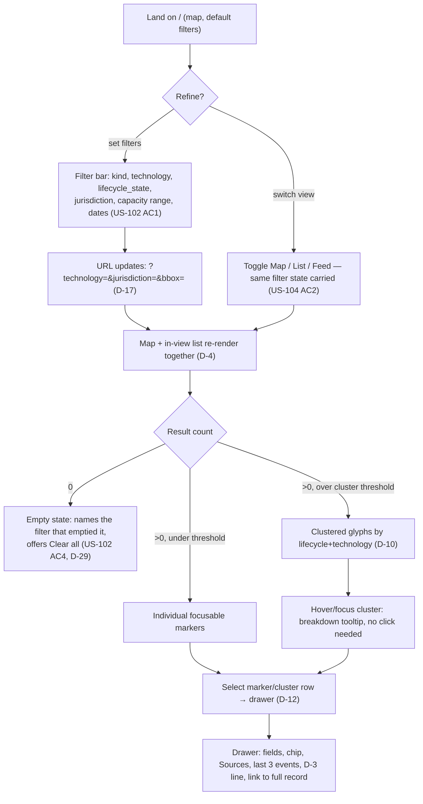

**Uncovered ISO areas (2026-10-07, expert review).** A list or map filtered by `iso=` for an ISO whose own queue has
no rows here (PJM, MISO, SPP, ISO-NE today) says so above the rows: "PJM's own interconnection queue is not covered
here. The proposals listed for PJM come from EIA-860M, an inventory of planned and operating generators in its area,
not from the queue." It is derived from `/v1/coverage`'s loaded sources and the manifest, so it disappears when a
queue starts loading (`web/coverage_statement.py`). The same inputs write `/pricing`'s coverage line, which claimed
"every major US interconnection queue" (docs/41's sentence; docs/41 itself is for its owner to correct).

**Large-load views (2026-10-07, lane L11).** No load record carries MW (0 of 578 live), so a `kind=load` or
`technology=load` list sorts by **name, A to Z** by default instead of capacity descending, and has no Capacity
column; the map drawer drops the Capacity row for a load with no MW (the in-view row already printed none). Name was
chosen over "last changed" because every record's `last_changed` is currently its load date, which orders nothing;
revisit once change events flow. `/methodology` explains why there is no Texas large-load request: ERCOT publishes its
large-load queue only as system-wide charts in PDF decks (`data/vocabulary/coverage_notes.yaml`,
`ercot_large_load_not_request_level`), and drops the note by itself once the ERCOT large-load source has a
published row (`applies_to.source_without_published_rows`).

**Status control, as built 2026-10-07 (audit UX-1).** The `lifecycle▾` filter of §5.1 is a "Status: active"
disclosure on both the map and the list bar (one macro, `status_filter`), with one checkbox per group: Announced,
In process, Contracted (the default, `ACTIVE_PROPOSAL_STATES`), Built or operating, Withdrawn or cancelled, Status
unknown. It replaces the "Include withdrawn & cancelled" box. The URL keeps the docs/23 grammar and its shortest
form: nothing for the default, `include_withdrawn=1` for the default plus withdrawn, otherwise one
`lifecycle_state` csv; a list form that sends one `lifecycle_state` per box is read as their union. The default view
is unchanged, and leaving the boxes as they are is still the default (the notice stays). The notice now counts built
and unknown-state proposals apart and links the built count to the same view with Built added (on the map it ticks
the box in place). Before, the 1,844 built proposals (484 of them operating data centres) were reachable only by
typing `?lifecycle_state=built`.

### 4.2 Open a proposal, read provenance and lifecycle (US-201, US-202, US-203)

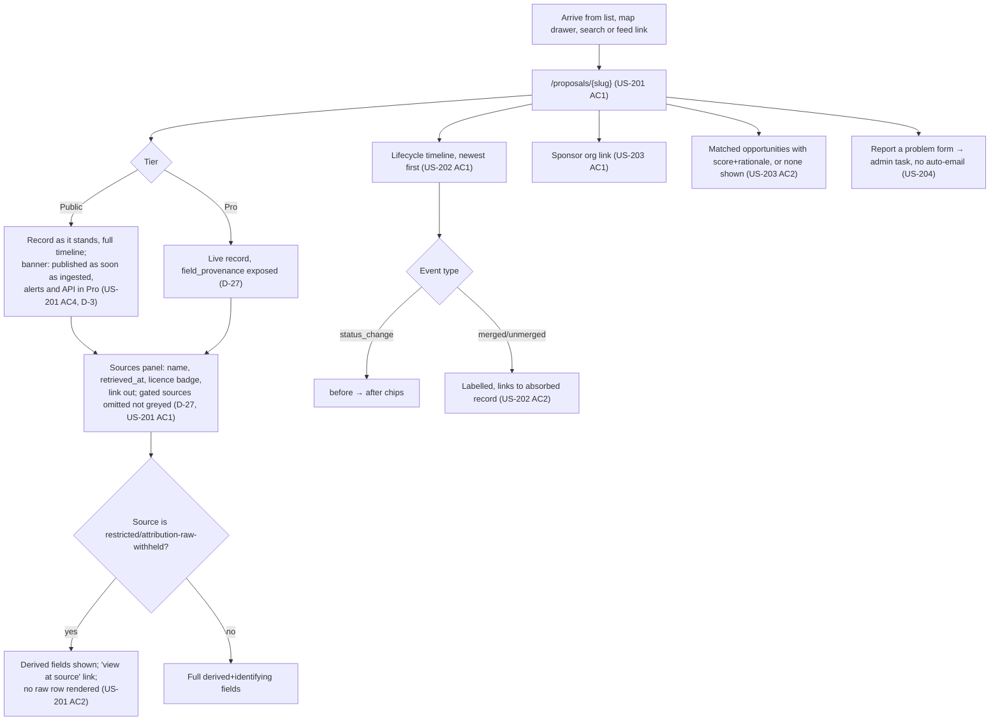

### 4.3 Track changes via saved search and alerts (US-501–504)

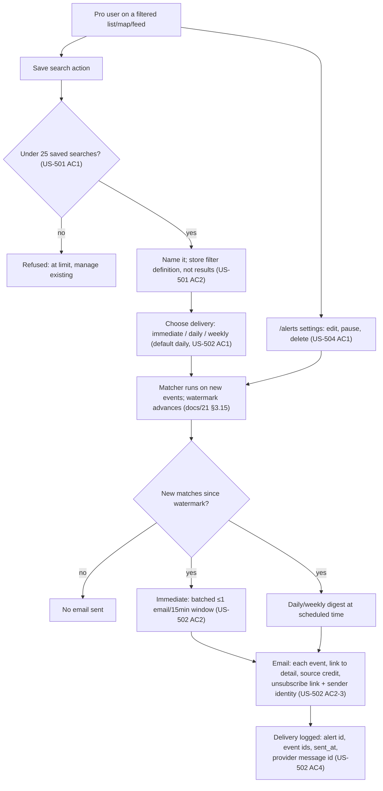

### 4.4 Browse opportunities and see matches (US-301, US-302, US-401, US-402)

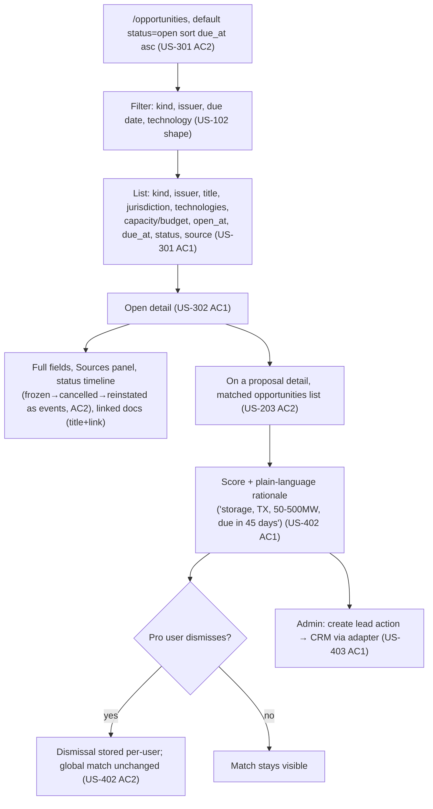

### 4.5 Submit a project — light intake (US-1001, US-1002)

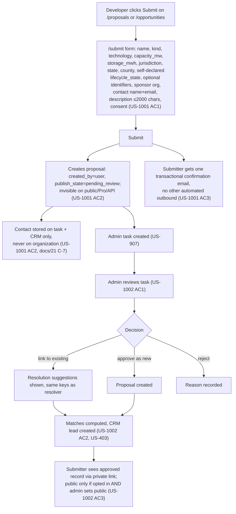

**As built, 2026-10-09 (lane C, `web/submit.py`, `web/templates/submit.html`).** These are the choices this
flow did not settle.
- **Entry.** One form at `/submit` for proposals (US-1001). It is linked from the page header of `/proposals`
  ("Know of a project that is not listed?") and of `/opportunities` ("Developing a project? ... we match it
  against opportunities like these"), which follows this flow's first node. US-1003's opportunity form is not
  built, so IA-3's utility framing from `/opportunities` is still open. It is not in the primary nav or the
  footer. `GET /submit` is indexable and in the sitemap; every POST result is `noindex` and `no-store`.
- **Fields.** Input names are the `IntakeProposalRequest` keys. The two nested objects use dotted names
  (`contact.email`, `identifiers.eia_plant_id`), which are also what the API's `errors[].field` uses.
  - Identifiers. "Interconnection queue" is a select of the seven ISO tokens plus "Not in an ISO queue, or
    not sure". With "Queue position ID" it becomes `queue_ids: [{iso, id}]`, and `iso` stays empty when the
    submitter is unsure, which is a shape the resolver already reads. "EIA plant ID" (digits) becomes
    `eia_plant_id`. "FERC docket" becomes `ferc_dockets`; a state docket goes in the description.
  - Sponsor is a name only. There is no organisation picker, and `sponsor_org_id` is never sent.
  - Jurisdiction is a code typed as the list filter takes it (`US-TX`, `US`, `GB`), upper-cased before sending.
    State and county are optional free text.
  - Technology is optional. Its options are the register's own (`/v1/meta/vocabularies`), so a submitted token
    is one the list can filter by.
  - Status is a self-declared select with Unknown last, linked to `/methodology#lifecycle`.
  - Capacity and storage are text inputs with `inputmode="decimal"`, not `type="number"`. A browser sends an
    invalid number input as empty, which would drop "1,200 MW" without a word; a text input lets the page
    say what is wrong.
  - Every answer is required unless its label says "(optional)". The publication opt-in is unticked by
    default.
- **Checks before sending.** The API admits five intake or report requests per visitor address per hour, and
  it stops at the first bad field. So the page checks every field the schema constrains, lists every problem
  at once in an error summary that has focus and links to each field, and spends none of the allowance on
  answers it can already see are wrong. Whatever the API still refuses lands on the field it names (422).
  - Textarea line breaks are counted as the browser counts them.
  - Nothing typed is lost on any error: 422, 429, an unreachable API (502) or a refused captcha. The honeypot
    is never echoed back.
- **Consent.** The consent box links the privacy notice only, because the site has no terms page.
  `consent_version` is `privacy-notice-<the notice's date>`.
- **Success.** The page says what happens next: an editor reviews it, it appears nowhere until then, it is
  linked, added or declined, then matched, and published only if the submitter opted in. It shows the task
  reference. It says no confirmation email is sent, because US-1001 AC3's email is not built. It does not
  link a private status page, because US-1002 AC3's `status_url` (`/status/{task_id}`) is not served. Both
  are recorded in `docs/40` §6 item 1.

### 4.6 Admin: source gate, publish decision, post queue (US-905, US-802)

**Report → record → unmerge (2026-10-07, audit UX-3).** A reader's report lands in `admin/tasks` with its issue type
in words ("Two different projects were merged into this record") and a subject link to the record's admin page by
kind (`/admin/records/{proposals|opportunities|organizations}/{id}`; the screens used to link `/admin/records/{id}`,
which is no route). The task page names the record, links its public page and, for a `wrong_merge` report, its
merge history and the unmerge form on the record page (`#history`, `#unmerge`). A privacy request's "Record named"
links the same way.

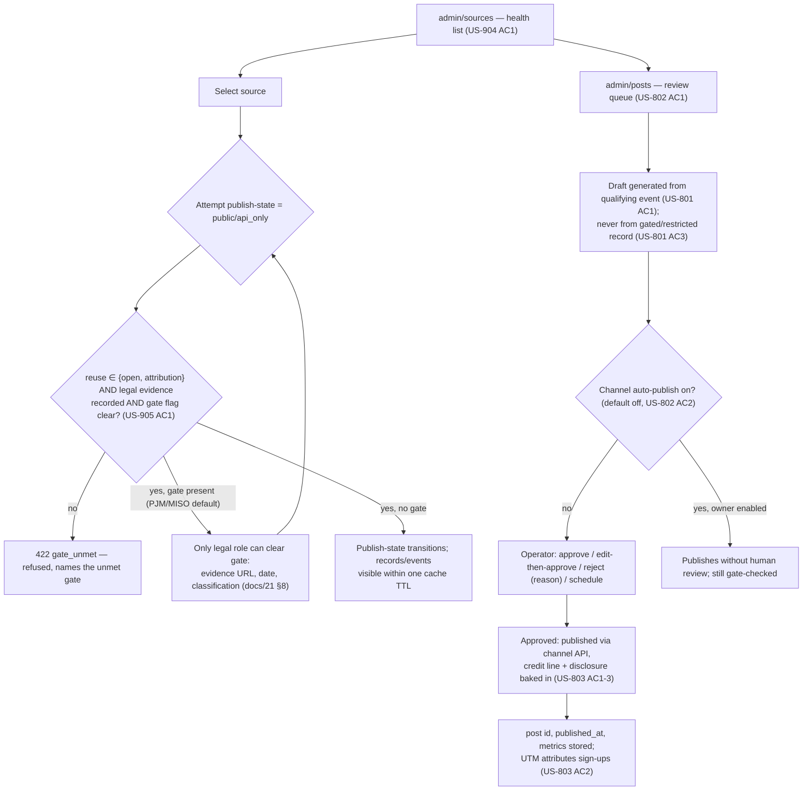

## 5. Wireframes — five key screens

Structured-text wireframes, not pixel layouts; component names match `docs/31-design-system.md` §5 inventory.
Grid and breakpoints per `docs/30` §5 (400/720/1080/1440px, D-32).

### 5.1 Map-first home (`/`)

```
┌───────────────────────────────────────────────────────────────────────┐
│ Inframation     Proposals · Opportunities · Map · Feed · Alerts      │ nav, identical all tiers
│ D-3 banner: "Every record and change event live. Alerts and API in Pro" │ fixed, public tier only
│ Filter bar: kind▾ technology▾ lifecycle▾ jurisdiction▾ capacity– –     │ D-19 tokens, URL-bound (D-17)
│ View: [Map] List Feed              1,834 in view                       │
│ ┌─────────────────────────────────────┬─────────────────────────────┐│
│ │ [MapLibre canvas]                    │ In view (142)               ││
│ │  ● cluster: size=count, colour=chip  │ chip│name    │state│MW      ││ synced list = accessible
│ │    family, icon=technology (D-10)    │ Prog│Gemini… │NV   │690     ││ path (D-14)
│ │  ▲ county-centroid marker, labelled  │ Neut│…       │TX   │—       ││
│ │  ▦ opportunity service territory     │ "Unplaced (12)" ▾           ││
│ └─────────────────────────────────────┴─────────────────────────────┘│
│ Legend (on-screen, D-10): ● Neutral ● Progress ● Committed ● Success  │
│ ● Danger [icons]     Basemap © OpenStreetMap contributors, ODbL (D-13)│
│ Attribution: "Sources: CAISO; ERCOT; EIA (public domain)." (D-27)     │
└───────────────────────────────────────────────────────────────────────┘
```
**As built, 2026-10-10 (review `docs/51` §2.6 item 2: the first viewport explained lateness before value; the key sat
below the fold).** Under the H1 (unchanged, `map_heading()`), one statement of value for the reader, then the
instruction: "Projects from public grid-queue and permit filings in the US and GB, matched across registers: every
claim linked to its source, every status change dated, and alerts when something you follow moves. Click a cluster to zoom
in, or a dot to open its record." (before: "Each dot is a proposal filed with a public grid queue or permit register
in the US or GB. Click a cluster…", then the tier notice). The map page has no tier notice block any more: how
current the sources are is said once, by the masthead link ("N of M sources behind their fetch schedule", to
`/methodology#vintage`), which this page keeps below 720px (`masthead--keep`, edition stamp hidden) where every other
page drops it; lists and records keep their notice. The dev-preview label still shows (`preview_banner` macro). The
key is drawn on the map: a `.map-key` row in the map overlay under the zoom and region controls, top left, where the
default view has ocean rather than the dense Northeast (a top-right panel hid New York and New England): from 720px a
17rem panel holding the status key, the region row and, when their layers are on, the asset and retired keys
(scrolls past the map's height); below 720px a strip of short labels ("In process"; the full words stay in the
accessible text). Page ground behind the words, so each hue keeps its measured contrast on `--bg`. A "Key" button
(map.js; hidden without scripts, when the key simply stays open) hides and shows it. Measured in headless Chromium on
the e2e store, dev-preview banner on as in the e2e server: map top 432 → 409 px at 1440×900 (budget 450), key top
1,070 → 470 px; 601 → 592 px at 400×800 (budget 640), key 1,073 → 649 px; axe (WCAG 2.2 AA tags) 0 violations on `/`
in both themes at both sizes. Open: with layers on, the panel covers the West Coast at the default view until "Key"
is pressed; at 720–1079px the expanded filter bar still puts the map at about 760 px.

**As built, 2026-10-10 (lane F), closing both.** With the existing-asset or retired layer on, the key is compact
(`docs/31` §5.17). The status key becomes the strip of short words, each layer's key is a section that closes, and the
panel stops at 15rem and scrolls inside, as a tab stop named "Map key". From 720 to 1079px the map's filter bar is
the "Filters (N active)" disclosure it already is below 720px; list pages keep theirs open. Measured as lane H did
(headless Chromium 141, a copy of the e2e store, dev-preview label on, app in process):

| | Before | After |
|---|---|---|
| Key panel, 1440×900, both layers on | 272×554 px, 150,688 px², 23.2 % of the canvas; Seattle, Portland, Sacramento, San Francisco, Los Angeles, San Diego under it | 272×240 px, 65,280 px², 10.0 %; Seattle, Portland (196 px tall with both sections closed) |
| Key panel, 1440×900, no layer | 272×276 px, 75,140 px², 11.6 %; Seattle, Portland | unchanged |
| Map top, 1024×768 | 634 px | 554 px |
| Map top, 768×1024 / 720×900 / 1079×800 | 741 / 761 / 577 px | 661 / 680 / 497 px |
| Map top, 1440×900 / 400×800 | 409 / 616 px | unchanged (budgets 450 / 640) |

At 1024×768 the budget is 600 px. At these widths the page is one column, as at 400px, so the 400×800 budget's
rule applies: keep 160 px of canvas (the zoom row and the key's first rows) in the first viewport, and 768 − 160 =
608, rounded down to 600. The measured 554 leaves 46 px, about the headroom lane H's budgets had. `web/test_e2e.py`
asserts it. axe-core 4.13.0 (WCAG 2.0–2.2 A and AA tags) in light and dark at 1440×900, 1024×768 and 400×800, in six
states each (no layer; both layers; retired only; both sections closed; Filters open, with and without layers):
0 violations in 36 runs. Before, the panel had a serious `scrollable-region-focusable` violation (it scrolled with
nothing a keyboard could reach) at all three sizes in both themes when layers were on.

Still open:

- At 1024×768 the header takes 233 px in three rows (wordmark, links, search). Collapsing it behind "Menu" up to
  1079px, as below 720px, would put the map at 432 px (measured with the rule injected; 490 px at 768×1024). That
  is a site-wide change and was not made.
- With "Existing assets" on, the asset-type row moves the map to 528 px at 1440×900 (budget 450).

**As built, 2026-10-11 (owner decision: records no register lists any more are hidden by default on the map and the
list, with a toggle; `web/unlisted.py`).** A project every register has dropped keeps the status its register last
stated (a removal is not a withdrawal), so it read as active pipeline. The rule: a view whose lifecycle choice is made
only of active states (the default, or any subset of announced through under construction) asks the API for
`listed=true` on every read it makes: the list's rows, the map's geo and cluster reads through `/api/proposals/geo`,
the lifecycle notice's active count and the empty-state facet counts, so "Showing N active proposals", the count line
and the rows are one set. A view that names any other state (built, withdrawn, cancelled, unknown, or "include
withdrawn") hides nothing, and a link that sets `listed` itself (a company page's "No longer listed" row) keeps it.
The toggle is `unlisted=include`, a site-only parameter never sent to the API; it is a box at the foot of the Status
disclosure on both bars ("Include proposals no register lists any more"; the summary then reads "active, no longer
listed"; a note says the box has no effect while a status outside the default is ticked). "View as: Map · List"
carries it both ways, `map.js` keeps it in the URL, "Clear all" clears it. Under the lifecycle notice, while the view
hides some, one line says how many with a link that shows them: "335 proposals no register lists any more are hidden.
Show them" (on the map the link ticks the box in place). Unchanged: "Save this search as an alert" stays on the
default view (the hiding is not in the query string) and an alert still matches every record, since a departure is
what a follower wants; the RSS and JSON feeds keep every record; the company pipeline and record pages already say
"no longer listed". The list offers no CSV or JSON export link (exports are the signed-in `POST /v1/exports`); a
future one must be built from the list's own API query.

The count costs one `limit=1&include=count` call, as each notice bucket does. Measured on a SQLite copy of the e2e
store with 335 of 4,014 active records' links marked gone (in-process app, median of 15): that call 70–79 ms. On the
list it adds no call: the default view's own total is the notice's active count, which is no longer asked for
separately (rows plus four counts, as before); `/proposals` 416–419 → 434–459 ms, most of it the `listed` predicate
the rule needs anyway. On the map it is a fifth count: `/` 316–323 → 416–436 ms, the notice fragment map.js fetches
after a filter change 248–274 → 356–363 ms (it runs beside the geo read). With the line, the map starts 19 px lower
(1440×900 409 → 428 px, 1024×768 554 → 573, 400×800 616 → 635; budgets 450, 600 and 640); the e2e store holds no
dropped record, so its pages show no line. axe-core 4.13.0 (WCAG 2.0–2.2 A and AA, best practice) on `/` and
`/proposals`, toggle off and on, Status open, light and dark, 400×800 and 1440×900: 0 violations in 18 runs.

States: empty — zero markers, filter bar names the facet + Clear all (D-29). Loading — skeleton tiles + list rows,
no spinner. Error — RFC 9457 `title`/`request_id` in place of the map; list loads independently. Delayed-tier —
D-3 banner, never dismissible on public. Restricted-precision — centroid marker labelled "county level (source
licence)", same wording in the drawer (D-9). Unplaced — "Unplaced (N)" collapsible row, never omitted (D-8).

### 5.2 Proposal detail with drawer variant (`/proposals/{slug}`, and the drawer opened from `/map`)

```
Full page (server-rendered, D-18):                    Drawer (from a map marker):
┌───────────────────────────────────────────────┐     ┌─────────────────────────┐
│ Home / Proposals / Gemini Solar     [breadcrumb│     │ [×] Gemini Solar + Storg│ role="dialog"
│ Gemini Solar + Storage  [chip: Progress·studied│     │ chip: Progress · studied│ focus trap (D-12)
│ Updated 12d ago (live tier) · [Live in Pro →]  │     │ D-3 line if public tier │
│ ─────────────────────────────────────────────│     │ fields · Sources ·      │
│ Fields (2-col, tabular-nums): kind, technology,│     │ last 3 events only      │
│  capacity_mw, jurisdiction, sponsor [link]     │     │ (condensed)             │
│ ─────────────────────────────────────────────│     │ [Open full record →]    │
│ Sources (D-27): CAISO Public Queue Report ·    │     └─────────────────────────┘
│  retrieved 11 Sep · [attribution]; derived     │
│  fields shown, raw withheld, [view at source→] │
│  (US-201 AC2). PJM row absent, not greyed (D-27│
│  item 3)                                        │
│ ─────────────────────────────────────────────│
│ Timeline (newest first, D-26): 2026-08-20      │
│  status_change filed→studied CAISO [licence];  │
│  2026-03-04 created CAISO [licence]            │
│ Matched opportunities: none shown (omitted,    │
│  not "0 found", US-203 AC2)                    │
│ [Report a problem →]   Attribution line (D-27) │
└───────────────────────────────────────────────┘
```
**As built, 2026-10-10 (lane S, owner decision on docs/51 §7 Q6; `web/sites.py`, `web/templates/_site_panel.html`,
`site_detail.html`).** After the facts block, "At this site" lists the record's site (docs/21 §3.25) when the viewer may
see two or more of its members: the lead first, each EIA plant's units under its first unit (summarised as a count above
20 records), every other member with its relationship to the lead, a confidence word, MW and status chip, each linking
to its record; neighbours at the same grid connection point sit apart in a collapsed "Also at this interconnection
point" list; a credit line names the registers. `/sites/{public_id}` adds the totals, sponsors (linked), the EIA plant
ids, connection points and operating-plant asset with its owners, and the Sources panel. `SITES_ENABLED=0` hides both.

States: loading — skeleton of the key/value grid and timeline rows. Error — RFC 9457 title, no stack trace; a
gated record renders identically to not-found (D-21/API-4). Delayed — n/a since 2026-09-21; nothing is absent by age,
not shown-then-blurred. Restricted-precision — "view at source" language, not a map label. Unplaced — n/a (no
map here); location falls back to text ("Clark County, NV — centroid").

**As built, 2026-10-10 (review `docs/51` §2.6 item 7).** A name its register files in capitals ("TRENT WIND FARM LLC")
is set in a readable case in the H1, the breadcrumb and `<title>` (so `og:title`) of proposal, opportunity, asset and
company pages ("Trent Wind Farm LLC"; `web/formatting.py::readable_name`): words of four letters or fewer stay in
capitals unless they are ordinary words (BESS, SLF, LLC, KCE stay; WIND, FARM, BLUE become words), Roman numerals,
initials and letters joined to digits are untouched, and a name with any lower-case letter is printed exactly as
filed. The name as filed is printed once under the H1 ("As filed: TRENT WIND FARM LLC"). The meta description,
JSON-LD, search, URLs and every other field keep the register's spelling. Grid connection point names are left as
filed (bus names such as `W_LOMA_ALTA_138` read worse cased). The proposal page's capacity and storage rows and its
meta description print through `mw` ("3,200", not "3200.0"). Every `<title>` separates page and site with a spaced em
dash ("Pricing — Inframation"), the dash the site's prose already uses, instead of " -- ".

### 5.3 Opportunity list (`/opportunities`)

```
┌─────────────────────────────────────────────────────────────────────┐
│ D-3 banner (public tier)                                              │
│ Filter bar: kind▾ issuer▾ technologies▾ due date range                │
│ Default: status=open, sort due_at asc (US-301 AC2)                    │
│ chp│ title                │ issuer │ tech       │ due    │ source     │ sticky header, 40-48px
│ Cmt│ 2027 All-Source RFP  │ APSC   │ solar,bess │ 15 Dec │ TED [i]    │ rows, numbers right-
│ Neu│ …                    │ …      │ …          │ …      │ …          │ aligned (D-24)
│ Page size 50, cursor pagination — no "page 7 of 40" (D-24)            │
│ Attribution line (footer)                                              │
└─────────────────────────────────────────────────────────────────────┘
```
As built (2026-10-07, audit UX-2, expert review): the Issuer column shows only when a row on the page has an issuer
(the linked organisation, else a Grants.gov notice's agency code, marked as a code); TED and World Bank buyer names
are in the normalised rows but are neither linked nor served by the API (reported to the API lane). A row whose due
date has passed while its source has not closed, cancelled or awarded it carries "Deadline passed {date}" beside the
status chip, here, on the record page and in search; the status itself stays the source's. Due dates do not wrap.
States: empty — "No open opportunities match these filters" + which facet + Clear all. Loading — skeleton rows
at final row height (no CLS). Error — RFC 9457 banner above table, table area empty. Delayed — D-3 banner;
delayed — n/a since 2026-09-21 (the record shows its current state and its full timeline). Restricted-precision — n/a here.
Unplaced — opportunities without a territory show jurisdiction as text only.

### 5.4 Pro alerts (`/alerts`)

```
┌───────────────────────────────────────────────────────────────────┐
│ Alerts                                        [+ New from filter] │
│ [card] TX storage 50–500 MW   daily·active·last run 06:00         │ saved-search card
│        7 new matches              [edit] [pause] [delete]         │ (docs/31 §5)
│ [card] Nevada BESS filings    immediate·paused·last run —         │
│        0 new matches              [edit] [resume] [delete]        │
│ Quota: 2 of 25 saved searches used                                 │
└───────────────────────────────────────────────────────────────────┘
```
States: empty — "No saved searches yet. Save a filter from any list or map to get alerted," linked to `/map`.
Loading — skeleton cards. Error — RFC 9457 banner; existing cards keep last-known state, staleness noted.
Delayed-tier — n/a (nothing is delayed). Restricted-precision, unplaced — n/a. At-quota — "New" disabled with
quota text, not silently hidden.

### 5.5 Admin source health (`admin/sources`)

```
┌───────────────────────────────────────────────────────────────────────┐
│ Source health                                        [+ add issuer]   │
│ St│ source          │last run │rows Δ│events│$/rec  │publish          │
│ ✓ │ CAISO gen_queue │ 05:00   │ +12  │ 12   │$0.004 │ public          │
│ ⚠ │ PJM interconn.  │ —       │ —    │ —    │ —     │ GATED (visible) │
│ ✗ │ MISO queue      │ 3 fails │ —    │ —    │ —     │ unknown         │
│ Row detail: cadence, licence class, legal evidence link,               │
│ [run now] [pause] [resume] [edit cadence]                              │
│ Gate clearance (legal role only): evidence URL + date + classification │
└───────────────────────────────────────────────────────────────────────┘
```
States: empty — n/a (registry always populated from `sources.yaml`; unimplemented shows literally as
"unimplemented", never absent, DA-12). Loading — skeleton rows. Error — adapter/API failure banner, table falls
back to last successful poll with a staleness timestamp. Delayed-tier — n/a (admin always live).
Restricted-precision, unplaced — n/a. Gated — publish column reads "GATED", not blank or a false "public".

## 6. State inventory summary

| State | Applies to | Rule |
|---|---|---|
| Empty | every list/map/feed | Names the filter that emptied results, offers Clear all (D-29, US-102 AC4) |
| Loading | every screen | Skeleton of final layout, never a spinner over a table (D-29, CLS) |
| Error | every screen | RFC 9457 `title` + `request_id`; never a stack trace; gated record = not-found, indistinguishable (D-29, API-4) |
| Tier notice | every public list/detail/feed (not the map page since 2026-10-10, §5.1 as built) | Fixed-position D-3 line: "Every record and every change event is published as soon as it is ingested. Alerts and API in Pro." (D-3, D-28). Since 2026-10-07 the stamp says "Live" only while every scheduled source is within its fetch allowance, else "No delay" with the late sources named (docs/31 §5.4) |
| Restricted-precision notice | map markers, detail location field | "location shown at county level (source licence)" wherever the geometry renders (D-9) |
| Unplaced-record fallback | map side panel only | "Unplaced (N)" collapsible, never silently dropped (D-8) |

## 7. Assumptions

| ID | Assumption | Basis | Affected |
|---|---|---|---|
| IA-1 | `/` is the map route rather than a separate marketing landing page, since US-104 makes the map primary and D-7 bans a marketing hero above a working screen | US-104, `docs/04` D-7 | `docs/31` home-screen component budget |
| IA-2 | Admin nav order follows the `docs/23` §4 endpoint grouping literally (Sources → Records → Resolution/Extraction → Tasks → Posts → Users/Customers → Keys/Costs/Audit) since no separate admin IA exists yet | `docs/23` §4 | `docs/20` §8 if that doc states a different order |
| IA-3 | The `/submit` intake route is reachable from both `/proposals` and `/opportunities` list toolbars (developer vs. utility framing) rather than a single generic entry, since US-1001 and US-1003 are separate forms with different fields | US-1001, US-1003 | Nav component in `docs/31` |
| IA-4 (2026-10-22) | Bankable's `/assessment` is the right pre-bridge landing for "Start a deal in Bankable": it is Bankable's public "Get Started" and creates a sponsor's project. Read in Bankable's code, not tested live | github.com/Tobombadil/bankablehq `src/App.tsx`, `src/components/landing/Header.tsx`, `src/pages/Assessment.tsx`, read 2026-10-22 | §2.6 link target; `BANKABLE_START_URL` changes it without code |
| IA-5 (2026-10-22) | Bankable ignores unknown query parameters, so the UTM parameters cannot break its start page | React Router passes query strings through; `Assessment.tsx` reads none | §2.6 |
| IA-6 (2026-10-22) | "Bankable is run by the team behind Inframation" is true, and the owner accepts it on public pages | `docs/18` §6 A2 (the owner owns or controls Bankable) | §2.6 copy; the owner confirms before Lane B ships |
| IA-7 (2026-10-22) | The site finder lane ships `/site-finder` as a server-rendered page behind a switch it turns on only when the page has results | The decision rows of 2026-10-22; the rule that a section shows only once it has something in it | §2.3, §2.8 Lane A item 2 |
| IA-8 (2026-10-22) | Desktop windows between about 1165 and 1240px, and tablets between 720 and 770px, are few enough that a taller header there costs less than hiding the links | Common laptop widths are 1280 and up; not measured on Inframation's traffic, which does not exist yet | §2.3; revisit with analytics |

## 8. Change history

- 2026-09-12 v1 — first draft (product-designer), following `docs/30-design-references.md` v1.
- 2026-09-19 — §3 page inventory rows for `/assets/{slug}` and the company page updated, §3.1 added
  (frontend-developer, midstream slice).
- 2026-09-19 — §3.1 updated (frontend-developer, second midstream slice): ethanol and RNG asset rows, the
  company-page descriptor for `other`-typed holders, grouped nearby rows, ethanol/RNG live on the map.
- 2026-09-19 — §1.1, §3 and new §3.2 (frontend-developer, navigation and discoverability lane): `/assets` and
  `/organizations` index pages, Open Graph and Twitter card meta, JSON-LD, `robots.txt`, and the split sitemap.
- 2026-10-07 — §1 nav as built and a names table, §3 `/docs/api` and `/feeds/*` as built, §4.1 status control,
  §4.6 report → record → unmerge (frontend-developer, lane L5, design audit UX-1, UX-3, UX-6, UX-7); §3.1 Follow,
  §4.1 uncovered ISO areas and large-load views, §5.3 opportunity issuer and deadline, §6 tier notice freshness
  (same lane, expert reviews 2026-10-07; lane L11).
- 2026-10-10 — as built (frontend-developer, pre-beta lane H, review `docs/51` §2.6): §1 Pricing out of the nav under
  the noncommercial posture; §3.1 company-page pipeline; §5.1 map page opening line, lateness once in the masthead,
  the key on the map; §5.2 readable record names, `mw` on the proposal page, title dash; §6 tier notice row.
- 2026-10-10 — as built (frontend-developer, lane F): §5.1 the compact key with a layer on and the map's filter
  bar as a disclosure at 720–1079px, with before/after measurements and the 1024×768 budget.
- 2026-10-10 — as built (backend, lane P): §3.1 the company pipeline from one aggregate, group links by
  `sponsor_scope`, "No longer listed" apart from the active pipeline, one name per grid; labelled company and
  connection-point lists; the record page's "no longer listed" line.
- 2026-10-11 — as built (frontend-developer, lane U, owner decision): §5.1 records no register lists any more are
  hidden from the map and the list on a view of active states, with the `unlisted=include` toggle, the hidden-records
  line and its measured cost.
- 2026-10-22 — design (product-designer, lane ia-phases, owner's phase decision): new §2.1–§2.9, the site by
  development phase (reader words Find · Build a deal · Get funded; a flat nav of the sections with pages, Site finder
  second once live; operations as lifecycle states on the one base map; the Build a deal block before the Bankable
  bridge; URLs; the implementation plan and the files other lanes hold); §1 nav paragraph and names table (three
  rows); §1.1 sitemap redrawn by phase and as built; §2 marked where the 2026-10-22 decisions changed it (view row,
  side list, bottom sheet, D-14 retired); §3 `/site-finder` row; §7 IA-4 to IA-8.
- 2026-10-23 — design (product-designer, lane nav-v2, owner's navigation and next-wave decisions): new §11, navigation
  and page purposes v2 (the evidence; a top bar Market · My pipeline · Funding with search, Alerts and account; section
  bars; one question and one primary action per page; record pages as URL tabs, with where each current section goes;
  the full-screen map landing and its panel tabs; nine testable panel stability rules; phones; wireframes at 1440 and
  390; URLs; the lanes and the tests that change; the owner's decisions; IA-9 to IA-15), with the coordinator's design
  input of the same day on My pipeline as one tracker (projects, bids, investments); §1 pointer; §1.1 sitemap redrawn
  by section; §3 page inventory rows marked where they change.

## 11. Navigation and page purposes v2 (2026-10-23)

**Status:** design, 2026-10-23 (product-designer, lane nav-v2). The decisions the owner confirms are in §11.13;
everything else follows from the decision rows below. It is built in lanes after the four builds in progress land
(§11.11).

**Built: V1, the shell (2026-10-23, lane nav-shell).** `partials/_top_bar.html` (48px sticky top bar, the
account menu, the phone Menu), `partials/_section_bar.html` (40px, 44px below 720px), `partials/_sections.html`
(sections, their pages, `holds`, `section_of()`, `section_current()`, `freshness()`), the words in `web/labels.py`
(`SECTION_LABELS`, `SECTION_TITLES`), `web/page.py` `nav_state` / `section_live` / `my_pipeline_listed`, and the
header rules and `site.js` behaviours (search over the bar, account menu, section-bar scroll and fades, sign-in
`next`, an empty moved-fragments table for V3 and V7). As built, against the text above: Funding, Grants & loans,
Invitations, State averages and Sources & licences are not listed until their pages exist (`NOT_YET_LIVE`; V4 adds
Funding with the count rule of §11.2), so a signed-out visitor sees Market alone in the top bar; `rfps` still reads
"RFPs & funding", and becomes "RFPs" in V4's change that moves grants and loans to `/funding`; the search field is
360px from 1080px, the width its whole placeholder needs in Plex or its metric fallback (240px, planned for 1080-1279px, showed about 70%
of it; 320px lost "ID…"; 336px cut the fallback face by 7px, PR #98 CI); at 1080px, signed in, with all three sections, the row needs 959 of its 1080px; About &
sources joins the section bar's right end from 1080px, the freshness line from 1280px; signed out under the
`commercial` posture, "Sign in" opens a small account menu (Sign in, Create an account, Pricing), so Pricing is only
ever in the account menu (two clicks to sign in there; one under today's `noncommercial` posture, where it stays a
link); the Menu button keeps its name "Menu" when open. Measured on a copy of the e2e store served without the
dev-preview label, before and after, at two moments: once the map's count line has landed, the map starts at 358px
at 1440x900 (was 372), 354px at 1024x768 (was 433), 429.5px at 390x844 (was 432) and 458px at 360x800 (was 480);
when its canvas first appears (where the desktop fold test reads it, before the count line takes its place), 343.5px
at 1440x900 (was 358) and 326px at 1024x768 (was 405). The header is 88px at desktop and tablet widths (was 103 and
168) and 92px on phones, which is 3px less on the home page and 26px more on other pages, where phones had no
masthead line and now carry the section bar. No fold budget changed.

Fix round (review of lane nav-shell, 2026-10-23). Sign out posts from every page, the `no-referrer` My pipeline
pages included, so `/logout` takes the My pipeline forms' rule (`Origin: null` with `Sec-Fetch-Site: same-origin`;
`web/auth.py` `_is_same_origin_form`, pinned to `web/my_projects.py` `same_origin_form`). The open search field and
the open account menu close when focus or a click leaves them, so Tab never lands on a control they cover
(SC 2.4.11), and Escape on the Menu button itself closes the Menu. "Sign in" no longer carries an `/unsubscribe`
token; an invitation (`/my/invitations/accept`) still carries its own, as its page's sign-in links do. The wordmark's
own rule is back for the admin header; the top bar sizes its copy. On a phone the map's search pick and the bottom
sheet's eased point (`map.js` `pick`, `revealAboveSheet`) allow for the sticky top bar, through one helper
(`topBarBottom`) and two changed lines in V2's file; the patch touches nothing else in `map.js`, so the coordinator
may land it with V1 or hand it to V2 together with its two e2e tests,
`test_a_picked_place_leaves_the_map_search_field_in_sight_under_the_top_bar` and
`test_a_tapped_point_just_under_the_top_bar_is_eased_clear_of_it`.

Left for later lanes, by name. **V2:** `map.js` (about line 703) still writes `next` onto
`.primary-nav a[href^="/login"]`, a selector nothing matches now that `site.js` `[data-signin]` carries the page;
`home_map.html` still defines ``, which `base.html` no longer has, and its comment
describes the masthead. **V4:** `organization_detail.html` hard-codes `>Companies</a>` in its breadcrumb, so it
joins `test_a_section_is_named_in_one_place` in V4's change to that page (build table row "Same file,
`test_a_section_is_named_in_one_place`"). **V3 and V4:** breadcrumbs that start with the section (`web/test_seo.py`
row) live in the page bodies, which V1 does not change; V3 does it for record pages, V4 for Companies and RFPs.

**Asked by the owner, verbatim:** "could we also improve the navigation and various pages? For navigation, use a top
bar and follow best practices from leading industry platforms to separate the site's major sections Map vs deal
building vs funding (with whatever names we are using for that). Further, give each page a clear purpose. Do not have
long scrolling pages with random sets of data stacked on top of eachother, its confusing." Earlier the same day: "id
really like the landing to be similar to previous business intelligence site I created called Pakira which was a full
screen map, much like some of the other energy intelligence systems as well, but keep the floating box and possible
list the companies in the floating box. Further, the floating box analytics are great but bounced around alot as you
scrolled in and didnt remain consistent which was jarring." Priorities, unchanged: a good experience for the average
user, mouse and phone users first, early credibility, so no empty sections.

**Decision rows this section applies** (`docs/00-PLAN.md`): 2026-10-23 "Navigation and pages: a global top bar…" and
"Next wave, queued behind the four builds in progress…" (item A, the landing and panel); 2026-10-22 "The site has two
modes, Market | My pipeline", "Copy rule: … Market intelligence", "Readers see the phases as Find · Build a deal · Get
funded", "The home map keeps what is in view, as one floating panel", "The responsive floor is 360px", "Build a deal is
built natively in Inframation", "Build a deal v1 choices", "Energy prices join Market intelligence"; 2026-10-21
"Company matching and subscriptions are free" (matches stay withheld from readers until a rule set clears US-401 AC3).
The coordinator's design input of 2026-10-23, that My pipeline is one central tracker of everything a user works on
(item types pending the owner), is folded into §11.3, §11.4, §11.5 and §11.9.

**What changes, in one table.**

| As built on 2026-10-23 | Becomes |
|---|---|
| One header: a masthead line (edition, source freshness, About & sources), the wordmark, six flat links, Sign in, search | A 48px **top bar** (Market · My pipeline · Funding, search, Alerts, account) over a 40px **section bar** for the pages of the current section (§11.2, §11.3) |
| "RFPs & funding", one list of every notice | **RFPs** in Market (buyers asking for projects); **Grants & loans** in Funding (public money offered) (§11.2) |
| Record pages as one long stack of numbered sections (NextEra's company page 9,959px, 11 screens at 1440; `docs/16` §1.1) | **URL tabs**, one job each, under a shared record header (§11.5) |
| The home map from 336px down at 1440×900, under the intro, filters and status rows | The map fills the viewport under the two bars; search, filters, count and views float in one bar (§11.6) |
| A panel with "In view" and "Key" tabs that re-renders on every answer | Tabs **Projects · Companies · Infrastructure · RFPs**, and nine testable stability rules (§11.6, §11.7) |
| My pipeline planned as "Your projects" cards (`docs/19` §6.2) | One **Tracker** of projects, bids and investments; "Track" replaces "Start a deal" (§11.4, §11.9.4) |

**Amends:** §1 (six flat links), §2.1 (the two-way switch at the top of the header becomes the top bar), §2.3 (a flat
nav with no phase labels), §2.4 (RFPs & funding as one Find list), §2.6 and `docs/19` §6.2 (the "Start a deal" block
and its words), `docs/16` U-4 (company tabs as `?tab=`: they become path segments, and `?tab=` still answers, §11.10).

### 11.1 Best practice, with evidence

Retrieved 2026-10-23 unless dated. Several product pages refused automated reading (HTTP 403); those are named, and
nothing below rests on them alone.

| Source | What it shows | What Inframation takes |
|---|---|---|
| Nielsen Norman Group, Laubheimer, "Local Navigation Is a Valuable Orientation and Wayfinding Aid", 2021, https://www.nngroup.com/articles/local-navigation/ | "The global navigation of the site shows the top tier of the tree, no matter where the user currently is"; local navigation "is contextual to the user's current location", should stay visible, and "should not be more salient than the global navigation"; it sits horizontally below the global navigation or on the left | Two bars: the top bar is the global tier on every page; the section bar under it is local and quieter |
| NN/g, Farrell, "Utility Navigation: What It Is and How to Design It", 2015, https://www.nngroup.com/articles/utility-navigation/ | Utilities (sign in, search, subscribe) are secondary tools; "Put utilities where people expect and need them", the top right being the common place | Search, Alerts and the account sit at the top bar's right; About & sources is a utility, not a section |
| NN/g, Sunwall, "Tabs, Used Right", 2024 (reviewed 2026), https://www.nngroup.com/articles/tabs-used-right/ | Tabs suit "lengthy content" with "clear groupings"; they are wrong when users must see the groups together (switching "tax[es] users' short-term memory"); "The fewer tabs, the better"; labels "usually 1-2 words" | Record tabs only where a page holds separable jobs; one- or two-word labels; what a reader compares stays together (the Overview carries every tab's headline figures) |
| NN/g, Fessenden, "Scrolling and Attention", 2018, https://www.nngroup.com/articles/scrolling-and-attention/ | 57% of page-viewing time is in the first screenful and 74% in the first two | Each tab's content starts in the first screen; a company Overview fits two screens at 1440 (`docs/16` §4.1's target) |
| NN/g, Budiu, "Login Walls Stop Users in Their Tracks", 2014, https://www.nngroup.com/articles/login-walls/ | Asking for sign-in before users see value makes them leave; reserve sign-in for actions that need it | A signed-out top bar has no My pipeline; sign-in is asked at "Track", the action that needs it |
| NN/g, Budiu, "Mobile Subnavigation", 2017, https://www.nngroup.com/articles/mobile-subnavigation/ | Under 6 subcategories, an accordion in the main menu; 6 to 15, a section menu, distinct in look from the main menu | Market's seven pages get a section bar on phones that looks unlike the Menu; the Menu's groups are accordions |
| Salesforce Lightning Design System, "Global Navigation", https://v1.lightningdesignsystem.com/components/global-navigation/; Trailhead, "Custom Record Pages", https://trailhead.salesforce.com/content/learn/modules/lightning_app_builder/lightning_app_builder_recordpage | Global navigation is "a Navigation Bar where your users find the App Launcher, App Name, and Pages that each App includes"; a record page's Tabs component starts with Details, Related and Activity | Sections over pages; a record as a set of views: Overview is Details, Portfolio and Pipeline are Related, Timeline is Activity |
| LinkedIn, "Sales Navigator: Top Navigation" (tip sheet TS019), https://business.linkedin.com/sales-solutions/learning-center/resources/tip-sheets/ts019 | Top navigation Home, Lists (saved leads and accounts), Discover, Inbox, Settings and an App Switcher; search is a separate section | The user's saved work is its own destination apart from discovery (My pipeline apart from Market); search is global, not a section |
| Bloomberg (bloomberg.com answered 403; from search-indexed Bloomberg pages): "Innovating a modern icon", https://www.bloomberg.com/company/stories/innovating-a-modern-icon-how-bloomberg-keeps-the-terminal-cutting-edge/ and "Bloomberg Terminal Essentials: IB, Worksheets & Launchpad", https://www.bloomberg.com/professional/insights/technology/bloomberg-terminal-essentials-ib-worksheets-launchpad/ | Finding functions was an early problem that "led to a hierarchical menu system"; Launchpad links panels in "security groups", so changing the security in one changes the others. Confidence medium: not read first-hand | One record, many views sharing its header and scope; the map panel's tabs all follow one view (the bbox and the filters) |
| OpenInfraMap, https://openinframap.org/ (page markup) | One `<header>` with the title and three links (about, stats, exports), then `<div id="map">`: the map fills the page under a slim header | The landing is the map under a slim top bar |
| Electricity Maps (`docs/30-design-references` §2.1); Pakira (the owner's screenshots, 2026-10-23) | A full-screen map with a breakdown panel; Pakira: a full-viewport map, one floating search bar with a result count, mode tabs and map, list and grid views, results docked beside the map | One floating bar (search, filters, count, views) and one floating panel |
| LandGate, https://www.landgate.com/, and Paces, https://www.paces.com/ (marketing navigation; the apps were not studied) | LandGate groups its energy offer by the developer's job ("Data Center Siting", "Offtake Capacity", "Power Pricing", "Transmission") and gives capital audiences their own entries ("Funds & Asset Managers", "Lenders & Insurances"); Paces groups by audience (Power Developers, Data Center Developers) then product | Capital is its own top-level destination, apart from siting and market data |
| Grid Status, PitchBook, Crunchbase | gridstatus.io answered 403 (as on 2026-09-12, `docs/30-design-references` §2.2); PitchBook and Crunchbase profiles answered 403, and their sectioned profiles are known only second-hand | Not relied on |
| Bankable (the owner's screenshots, 2026-10-23; `docs/18` §1) | A top bar (Projects, Pipeline, Community, alerts, account); a data room with folders and document counts, a score card on the right and tabs (Overview, Progress, Funding, Team); a funder pipeline with adjustable pillar weights and Engage, Watch and Pass | The tracker item's tabs, the folder layout and a pillar card with counts, never a single score (`docs/19` §2.3) |
| web.dev, "Cumulative Layout Shift (CLS)", updated 2023-04-12, https://web.dev/articles/cls | Good is 0.1 or less; shifts within 500 ms of a tap, click or keypress are excluded, but "Scrolls, drags, and pinch-zoom gestures don't qualify" | A panel that reflows after a map drag is a counted layout shift (S-8) |
| MapLibre GL JS, "MapEventType", https://maplibre.org/maplibre-gl-js/docs/API/type-aliases/MapEventType/ | `move` is "Fired repeatedly during an animated transition"; `moveend` "just after the map completes a transition" | The panel renders after `moveend` only (S-6) |
| NN/g, Laubheimer, "Executing UX Animations: Duration and Motion Characteristics", 2020, https://www.nngroup.com/articles/animation-duration/ | Most UI animation 100–500 ms; 200–300 ms for substantial changes | Figures ease over 200 ms (S-4) |

**What the evidence settles:** two levels of navigation, utilities at the top right, sign-in at the action that needs
it, tabs only for separable jobs, numbers that change in place rather than jump. **What it does not settle:** the words.
They follow the owner's decisions and the desk test of §2.2; the cheap check is the first-click test §2.2 proposes
for the beta testers (`docs/65`), with two questions: "where would you go to track a bid for this RFP?" and "where
would you find a federal grant for a battery?".

### 11.2 The top bar

**The sections: Market · My pipeline · Funding**, then search, Alerts and the account. The coordinator's proposal
stands; the reasons are in the table.

| Item | Holds | Signed-out visitor | Why this word |
|---|---|---|---|
| **Market** | Map, Site finder, Projects, Companies, RFPs, Infrastructure, Prices (§11.3) | Shown | The owner's mode word (2026-10-22). The copy rule puts "Market" wherever space is tight, which a top bar is; "Market intelligence" is the section bar's title, the page titles and the meta descriptions |
| **My pipeline** | The Tracker of the user's projects, bids and investments, and each item's pages | **Not shown** | The owner's word and developers' own. A signed-out visitor has nothing in it, so the item would be a login wall for every one of them (NN/g, §11.1). Their way in is **Track** on any eligible record, which asks for sign-in at that moment (`docs/19` §6.2's signed-out flow), and About's `#deals` |
| **Funding** | Grants & loans now; Funders, the invited-funder showroom, after counsel (`docs/18` §4) | Shown | A place, named by a noun like the other two. "Get funded" stays the phase word in prose (About `#deals`) and is Bankable's tagline. With "RFPs & funding" split, "Funding" no longer collides with a list name (§2.2's worry) |
| Search | One field: projects, companies, places, RFPs, funding notices, infrastructure (`/search`) | Shown | A utility on every page (NN/g) |
| Alerts | `/alerts` | Shown | Free (2026-10-21); its page explains and asks for sign-in to save, as now |
| Account ▾ or Sign in | Account, Download your data, Sign out; Pricing only under the `commercial` posture | "Sign in" | A utility |

The order follows the phases a reader moves through: Find, Build a deal, Get funded.

**Funding is not empty.** It lists the opportunity kinds that offer money: `foa`, `loan_program` and `program`
(`web/labels.py` `OPPORTUNITY_KIND_LABELS`). The store held 149 `foa` records on 2026-09-20 (decision row "Coverage
gap"), and Grants.gov answered 151 hits for "energy" on 2026-09-12 (`docs/11`). This session had no store, so today's
open count is not measured here. The page defaults to open or announced notices (Grants.gov's forecasts map to `announced`,
`pipeline/connectors/us_grants_gov_search2/status_map.yaml`) that pass the matcher's energy gate (as
`/opportunities` does since 2026-10-22), soonest deadline first, with "All notices" one click away. **Rule:** the Funding
item renders while that default view holds at least one row; the build lane states the live count in its PR. At zero
the item hides until a notice arrives (no empty section), and `/funding` still answers by URL with "No open funding
notices now; N closed in the last twelve months".

**Utility RFPs belong in Market.** Four reasons. (1) An RFP is a buyer asking for power, capacity or a project: demand
for the project's output, the other side of the market the map shows. Reading it beside projects, prices and grid
points is prospecting, and the 2026-10-22 rows already call RFPs a Find list. (2) The matcher pairs RFPs with projects
and companies, and its results (the Matches tabs, §11.5) are Market pages. (3) Funding answers a different question
(who pays for the project) for a different audience (lenders and funders), the split LandGate's navigation also draws.
(4) A developer responding to an RFP tracks it as a **Bid** in My pipeline (§11.4), so the RFP's page is a doorway to
My pipeline, as it was to "Build a deal" (§2.4). Tenders, auctions and procurement notices go with RFPs; a notice goes
where its kind says.

**Layout.** 48px tall and sticky at every width; the only sticky bar on the site. From 1080px: the wordmark, the three
sections, then the search field (320px, 240px at 1080–1279px), Alerts and the account. From 720 to 1079px the search
field is an icon button that opens the field over the bar. Below 720px: the wordmark, the search button and Menu
(§11.8). The section that holds the page is marked `aria-current="true"` (`"page"` on its landing page), with weight
600 and a 2px underline, the idiom of §1. The wordmark links to `/`.

**What leaves the header.** The masthead line (28px: "Inframation register · public edition", the source-freshness
line, About & sources) goes. Source freshness moves to the section bar's right end from 1280px (`All N scheduled sources
fetched on schedule`, or `N of M sources behind their fetch schedule`, the same strings and link as today), and stays
in the tier notice on lists and records (`docs/31` §5.4) and in the map's attribution strip. About & sources moves to
the section bar's right end, the Menu, the map's attribution strip and the footer. The beta bar, while
`SITE_ACCESS=basic`, sits above the top bar as it sits above the masthead today.

### 11.3 The section bars

**Rules for every section bar.** 40px tall (44px below 720px), directly under the top bar, not sticky. Quieter than
the top bar: Plex Sans 400 at `--text-2`, the current page at 600 with an underline; from 1280px the section's title
leads in Plex Mono capitals at `--text-1`. Plain links to their own URLs in `<nav aria-label="{Section} pages">`,
`aria-current` as in §1. A section bar shows on every page of its section, even with one item, so the chrome is the same
height in every section and nothing below it jumps when the reader moves between sections. A record page shows its
section's bar with its list marked `aria-current="true"`. Pages that are not yet live are left out (`section_live`,
§2.8), never shown disabled.

| Section | Bar, in order | Third level | Notes |
|---|---|---|---|
| Market | **MARKET INTELLIGENCE** · Map · Site finder · Projects · Companies · RFPs · Infrastructure · Prices · *(right)* source freshness · About & sources | Infrastructure: *Plants, pipelines & lines* · *Grid connection points* (as built). Prices: *Hubs & zones* · *State averages* | Map-shaped tools first (the landing, then the finder), then the record lists in the ratified order, then Prices (aggregates, not records). Site finder joins when its page has results, Prices when its page ships. Alerts leaves the bar: it is a utility in the top bar |
| My pipeline | **MY PIPELINE** · Tracker · Invitations | None | Invitations shows only while one waits for this user. The Tracker's type filter (All · Projects · Bids · Investments) is a control on the page, not bar items: one list, filtered. Later: Documents, every file across items, when data rooms ship |
| Funding | **FUNDING** · Grants & loans · Funders | None | Funders after counsel has read `docs/18` §4, invited capital partners only, never a public listing of deals seeking investment |
| About (reference) | **ABOUT** · About · Sources & licences · Coverage & methodology · Attribution · API & feeds | Coverage & methodology: *Release dates* · *What is not here* · *Status words* | Reached from the footer, the Menu and About & sources. Privacy and the legal pages stay footer links with no bar |

Search, Alerts, Account, sign-in and the admin surface have no section bar. Admin keeps its own navigation (§1.3).

**Words** (one place, `web/labels.py`; code keys in brackets). Sections: Market `market`, My pipeline `my_pipeline`,
Funding `funding`. Section titles: "Market intelligence", "My pipeline", "Funding", "About". New page labels: RFPs
`rfps` (was "RFPs & funding"), Prices `prices`, Hubs & zones `prices_hubs`, State averages `prices_states`, Grants &
loans `funding_grants`, Funders `funders`, Tracker `tracker`, Invitations `invitations`, Sources & licences
`about_sources`, Coverage & methodology `methodology`, Attribution `attribution`, API & feeds `api`. New list H1s: "RFPs
and tenders" (`/opportunities`) and "Grants, loans and programmes" (`/funding`). Breadcrumbs start with the section,
as the copy rule asks for "Market" there: "Market / Companies / {name}", "Funding / Grants & loans / {title}", "My
pipeline / Tracker / {item}".

### 11.4 One purpose per page

Every page answers one question and offers one primary action, styled as the one primary button (`docs/31` §5.16);
everything else is a link or a secondary button. **Exception:** reference prose (Methodology's tabs, the legal pages)
may run long when it opens with a contents list; a data page may not.

| Page | URL | The one question it answers | Primary action | Change |
|---|---|---|---|---|
| **Market** | | | | |
| Map | `/` | What is being built, where, and by whom? | Find (the floating search field) | Full-screen (§11.6) |
| Site finder | `/site-finder` | Where could a large load or a plant connect to power? | Set the criteria | The finder lane's page; each candidate offers Track |
| Projects | `/proposals` | Which projects match my filters? | Save this search as an alert | View switch Map · List · Grid (§11.6) |
| Project | `/proposals/{slug}` and tabs | Per tab (§11.5) | Track | URL tabs |
| Site | `/sites/{id}` | What records sit at this one physical site? | Open the lead record | None: one job already (1,698px at 1440) |
| Companies | `/organizations` | Who owns, runs and develops the most? | Find a company by name | The pages lane's index; the view switch |
| Company | `/organizations/{slug}` and tabs | Per tab | Follow this company | URL tabs |
| RFPs | `/opportunities` | Which buyers are asking for projects now? | Save this search as an alert | RFP kinds only (§11.2) |
| RFP | `/opportunities/{slug}` | What is asked, by whom, by when? | Read the notice at source | Track (creates a Bid); a Matches tab once matches publish |
| Infrastructure | `/assets` | What is already built, and where? | Filter by type and state | None |
| Grid connection points | `/interconnection-points` | Where are projects queuing to connect? | Sort by active MW | None |
| Plant, pipeline or line | `/assets/{slug}` and tabs | Per tab | Show on the map (Track for retiring and retired plants) | URL tabs |
| Grid connection point | `/interconnection-points/{id}` and tabs | Per tab | Track | URL tabs |
| Prices: hubs and zones | `/prices` | What does power sell for at the hubs and zones, and how does it behave? | Sort by a statistic | The glossary becomes a closed disclosure "What these figures mean"; the link-out markets one line under the table; state averages move to their own tab |
| Prices: state averages | `/prices/states` | What do businesses pay for power in each state? | Sort by a sector | New URL tab |
| **Funding** | | | | |
| Grants & loans | `/funding` | Which public funding is open for my project? | Save this search as an alert | New: kinds `foa`, `loan_program`, `program` |
| Funding notice | `/opportunities/{slug}` | What is offered, by whom, by when, and for what? | Read the notice at source | Track (creates a Bid); section and breadcrumb by kind |
| Funders (later) | after counsel | Which invited funders' criteria does this deal meet? | Not designed here | `docs/18` §4 first |
| **My pipeline** (signed in) | | | | |
| Tracker | `/my` | What am I working on, and what is due next? | Add an item | New (coordinator's input): every item the user owns or was invited to, sorted by next deadline (undated items after, most recently changed first), with a type filter. Below 720px each item is a ruled two-line card in one column; from 720px a table. Each item shows its stage, next deadline, what changed on its linked records since the user's last visit, and readiness |
| New item | `/my/items/new` | What is this item? | Create | The type is chosen first (Project · Bid · Investment); fields prefilled from the starting record under `docs/19` §7's licence rule |
| Item | `/my/items/{id}` and tabs | Per tab (§11.5) | Per tab | Same tabs for every type |
| Invitations | `/my/invitations` | Who has invited me, to what? | Accept | Shown only while one is pending; the accept page `/my/invitations/accept` (`docs/19` §6.2) is unchanged |
| **Utilities and reference** | | | | |
| Search | `/search?q=` (`&type=`) | Which records match my words? | Open the top hit | Tabs by type with counts and a top hit (`docs/16` §4.4): All · Companies · Projects · Infrastructure · RFPs · Funding |
| Alerts | `/alerts` | What am I following, and what changed? | New alert from a search | None |
| New alert | `/alerts/new` | What should this alert watch? | Save alert | None |
| Account | `/account` | What does my account hold, and how do I leave? | Download your data | None (one short page) |
| About | `/about` | What is Inframation, who runs it, and how do the phases fit together? | Read the sources and licences | Split: it was 5,124px at 1440 (`docs/16` §1.1) |
| Sources & licences | `/about/sources` | Which register says what, under which licence? | Open a source's terms | New: today's About §2 and §3 |
| Coverage & methodology | `/methodology`, `/methodology/gaps`, `/methodology/status-words` | How current is each source? What is not here? What do the status words mean? | Check a source's fetch date | Three URL tabs (10,894px, 12 screens today); About's method notes join it |
| Attribution | `/attribution` | Whom must I credit, and how? | Copy a credit | None |
| API & feeds | `/docs/api` | How do I get this data by program? | Subscribe to a feed | None |
| Pricing | `/pricing` | What does each plan include? | None under `noncommercial` (a posture note) | By URL and the account menu only |
| Submit a project | `/submit` | How do I add my project to the register? | Submit | None |
| Sign in, register, verify, reset | as today | Am I who I say I am? | The form's button | None |
| Privacy, reuse, API licence, contact, bot | as today | Read | None | Footer links |

**The tracker's item types** (coordinator's input, pending the owner's confirmation):

| Type | Stages, in order | Created by Track on | Next deadline, live from |
|---|---|---|---|
| **Project** (developing) | Prospecting → Site control → Development → Ready to build → Construction → Operating (`docs/19` §2.1's stages) | A project page ("I'm developing this, or something near it"), a site-finder candidate, a retiring or retired plant, a grid connection point; or blank | The soonest due date among its attached bids' notices; none otherwise |
| **Bid** (responding to an RFP or a funding call; may attach to one of the user's projects or stand alone) | Considering → Preparing → Submitted → Shortlisted → Won / Lost / Withdrawn | An RFP or funding notice page; or blank | The notice's `due_at`, read live, so a deadline the issuer moves moves here |
| **Investment** (a project the user is looking to fund) | Screening → Diligence → Term sheet → Committed → Closed / Passed | A project page ("I'm looking to fund this"); or blank | None from public records today |

**"Track" replaces "Start a deal"** on record pages (`docs/19` §6.2's block keeps its place, after the key facts, and its
mechanics: a POST form, the record in the body, the signed-out cookie and `next`). Its words: heading "Track this",
one line ("Add it to your private tracker: its deadline and changes follow the public record."), the button
**Track**, and the privacy note ("Only you, and the people you invite, can see it."). On a project page the form asks
which type; on an RFP or funding notice it creates a Bid and offers to attach it to one of the user's projects.
**The tracker shows no counts to anyone else, ever:** no "N people track this", no tracked-item counts in public pages,
page HTML, JSON-LD, social cards, analytics, logs, alerts or the admin dashboards, and a record's sponsor is never told
it is tracked or by whom (an Investment item is the funder's private note, which keeps it clear of `docs/18` §4's
solicitation question). This extends the 2026-10-22 consent guardrail and `docs/19` §5.2; `tests/test_private_isolation.py`
pins it.

### 11.5 Record pages as URL tabs

**Rules.**

- **T-1 One header on every tab:** breadcrumb, H1 (readable name), status chip or type badge, the company or owner line
  (`docs/16` U-2, U-20), the tier notice (D-3), the one primary action, then the tab bar. The scope switch of a company
  (This company only · With direct subsidiaries · Whole group) sits in the header and applies to every tab.
- **T-2 One job per tab**, named in one or two words, with a count where the tab lists countable rows ("Pipeline 73").
- **T-3 A tab shows only when it has content; a tab bar shows only with two or more tabs.** A tab URL reached while
  empty answers 404 with the header, the tab bar and one line ("No RFPs recorded for this company"), so the reader can
  move on and a crawler does not index an empty page.
- **T-4 Provenance on every tab** (D-2, D-27, D-34): each tab ends with its own credits line (the registers behind its
  rows, their licence words and retrieval dates) and the record's attribution line; the Sources tab holds the full
  panel. Per-field "source:" notes stay where they are.
- **T-5 Overview is the record's URL** and answers its main question within two screens at 1440 and four at 390. It
  holds the top five rows of each other tab with "All N in {tab} →", so nothing a reader compares is split across tabs.
- **T-6 URLs are path segments** under the record URL (`/organizations/{slug}/pipeline`). `?tab={name}` (`docs/16` U-4's
  form) answers 301 to the segment; every query parameter the tab understands (scope, sort, filters) is carried; a
  merged slug's 301 to the survivor keeps the segment. A path segment names the view in the address bar, the access
  log and analytics, and lets each tab's route read only its own data. It departs from D-17's word "parameters", not
  from its purpose: the tab is in the URL.
- **T-7 Search engines:** the Overview is indexable, in the sitemap and carries the JSON-LD; tab pages are
  `noindex, follow` and canonical to themselves, so tens of thousands of thin tab URLs do not compete with the record.
  `BreadcrumbList` stops at the record.
- **T-8 Old anchors keep working.** The Overview keeps an element with each old section id (`#assets`, `#nearby`,
  `#pipeline`, `#group`, `#owners`, `#sources`): that tab's summary block, which links to the tab. `site.js` replaces
  the URL with the tab's when a known fragment arrives (`location.replace`, so Back is not doubled). Without scripts the
  reader lands on the summary and its link.
- **T-9 The tab bar** is a `<nav aria-label="{record name} sections">` of plain links with `aria-current="page"`, not a
  `role="tablist"` (the Infrastructure tabs' pattern, `docs/16` §3.2); below 720px it scrolls sideways like a section
  bar.
- **T-10 Each tab reads only its own data.** Today's company page makes every read for every section on every load.

**Company** (`/organizations/{slug}`): **Overview · Portfolio · Pipeline · Matches · RFPs · Sources**, the owner's
order plus Sources. From `organization_detail.html` as built, and as the pages lane changes it:

| Section today | Moves to |
|---|---|
| Breadcrumb (the ownership chain), H1, descriptor badge, "As filed" | Header (every tab) |
| Profile line and facts (pages lane: about, website, headquarters, listing, each with its source) | Overview |
| Summary line ("Operates 3 gas pipelines · Owns 12 power plants") | Overview, as a figure strip: operating assets · operating GW · owned GW · projects in development · development GW · RFPs issued, the companies index's stored figures (decision row 2026-10-22), each linking to its tab |
| "Follow this company's proposals"; "Follow its opportunities" | Header: one primary "Follow this company"; "Follow its RFPs" on the RFPs tab |
| Field grid (type, country, jurisdiction, website, LEI, Wikipedia, parent claim) | Overview, "Facts" |
| "No parent recorded …" coverage sentence | Portfolio › By company |
| Scope links | Header |
| Group summary line and notes; Group table | Portfolio, view **By company** (`?by=company`) |
| Pipeline block (`partials/_org_pipeline.html`: by status, by technology, by ISO, registers) | Pipeline, then its project list |
| 1. Assets: mini-map, asset-filter notice, one table per role and type | Portfolio, view **By asset** (default); the map moves to Overview as one combined map, operating assets filled and active projects as rings (`docs/16` §4.1) |
| 2. Proposals near these assets, with its technology filter (`nearby_technology`) | Matches: "Projects near its assets" |
| 3. Proposals (the 100 most recently changed) | Pipeline, under its tables, paged and sortable |
| 4. Opportunities | RFPs, shown only when it has issued any |
| 5. Sources | Sources; each tab's own credits line (T-4) |

**Matches** answers "what fits this company?": today the projects within 25 km of its assets, a deterministic,
published proximity match; later the RFPs that fit its projects, once a rule set clears US-401 AC3 (decision rows
2026-10-21). It shows when either has rows. The Overview's "Largest assets (5)" and "Recently changed projects (5)"
link to Portfolio and Pipeline.

**Project** (`/proposals/{slug}`): **Overview · Timeline · Sources · Matches** (Matches once matches publish).

| Section today (`proposal_detail.html`) | Moves to |
|---|---|
| Breadcrumb, H1, status chip, slip note, "No longer listed", "As filed", company line and its claim | Header |
| Tier notice (`delayed_banner`) | Header |
| Field grid | Overview |
| Location (`partials/_proposal_location.html`) | Overview |
| "At this site" (`_site_panel.html`) | Overview, its first five rows, then "All N at this site →" to `/sites/{id}` |
| Track block (was Build a deal, §2.6) | Overview, after the facts |
| 1. Sources | Sources |
| 2. Lifecycle timeline; 4. History | Timeline: one dated list, newest first, stated future dates marked as stated, record-maintenance rows collapsed (`docs/16` §4.2) |
| 3. What this record combines | Sources, as "Combined records" |
| Report a problem | Sources (the form); a "Report a problem" link at the foot of every tab |
| Attribution line | Every tab |

**RFP or funding notice** (`/opportunities/{slug}`): one page today (1,119px at 1440: facts, value, summary, sources,
a short status timeline), so no tabs. It gains **Overview · Matches** once matches publish. Its section bar and
breadcrumb follow its kind: Market / RFPs, or Funding / Grants & loans.

**Plant, pipeline or line** (`/assets/{slug}`): **Overview · Retirement · Grid · Ownership · Nearby · Sources**, each
after Overview only when it has content. An operating plant today shows Overview · Ownership · Nearby · Sources.

| Section today (`asset_detail.html`) | Moves to |
|---|---|
| Breadcrumb, H1, badge, "As filed", owner and operator line | Header |
| Field grid; the two-lengths note | Overview |
| Map (mini-map) | Overview |
| Attributes | Overview, a closed disclosure "All N attributes from {source}" |
| Retirement: rule text, facts, by technology, generator units, changes, reuse note | Retirement (retiring and retired plants); the Overview shows its first fact ("Retiring: N MW by {year}, EIA-860M") |
| Retirement: grid connection rows, lines within 25 km, interconnection points nearby | Grid (today only retiring and retired plants have these, `web/retirement.py`; Grid widens to every plant when the API serves a grid block per plant, ask B-3, and gains the pricing node of `docs/29` §8) |
| Owners and operators | Ownership, when the asset has two or more ownership records; a sole owner and operator stays the header line with its source and date |
| Nearby proposals | Nearby |
| Sources | Sources |

**Grid connection point** (`/interconnection-points/{id}`): **Overview · Projects · Changes · Sources**. Overview is the
field grid and "By technology"; Projects is "Projects connecting here"; Changes is "Recent changes at this point"
(shown when there are any); Sources is the panel.

**Site** (`/sites/{id}`): unchanged, one page.

**Tracker item** (`/my/items/{id}`): **Overview · Linked records · Checklist · Notes · People · Documents** (Documents
when data rooms ship), the same for every type (coordinator's input). Overview: type, stage (editable), next deadline,
"Changed since your last visit" (the change events on its linked records since this user last opened the item, from
the public event history, with each event's source), the readiness card by pillar (counts, "your status, not
verified", no single score, `docs/19` §2.3), and the map point. Linked records: each linked public record's live facts
with its Sources line, "Open" and "Remove" (`docs/19` §2.2). Checklist: `docs/19` §6.2's checklist page (six folders,
four-way status, suggested evidence never marked verified). Notes: newest first, the add box. People: members, roles,
invitations, "Copy link". Documents: the six checklist folders with document counts and items done, the readiness card
beside them (§11.9.4), to `docs/19` §3's security bar. Primary action per tab: Overview, set the stage; Linked records,
link a record; Checklist, mark an item; Notes, add a note; People, invite; Documents, upload. The user's last-visit
time per item is private data in the private tables, erased with the account, never in analytics.

### 11.6 The full-screen map landing

**Layout.** The top bar (48px) and the Market section bar (40px) sit over the map, which fills the rest of the
viewport, full-bleed (`100dvh` less 88px). At 1440×900 the canvas is 1440×812, against 1400×630 from 336px down today
(`docs/31` §5.19): 33% more map, nothing above it but navigation. The landing does not scroll at any width from 720px,
and has no footer; the footer's links are in the Menu, the section bar's right end and the map's attribution strip.

**The floating bar** (one row, 48px, top left, 12px in; up to 720px wide and 12px short of the panel):

- **Find**: today's map search (`docs/31` §5.18), placeholder "Find a project, company or place".
- **Filters (N)**: opens today's filter form (`#map-filters`: technology, kind, jurisdiction, status, layers, asset
  types, location precision) as a sheet anchored under the bar, 560px wide, scrolling inside; "Show N projects" and
  "Clear all" at its foot, and "Save this search as an alert".
- **The count**: "N projects match", every match anywhere, in tabular figures, then "Why?", which opens the lifecycle
  notice and the hidden-records line as a popover. Coverage notes (`/?iso=PJM`) are provenance, so they show as a
  line under the bar at every width (`docs/31` §3's rule).
- **Map · List · Grid**: three links carrying the query. Map is `/`. List and Grid open the list page of the panel's
  current tab (Projects → `/proposals`, Companies → `/organizations`, Infrastructure → `/assets`, RFPs →
  `/opportunities`) with the same filters and `layout=list` or `layout=grid`. **List** is the two-line row (as built
  below 720px, now offered at every width); **Grid** is the full sortable table (as built from 720px). "Grid" means a
  data grid, never a grid of cards (D-7; `docs/31` §3). Below 720px, where the table is the two-line row anyway, the
  switch is Map · List. The list pages carry the same switch. Until the list endpoints accept `bbox` (ask B-2), List
  and Grid carry the filters but not the map's area, and the list says so in its count line ("All N matches, not only
  the map's area").

**The intro becomes one dismissable line** under the bar: the H1 (`map_heading()`, "Planned power plants, batteries,
data centres and CO2 storage wells"), "from public filings in the US and GB, every fact linked to its source", "About
this map" (today's disclosure) and a close button. It is one line from 1280px and two below. The full sentence is
always in the HTML, so first-time visitors and search engines read it. Dismissing it is remembered per viewer in
`localStorage` ("inframation.mapIntro", every read and write in `try`/`catch`), applied by a class set in `<head>`
before first paint, so it never shifts the page; the H1 stays in the DOM, visually hidden. The home `<title>` becomes
"Inframation — Energy market intelligence" (copy rule).

**Controls.** Zoom in, zoom out, Reset and "Jump to" in a column at the left edge under the bar. The attribution strip
is bottom left: "© OpenStreetMap contributors · Sources · About & sources", the full source phrase behind its "ⓘ".
Errors (RFC 9457 title, request id, Retry) show as a strip under the bar; the panel keeps its last state. The
dev-preview label (`preview_banner`) floats under the bar like the intro line, so no state of the page moves the map.

**The panel** keeps its place, size and surface (`docs/31` §5.19: top right, 12px in, 340px wide from 1080px and 300px
from 720px, the map's height less 24px; collapsed by default from 720 to 1079px). New anatomy:

- **Header** (44px): "In view", **Key** (a toggle button, `aria-pressed`, that lays the full key over the tab body;
  the tab strip stays), and the collapse chevron.
- **Tab strip** (48px): **Projects · Companies · Infrastructure · RFPs**, each label over its in-view count. Collapsed,
  the panel is the header and the strip (92px), so the counts stay at a glance.
- **Projects**: a summary slot (N projects · X GW, the status bar and its words, the key for the marks in glyphs and
  words), then the overview or the list of today (`docs/31` §5.19), switched by S-3. At its foot, signed in, "Your pipeline: N in
  view (only you can see these)" (`docs/19` §2.7), never in a count.
- **Companies** (the owner's "list the companies in the floating box"): "Companies with projects or plants in view,
  by GW". One row per company: name, projects in view, GW in development, operating GW. Sorted by GW in development
  by default (the map's default status filter shows active projects), with a switch to operating GW. 25 rows, then
  "Open the Companies list". MW sums generation and storage only, as the pipeline block does (a data centre's MW is
  demand). A natural person named in a register is not listed (`docs/13` §5.5). Hovering a row rings that company's
  marks (mouse only); a click fits them, as map search does. Needs an API aggregate (ask B-1).
- **Infrastructure**: an overview by type at national and multi-state views (power plants and GW by fuel, pipeline
  miles, LNG terminals, retired and retiring plants), the list once zoomed in (today's existing-asset and retired
  groups). With the layers off, its body says so and offers "Show existing infrastructure".
- **RFPs**: open RFPs whose place (service territory, state or country) lies in view, soonest deadline first: status
  chip, title, issuer, due date, value; from `GET /v1/opportunities/geo`. With none in view: "No open RFPs in this
  area" and "N open across the map".
- Each tab ends with its credits line (T-4). The record drawer still opens in the panel's place (`docs/31` §5.19).

### 11.7 Panel stability rules

**Why it bounced, as built** (`web/static/js/map.js`, 2026-10-23): (1) after one move, up to four answers land
separately (`refetch` for projects, `refetchAssets`, `refetchRetired` and the busiest areas), and each calls `render()`,
which rebuilds the list (`listEl.innerHTML = ""`) and the header; (2) the overview and the list swap at one threshold
(`chooseInViewMode`: zoom 5, 300 projects, 25), so a view near it flips on small moves; (3) rows are rebuilt in each
answer's order; (4) numbers are replaced, not changed; (5) slots appear and disappear (the "also in view" line, the
unplaced note, key rows); (6) `resetInViewPages()` on every refetch closes "Show more". The rules below remove each.

| Rule | Requirement | Test |
|---|---|---|
| **S-1 Fixed box** | The open panel's box (top, right, width, height) depends on the viewport alone. No data, mode, tab, loading or error state changes it. Collapsed, it is 92px tall | e2e: record `#map-panel`'s bounding box after first idle, then after each of 12 scripted moves (pans, zoom 4 to 9 and back, a region jump, a filter change, every tab); all equal the first within 0.5px |
| **S-2 Reserved slots** | Each tab is a fixed stack of slots with heights set in CSS from first paint. Projects: summary (3 lines); hint (1 line); by status, 6 rows (all six groups always drawn, a zero shown as a muted "0", never removed); technology, 4 rows; busiest areas, 5 rows; "also in view", 2 lines; the list region last. Companies: summary (1 line), sort switch (1 row), rows. Infrastructure and RFPs alike. Nothing above a slot moves when that slot's content changes | e2e: each slot's `offsetTop` in its tab is equal in the loading, loaded, empty and error states and across the 12 moves |
| **S-3 Hysteresis** | With *n* the projects in view (what lies left of the open panel, `docs/31` §5.19) and *z* the zoom: overview → list when *n* ≤ 25, or when *z* ≥ 5.5 and *n* ≤ 250 and the answer is not clustered; list → overview when (*n* > 40 and *z* < 4.5), or *n* > 350, or the answer is clustered. Otherwise the mode stays. Today's single switch is *z* 5, *n* 300, 25 (`chooseInViewMode`). Infrastructure uses the same numbers for assets in view. Evaluated once per committed update (S-6) | Unit: `window.__mapPanelRules.nextMode(mode, n, zoom, clustered)` over a case table, including the sequence zoom 4.9, 5.1, 4.9 with 280, 320, 280 in view, which must not flip. e2e: zoom 4.8, 5.0, 5.2, 5.0, 4.8 at one centre gives at most one mode change |
| **S-4 Figures ease** | Every number and meter in the panel and the floating bar's count moves from the value shown to the new value over 200ms (`--motion-base`), ease-out; a new value retargets from the value on screen; integers stay rounded with separators on every frame; a figure never counts up from zero (the first value is set directly). Each figure's box is `tabular-nums` with a minimum width for the widest value of its kind ("999,999"; "9,999.9 GW"), so a new digit moves nothing beside it. Under `prefers-reduced-motion: reduce` values are set at once. Amends `docs/31` §8 ("cross-fade over 150ms") for these figures: a cross-fade of two numbers on every move reads as flicker, a tween as one figure changing | e2e: after a committed update, sample at +0, +100 and +250ms: the final value at +250ms; at +100ms strictly between the two when they differ by 10 or more; with reduced motion, final at +0. A count going 999 → 1,000 moves no neighbour's x |
| **S-5 Stable order** | A ranked list (companies by GW, busiest areas, top technologies, RFPs by deadline, the project list) keeps its rows and their order on an update, values changing in place, unless a row would move 2 or more places in the exact order, or a row's value now exceeds the row above it by more than 10%. Then it re-sorts exactly, once, with a 150ms cross-fade, no sliding rows. A row that leaves the view is replaced in its slot by the best-ranked newcomer; other newcomers join at the end. A filter change, a tab switch or a sort change always sorts exactly. While the pointer is over the panel or the panel holds focus, nothing re-sorts; a pending re-sort waits until 400ms after the pointer leaves | Unit: `__mapPanelRules.reorder(previous, next)` over a case table. e2e: with the pointer over the Companies tab, pan; the row order is unchanged and the values have eased |
| **S-6 One commit per settled move** | Between `movestart` and `moveend` (drag, pinch, scroll zoom, `flyTo`) nothing in the panel or the floating bar changes. Reads start 200ms after `moveend` (as now). All the view's answers (projects, assets, retired plants, areas, companies, RFPs) commit in one frame when the last lands, or 800ms after the first with what has landed; a later answer fills only its own slot. A newer move cancels an older one's pending commit (the sequence numbers kept as built). "Show more" keeps its state while the view's filters are unchanged | e2e: a `MutationObserver` on `#map-panel` and the floating bar records no mutation during a scripted drag (pointer down, ten moves, up) or a `flyTo`, and after `moveend` one batch within one animation frame, plus at most one late fill per slot |
| **S-7 Skeletons hold** | From first paint every slot shows a skeleton at its final height (bars in `--border` at line height). A later read never swaps loaded values back to skeletons: the old values stay until the commit, with a 2px progress line at the panel's top edge while a read is out. An empty slot shows a one-line reason at the same height ("No RFPs in this area"); an error shows its line and Retry at the same height. No slot is `display: none` after first paint; only whole tabs hide | e2e with a fake transport (delays, empty answers, errors): slot heights identical across loading, loaded, empty and error |
| **S-8 Layout-shift budget** | Over the scripted 12-move session, the layout-shift entries whose sources lie in the panel or the floating bar sum to 0.02 or less at 1440×900 and 390×844; the page stays within D-31's 0.1. Drags and pinches are not "input" for CLS (web.dev, §11.1), so these shifts count | e2e: a `PerformanceObserver` on `layout-shift` filtered by source node |
| **S-9 Tabs and collapse keep their place** | Switching tabs or collapsing changes no box (S-1), and each tab keeps its own scroll (as built). The overview-to-list swap cross-fades over 150ms in the same box; the summary slot above it does not move | e2e: as S-1, across tab switches and collapse and reopen |

### 11.8 Phones (360px floor)

- **Top bar** (48px, sticky): the wordmark, a search button (44×44; it opens the field over the bar, and Escape or
  Close puts the bar back) and **Menu** (44×44). Alerts and the account move into the Menu.
- **Menu**: an in-place panel, as built (`docs/31` §3), every row 44px. Groups as accordions, the current section's
  open: Market (its seven pages), My pipeline (signed in), Funding; then Alerts, Account or Sign in, About & sources and
  the source-freshness line.
- **Section bar** (44px, not sticky): one row that scrolls sideways (`overflow-x: auto`, scroll snap, no visible
  scrollbar), never wraps; the current item scrolled into view on load without animation; a 24px fade on the cut edge
  signals more. The section title is not drawn below 1280px. Record tab bars behave the same way.
- **The map** fills `100dvh` less the two bars (92px). One finger pans it on the landing, because there is no page
  below the map to scroll: today's cooperative gestures (`docs/31` §3, M-3) stay on the record pages' mini-maps. The
  floating bar is the search field with Filters (full width less 16px, 8px from the top), then a line with the count,
  "Why?" and Map · List. The intro line is one line, clamped, under it, tap to read and dismiss. The zoom column stays
  on the right edge (44px buttons, as built).
- **The panel is a bottom sheet** over the map with three heights: peek 112px (handle, the tab strip with counts, the
  summary line), half (50% of the map) and full (the map less 56px, so the search stays visible). Drag the handle or tap
  a tab to open it; no in-between resting heights. The record drawer opens in the same sheet (the bottom-sheet pattern
  of `docs/31` §5.8, kept) and Back returns to the panel. This replaces "a bar under the map that opens in the page"
  (`docs/31` §5.19), which a full-screen map has no room for. The sheet's scroll is contained (`overscroll-behavior: contain`).
- **Lists, records and the tracker** are one column; tables are two-line rows (decision row 2026-10-22); the primary
  action is a full-width 44px button under the header.
- **At 360px** nothing scrolls sideways: the top bar needs about 110px for the wordmark and 2×44px for the buttons; the
  section bar and tab bars scroll inside themselves.

### 11.9 Wireframes

Structured text, not pixel layouts; 116 characters stand for 1440px and 40 for 390px. Figures and names are
illustrative, not measured. Where the model is too narrow, labels are shortened: on screen the freshness link reads
"All 21 scheduled sources fetched on schedule" and About reads "About & sources", and the panel's tabs read Companies
and Infrastructure in full (IA-12).

#### 11.9.1 The top bar and a section bar

Signed in, on the Companies list, at 1440:

```
┌──────────────────────────────────────────────────────────────────────────────────────────────────────────────────┐
│ Inframation    Market    My pipeline    Funding     [⌕ Search projects, companies, places ]   Alerts   Account ▾ │
│                ━━━━━━                                                                                            │
├──────────────────────────────────────────────────────────────────────────────────────────────────────────────────┤
│ MARKET INTELLIGENCE  Map  Site finder  Projects  Companies  RFPs  Infrastructure  Prices     On schedule · About │
│                                                  ━━━━━━━━━                                                       │
└──────────────────────────────────────────────────────────────────────────────────────────────────────────────────┘
```

Signed out at 1440: no My pipeline.

```
┌──────────────────────────────────────────────────────────────────────────────────────────────────────────────────┐
│ Inframation    Market    Funding                      [⌕ Search projects, companies, places ]   Alerts   Sign in │
└──────────────────────────────────────────────────────────────────────────────────────────────────────────────────┘
```

At 390, closed and with the Menu open:

```
┌──────────────────────────────────────┐    ┌──────────────────────────────────────┐
│ Inframation              [⌕]  [Menu] │    │ Inframation             [⌕]  [Close] │
├──────────────────────────────────────┤    ├──────────────────────────────────────┤
│ Map  Site finder  Projects  Compan░  │    │ ▾ Market                             │
└──────────────────────────────────────┘    │   Map                                │
                                            │   Site finder                        │
 Closed: bar 48px, section bar 44px.        │   Projects                           │
 The section bar scrolls sideways; its      │   Companies          (current)       │
 current item is scrolled into view and     │   RFPs                               │
 the cut edge fades (░) to say more.        │   Infrastructure                     │
 Menu: every row 44px; the current          │   Prices                             │
 section's group open, the others shut.     │ ▸ My pipeline                        │
                                            │ ▸ Funding                            │
                                            ├──────────────────────────────────────┤
                                            │ Alerts                               │
                                            │ Account                              │
                                            │ About & sources                      │
                                            │ 21 of 21 sources on schedule         │
                                            │                                      │
                                            └──────────────────────────────────────┘
```

#### 11.9.2 The full-screen map

At 1440×900 (the panel on its Projects tab, national view, so the overview):

```
┌──────────────────────────────────────────────────────────────────────────────────────────────────────────────────┐
│ Inframation    Market    My pipeline    Funding     [⌕ Search projects, companies, places ]   Alerts   Account ▾ │
├──────────────────────────────────────────────────────────────────────────────────────────────────────────────────┤
│ MARKET INTELLIGENCE  Map  Site finder  Projects  Companies  RFPs  Infrastructure  Prices     On schedule · About │
├──────────────────────────────────────────────────────────────────────────────────────────────────────────────────┤
│ ┌─────────────────────────────────────────────────────────────────────────────┐  ┌─────────────────────────────┐ │
│ │ ⌕ Find a project or place  [Filters 2]  6,009 match · Why?  [Map│List│Grid] │  │ In view            [Key]  ˄ │ │
│ └─────────────────────────────────────────────────────────────────────────────┘  ├─────────────────────────────┤ │
│  Planned power plants, batteries, data centres and CO2 storage wells (the h1),   │ Projects Compan. Infra. RFPs│ │
│  from public filings in the US and GB, every fact sourced.  About this map  ×    │ 4,138    312     2,040   6  │ │
│                                                                                  │ ━━━━━━━━                    │ │
│  [ + ]                                                                           ├─────────────────────────────┤ │
│  [ − ]                          (12)                                             │ 4,138 projects · 92.4 GW    │ │
│  [Reset]                                                                         │ ▮▮▮▮▮▮▮▮▮▮▮▮▮▮▮▮▮▮▮▮▮▮▮▮▮▮  │ │
│  [Jump to ▾]      ( 37 )                                                         │ ○ 561  ◔ 2,974  ■ 603       │ │
│                                                    (214)                         │ Zoom in or search to list.  │ │
│                                                                                  │ BY STATUS                   │ │
│                                           ●  ●                                   │ Announced               561 │ │
│                                                                                  │ In process            2,974 │ │
│                                                                                  │ Contracted              603 │ │
│                             ▦ county, 9                                          │ Built or operating        0 │ │
│                                                             (1,208)              │ Withdrawn or cancelled    0 │ │
│                                                                                  │ Status unknown            0 │ │
│                                                                                  │ TECHNOLOGY (top 4)   4 rows │ │
│           MapLibre canvas, full-bleed, 1440 × 812 under the two bars             │ BUSIEST AREAS        5 rows │ │
│           (today: 1400 × 630, from 336px down)                                   │ Texas            1,129  [→] │ │
│                                                                                  │ California         612  [→] │ │
│                                                                                  │ …  (rows reserved, S-2)     │ │
│  ⓘ © OpenStreetMap contributors · Sources · About & sources                      └─────────────────────────────┘ │
└──────────────────────────────────────────────────────────────────────────────────────────────────────────────────┘
```

At 390×844 (the sheet at its peek):

```
┌──────────────────────────────────────┐
│ Inframation              [⌕]  [Menu] │
├──────────────────────────────────────┤
│ Map  Site finder  Projects  Compan░  │
├──────────────────────────────────────┤
│┌────────────────────────────────────┐│
││ ⌕ Find on the map      [Filters 2] ││
│└────────────────────────────────────┘│
│ 6,009 match · Why?        [Map│List] │
│ Planned power plants, batteries… ×   │
│                                      │
│                               [+]    │
│                                      │
│     ( 37 )                    [−]    │
│                                      │
│                               [⤢]    │
│               (214)                  │
│                               [Key]  │
│                                      │
│                                      │
│       ●  ●     (12)                  │
│                                      │
│                                      │
│                                      │
│ map: 100dvh − 92px; one finger pans  │
│                                      │
│                                      │
├──────────────────────────────────────┤
│                ────                  │
│ Projects Compan. Infra. RFPs         │
│ 4,138    312     2,040   6           │
│ ━━━━━━━━                             │
│ 4,138 projects · 92.4 GW             │
│ ▮▮▮▮▮▮▮▮▮▮▮▮▮▮▮▮▮▮▮▮▮▮▮▮▮▮▮▮▮▮       │
│ sheet: peek 112px · half · full      │
└──────────────────────────────────────┘
```

#### 11.9.3 A company page with tabs

The Overview tab at 1440:

```
┌──────────────────────────────────────────────────────────────────────────────────────────────────────────────────┐
│ Inframation    Market    My pipeline    Funding     [⌕ Search projects, companies, places ]   Alerts   Account ▾ │
├──────────────────────────────────────────────────────────────────────────────────────────────────────────────────┤
│ MARKET INTELLIGENCE  Map  Site finder  Projects  Companies  RFPs  Infrastructure  Prices     On schedule · About │
├──────────────────────────────────────────────────────────────────────────────────────────────────────────────────┤
│ Market / Companies / Example Energy Inc                                                                          │
│ Example Energy Inc   [Power plant owner and developer]                                   [ Follow this company ] │
│ Utility holding company (Wikidata) · example.com (SEC EDGAR) · Florida · NYSE: EXMP (SEC EDGAR)                  │
│ Showing: This company only · With direct subsidiaries · [Whole group]                          Tier notice (D-3) │
│                                                                                                                  │
│ Overview   Portfolio 312   Pipeline 73   Matches 13   Sources 6                                                  │
│ ━━━━━━━━                                                                                                         │
│──────────────────────────────────────────────────────────────────────────────────────────────────────────────────│
│ OPERATING ASSETS │ OPERATING GW │ OWNED GW │ PROJECTS IN DEVELOPMENT │ DEVELOPMENT GW │ RFPS ISSUED              │
│ 312 →            │ 58.1 →       │ 41.7 →   │ 33 →                    │ 7.1 →          │ —                        │
│──────────────────────────────────────────────────────────────────────────────────────────────────────────────────│
│ FACTS                                                 │ MAP: operating assets filled, active projects as rings   │
│ Type          Utility holding company                 │                                                          │
│ Country       US · jurisdiction US-FL                 │         ■   ■ ○        ○                                 │
│ LEI           <20-character LEI> (GLEIF)              │      ■ ■■  ○      ■                                      │
│ Parent        none recorded (why)                     │             ■ ○○ ■                                       │
│ Group         8 companies → Portfolio › By company    │                  (the existing key)                      │
│──────────────────────────────────────────────────────────────────────────────────────────────────────────────────│
│ LARGEST ASSETS (5)                                    │ RECENTLY CHANGED PROJECTS (5)                            │
│ Example Nuclear 1    Nuclear  2,000 MW  FL            │ ◔ Example Solar 2   Solar   250 MW   TX   12 Oct         │
│ Example Gas CC       Gas CC   1,500 MW  FL            │ ■ Example Wind      Wind    300 MW   OK    9 Oct         │
│ …                                                     │ …                                                        │
│ All 312 in Portfolio →                                │ All 73 in Pipeline →                                     │
│──────────────────────────────────────────────────────────────────────────────────────────────────────────────────│
│ Sources of these figures: EIA-860M, EIA-860 and EPA GHGRP (public domain); ERCOT (credit required by             │
│ licence); NYISO (derived fields only). Retrieved 9–21 Oct 2026. Every source and licence: the Sources tab.       │
│                                                                                                                  │
│ Names and figures are illustrative, not measured. No RFPs tab: this company has issued none (T-3).               │
│ Overview target: two screens at 1440 (docs/16 §4.1). NextEra's page today is 9,959px, 11 screens.                │
└──────────────────────────────────────────────────────────────────────────────────────────────────────────────────┘
```

At 390:

```
┌──────────────────────────────────────┐
│ Inframation              [⌕]  [Menu] │
├──────────────────────────────────────┤
│ Projects  Companies  RFPs  Infras░   │
├──────────────────────────────────────┤
│ Market / Companies                   │
│ Example Energy Inc                   │
│ [Power plant owner and developer]    │
│ Utility holding company (Wikidata)   │
│ [      Follow this company       ]   │
│ Showing: This company only ·         │
│ With direct subsidiaries · [Group]   │
│ Overview  Portfolio 312  Pipeline░   │
│ ━━━━━━━━                             │
│──────────────────────────────────────│
│ OPERATING ASSETS        OPERATING GW │
│ 312 →                         58.1 → │
│ OWNED GW              IN DEVELOPMENT │
│ 41.7 →                 33 · 7.1 GW → │
│──────────────────────────────────────│
│ Type      Utility holding company    │
│ Country   US · US-FL                 │
│ Parent    none recorded (why)        │
│ [ map 358 × 220, two-finger pan ]    │
│                                      │
│ LARGEST ASSETS                       │
│ Example Nuclear 1                    │
│ Nuclear · 2,000 MW · FL              │
│ Example Gas CC                       │
│ Gas CC · 1,500 MW · FL               │
│ All 312 in Portfolio →               │
│                                      │
│ RECENTLY CHANGED PROJECTS            │
│ ◔ Example Solar 2                    │
│ Solar · 250 MW · TX · 12 Oct         │
│ All 73 in Pipeline →                 │
│                                      │
│ Sources of these figures: EIA-860M…  │
│ Target: 4 screens at 390 (21 today). │
└──────────────────────────────────────┘
```

#### 11.9.4 My pipeline: a tracker item with its data room

A Project item on its Documents tab, at 1440 (Bankable's folders, document counts and the card on the right, with
counts by pillar and no score):

```
┌──────────────────────────────────────────────────────────────────────────────────────────────────────────────────┐
│ Inframation    Market    My pipeline    Funding     [⌕ Search projects, companies, places ]   Alerts   Account ▾ │
├──────────────────────────────────────────────────────────────────────────────────────────────────────────────────┤
│ MY PIPELINE   Tracker   Invitations 1                                                                            │
├──────────────────────────────────────────────────────────────────────────────────────────────────────────────────┤
│ My pipeline / Tracker / Example Solar + Storage                                                                  │
│ Example Solar + Storage   [Project]   Stage: [Development ▾]                                [ Upload documents ] │
│ Private: only you and the 2 people you invited can see this item. Nothing here feeds public pages or counts.     │
│                                                                                                                  │
│ Overview   Linked records 3   Checklist 9 of 32   Notes 4   People 3   Documents 14                              │
│                                                                        ━━━━━━━━━━━━                              │
│──────────────────────────────────────────────────────────────────────────────────────────────────────────────────│
│ FOLDERS                        DOCUMENTS   ITEMS DONE                       │ READINESS BY PILLAR                │
│ ▸ Contracts                            3   2 of 8                           │ your status, not verified          │
│ ▾ Permits                              4   3 of 7                           │                                    │
│     Land Use Permit          land_use.pdf     Available  12 Oct             │ Completeness        9 of 32        │
│     Air Quality Permit       air_permit.pdf   Scanning…  14 Oct             │ Fundamentals        3 of 10        │
│     Environmental Approvals  none yet         [Upload]                      │ Counterparties      2 of 7         │
│     Suggested from public records · not verified  [Accept]                  │ Regulatory & site   3 of 9         │
│ ▸ Finance                              2   1 of 6                           │ Sponsor             1 of 6         │
│ ▸ Security                             0   0 of 3                           │                                    │
│ ▸ Feasibility                          5   3 of 5                           │ No single score until              │
│ ▸ Legal & Corporate                    0   0 of 3                           │ documents and a reviewer           │
│                                                                             │ exist (docs/19 §2.3)               │
│──────────────────────────────────────────────────────────────────────────────────────────────────────────────────│
│ Files are private, scanned before they open, and served as downloads through 5-minute signed links; every        │
│ upload, download and delete is in the item's access log (docs/19 §3). The folders are the checklist's six.       │
│                                                                                                                  │
│ The Overview tab holds instead: stage · NEXT DEADLINE 15 Dec 2026, live from the linked RFP · WHAT CHANGED       │
│ since your last visit ("queue status studied → permitted, 14 Oct") · the readiness card · the map point.         │
│ Names, dates and counts are illustrative.                                                                        │
└──────────────────────────────────────────────────────────────────────────────────────────────────────────────────┘
```

At 390:

```
┌──────────────────────────────────────┐
│ Inframation              [⌕]  [Menu] │
├──────────────────────────────────────┤
│ Tracker   Invitations 1              │
├──────────────────────────────────────┤
│ My pipeline / Tracker                │
│ Example Solar + Storage              │
│ [Project]  Stage [Development ▾]     │
│ Private: you and 2 invited people    │
│                                      │
│ Checklist 9/32  Notes 4  Documents░  │
│                          ━━━━━━━━━━  │
│ [        Upload documents        ]   │
│ Readiness: 9 of 32 done            ▸ │
│ (your status, not verified)          │
│──────────────────────────────────────│
│ ▸ Contracts               3 · 2 of 8 │
│ ▾ Permits                 4 · 3 of 7 │
│    Land Use Permit                   │
│    land_use.pdf · Available          │
│    Air Quality Permit                │
│    air_permit.pdf · Scanning…        │
│    Environmental Approvals           │
│    [Upload]                          │
│ ▸ Finance                 2 · 1 of 6 │
│ ▸ Security                0 · 0 of 3 │
│ ▸ Feasibility             5 · 3 of 5 │
│ ▸ Legal & Corporate       0 · 0 of 3 │
│──────────────────────────────────────│
│ Every row 44px, one column. Files    │
│ download; they never open inline.    │
│                                      │
└──────────────────────────────────────┘
```

The Tracker itself, at 1440 and 390:

```
┌──────────────────────────────────────────────────────────────────────────────────────────────────────────────────┐
│ Inframation    Market    My pipeline    Funding     [⌕ Search projects, companies, places ]   Alerts   Account ▾ │
├──────────────────────────────────────────────────────────────────────────────────────────────────────────────────┤
│ MY PIPELINE   Tracker   Invitations 1                                                                            │
├──────────────────────────────────────────────────────────────────────────────────────────────────────────────────┤
│ Tracker                                                                                          [ Add an item ] │
│ Show: [All 7] · Projects 3 · Bids 3 · Investments 1      Sort: next deadline ▾         Only you see these counts │
│                                                                                                                  │
│ Type        Item                       Stage        Next deadline         Changed since your visit  Readiness    │
│──────────────────────────────────────────────────────────────────────────────────────────────────────────────────│
│ Bid         Example Utility 2027 RFP   Preparing    15 Dec · in 53 days   Deadline moved, 20 Oct    4 of 12      │
│ Project     Example Solar + Storage    Development  15 Dec · via its bid  1 status change           9 of 32      │
│ Investment  Example Wind               Diligence    —                     —                         —            │
│ Project     Site near Example 345 kV   Prospecting  —                     —                         2 of 32      │
│ Undated items follow the dated ones, most recently changed first. Names and dates are illustrative.              │
└──────────────────────────────────────────────────────────────────────────────────────────────────────────────────┘
```

```
┌──────────────────────────────────────┐
│ Inframation              [⌕]  [Menu] │
├──────────────────────────────────────┤
│ Tracker   Invitations 1              │
├──────────────────────────────────────┤
│ Tracker                [Add an item] │
│ [All 7] Projects 3  Bids 3  Inves░   │
│──────────────────────────────────────│
│ BID · Preparing                      │
│ Example Utility 2027 RFP             │
│ Due 15 Dec · in 53 days              │
│ Deadline moved, 20 Oct               │
│ Checklist 4 of 12                    │
│──────────────────────────────────────│
│ PROJECT · Development                │
│ Example Solar + Storage              │
│ Due 15 Dec, via its bid              │
│ 1 status change since your visit     │
│ Checklist 9 of 32                    │
│──────────────────────────────────────│
│ Ruled rows in one column, not tiles. │
└──────────────────────────────────────┘
```

### 11.10 URLs

- **Every current URL keeps working.** The record URLs are the Overview tabs. `/opportunities` keeps its route, and
  its default lists the RFP kinds; its meaning narrows from "every notice" to "RFPs and tenders", and the page says
  in its standfirst where grants and loans went.
- **New:** `/funding`; `/prices/states`; `/about/sources`; `/methodology/gaps`, `/methodology/status-words`; the tab
  segments `/proposals/{slug}/{timeline|sources|matches}`, `/organizations/{slug}/{portfolio|pipeline|matches|rfps|sources}`,
  `/assets/{slug}/{retirement|grid|ownership|nearby|sources}`, `/interconnection-points/{id}/{projects|changes|sources}`;
  `/my`, `/my/items/new`, `/my/items/{id}` and `/my/items/{id}/{linked|checklist|notes|people|documents}`,
  `/my/invitations` (all `/my/` disallowed in `robots.txt`, as `docs/19` P3 plans). `docs/19` §6.2's `/my/projects…`
  URLs are not yet built; if P3 ships them first, they answer 301 to the new ones.
- **Redirects (301, query kept):** `{record}?tab={name}` → `{record}/{name}`; `/organizations/{slug}?status=…` or
  `?role=…` (the companies index's figure links) → `/organizations/{slug}/portfolio?…`; `/organizations/{slug}?nearby_technology=…`
  → `/organizations/{slug}/matches?…`; `/opportunities?kind=` naming only funding kinds → `/funding?…`.
- **Fragments** (`/about#sources`, `/methodology#ownership`, `/methodology#absences`, `/methodology#states`,
  `/prices#states`, the record anchors of T-8): the page keeps the id on a summary block that links to the new page,
  and `site.js` replaces the URL. `/methodology#vintage`, linked from the freshness line, stays on `/methodology`.
- **Sitemap:** adds `/funding`, `/prices`, `/prices/states`, `/about/sources` and the methodology tabs; record tabs
  stay out (T-7).
- **Parameters:** `layout=list|grid` on the list pages; `by=company` on Portfolio; `type=` on `/search`. `bbox` on the
  list pages once the API takes it (B-2).

### 11.11 Implementation plan in lanes

**First, the four builds in progress land**, each holding these files now:

| Build in progress | Files it holds |
|---|---|
| Companies and RFP pages (lane "pages") | `web/templates/organizations_list.html`, `opportunities_list.html`, `organization_detail.html`, `opportunity_detail.html`, `partials/_organization_rows.html`, `partials/_opportunity_rows.html`, `web/organizations.py`, `web/viewmodels.py`, `web/list_sort.py` |
| Site finder | `site_finder.*` (`web/templates/site_finder.html`, `web/static/js/site_finder.js`), its route module and switch, `services/site_finder/` |
| Prices | `prices.*` (`web/templates/prices.html`, `partials/_price_rows.html`), `web/prices.py`, `web/test_prices.py`, the route mount in `web/app.py` |
| My pipeline pages (`docs/19` P3) | `web/templates/my/*`, `web/my_projects.py`, `partials/_start_deal.html`, `web/static/css/my.css` |

**Then, in order:**

| Order | Lane | Owns (writes) | Depends on |
|---|---|---|---|
| 1 | **V1 · The shell** | `web/templates/base.html` (header and footer), new `partials/_top_bar.html` and `partials/_section_bar.html`, `partials/_sections.html` (sections, their pages, `holds`, `current()`), `web/labels.py` (§11.3's words), `web/page.py` (a `nav` context: signed in, `MY_PIPELINE`, posture, `section_live` for Site finder, Prices and Funding; registered wherever `section_labels` is today: `web/page.py`, `web/auth.py`, `web/legal.py`, `web/pricing.py`, `web/admin/shell.py`), `web/static/js/site.js` (Menu accordions, section-bar scroll, the fragment table of T-8 and §11.10), the header rules of `web/static/css/styles.css` | The four builds landed; nobody else with `base.html` open |
| 2 | **V2 · Landing and panel** (next-wave item A) | `web/templates/home_map.html`, `web/static/js/map.js`, `_map_notice.html`, the map rules of `styles.css`, the home route in `web/app.py`, `web/map_search.py` | V1. B-1 for the Companies tab (the tab ships hidden until B-1 answers) |
| 2 | **V3 · Record tabs: projects, assets, grid points** | `proposal_detail.html`, `asset_detail.html`, `interconnection_point_detail.html` split into one template per tab over new `partials/_record_header.html` and `partials/_record_tabs.html`; the routes in `web/app.py`, `web/assets_pages.py`, `web/interconnection_points.py`; `web/sitemaps.py`; the Track include | V1 (hands its fragment entries to V1's table in `site.js`) |
| 2 | **V7 · Search tabs, About and Methodology** | `search.html`, `about.html` and a new `about_sources.html`, `methodology.html` split into three, their routes in `web/app.py` | V1 |
| 3 | **V4 · Companies, RFPs and Funding** | `organization_detail.html` split into tabs, `partials/_org_pipeline.html`, `web/organizations.py` (tab routes, the 301s, the index's figure hrefs pointing at tabs), `opportunities_list.html` (H1, standfirst, RFP kinds), a new `funding_list.html` and the `/funding` route sharing the opportunities list code (one function, two kind sets), `opportunity_detail.html` (section and breadcrumb by kind) | V1, V3's record partials; the pages lane landed |
| 3 | **V5 · Prices tabs** | `prices.html` split into Hubs & zones and State averages, `web/prices.py` (`/prices/states`) | V1; the prices lane landed |
| 3 | **V6 · My pipeline as one tracker** | `web/templates/my/*` (tracker, item tabs), `partials/_track.html` (replacing `_start_deal.html`), `web/my_projects.py`, `my.css`. If P3 has not started, P3 builds this design directly | V1; the owner's answer on item types (§11.13); the backend follow-up B-5 |

**V1 goes first** because every later lane renders inside its header and section bar, it changes the most-pinned
tests in one place, and it is small. V2, V3 and V7 then run in parallel: their files do not overlap.

**Backend asks** (API lane, not these lanes):

- **B-1** Companies in view: `GET /v1/organizations/in-view?bbox&zoom&{proposal filters}`, the top 25 companies by
  development MW (generation and storage) with operating MW from the assets in view, each with its `list_query`;
  withheld while a visibility gate moves, as `organization_stats` is (decision row 2026-10-22); natural persons
  excluded; within the `/geo` budget (D-13, 400ms p95).
- **B-2** `bbox` on `GET /v1/proposals`, `/v1/assets`, `/v1/opportunities` (the geo routes already parse it, `_parse_bbox`
  in `services/api/records.py`).
- **B-3** A grid block for every plant (nearest substations and lines, voltage, connection points), so Grid shows for
  operating plants.
- **B-4** `capacity_mw_by_lifecycle_state` and `capacity_mw_by_technology` on geo features (already asked, `docs/31` §5.19).
- **B-5** Tracker items: a type and its stages on the private item (the data lane chooses the shape), the next deadline
  derived from linked records, and a private last-visit time per user and item.

**Tests that pin nav labels and page structure** (found by grepping `web/test_*.py`), and how each changes:

| Test | Pins | Changes to |
|---|---|---|
| `web/test_layout_states.py` `PRIMARY` (line 720), `_primary_nav` (738), `test_the_primary_nav_is_six_sections_in_order_and_marks_where_the_reader_is` (768) | Six links in order inside `<nav class="primary-nav" aria-label="Primary">` | Table-driven: the top bar's items by session state (signed out: Market, Funding; signed in with `MY_PIPELINE`: Market, My pipeline, Funding), each section bar's items in order, `aria-current` on the section and the page. V1 |
| Same file, `test_a_link_is_marked_on_its_page_and_on_every_page_its_section_holds` (796) | `current()` per key and path | Gains the sections' `holds` (`/funding` and funding-kind records under Funding, `/my` under My pipeline, `/prices` under Market). V1 |
| Same file, `test_a_section_is_named_in_one_place` (805) | Section names only in `labels.py` | The new names and titles join the list; `organization_detail.html` joins the templates checked for `>Companies</a>` (§2.8 item 5). V1 |
| Same file, `test_infrastructure_is_one_heading_over_two_tab_links` (849) | Infrastructure's two URL tabs | Unchanged; a twin for Prices' two tabs. V1, V5 |
| Same file, `test_the_two_record_lists_say_in_one_line_which_side_of_the_market_they_hold` | The `/opportunities` standfirst "Demand side: buyers and funders asking for projects" | "Demand side: buyers asking for projects"; a twin for `/funding`. V4 |
| Same file, `test_only_the_five_lists_take_the_compact_list_header` | Five list paths | Adds `/funding`. V4 |
| Same file, `test_about_and_sources_is_a_masthead_link_and_in_the_footer_not_a_destination` (912) and `test_the_map_page_states_source_lateness_once_in_the_masthead` (421) | The masthead's About link and freshness line | The section bar's right end from 1280px, the Menu, the footer; the same strings. V1 |
| Same file, the map intro tests `test_the_map_page_heading_and_its_meta_share_one_source` (329), `test_the_map_page_opens_on_a_plain_line_not_a_source_list` (340), `test_the_map_page_says_what_the_product_does_before_anything_else` (404) | `.map-intro`, its H1 and lede | The intro line: H1 and sentence in the HTML, the close button, the head class. V2 |
| Same file, the panel tests `test_the_key_is_a_tab_of_the_panel_floating_over_the_map` (459), `test_the_panel_floats_translucent_and_is_a_bar_below_720px` (534), `test_map_js_keeps_the_panel_choice_per_browser_and_follows_the_width` (565), `test_the_map_filter_bar_is_a_disclosure_from_720_to_1079_px` (580) | The In view and Key tabs; the phone bar; the filter disclosure | The four tabs and the Key button; the phone bottom sheet; the panel choice rule stands; the filters as the floating bar's sheet at every width. V2 |
| `web/test_e2e.py` `SECTIONS` (3789), `test_nav_is_six_sections_with_infrastructure_tabs_short_list_headers_and_a_favicon` (3801), the Menu test (1296–1302) | Six links at 1440, the Menu at 400 | Top bar and section bar at 1440; at 360 and 390 the Menu's groups, the section bar scrolling inside itself, no page overflow. V1 |
| `web/test_e2e.py` map fold (1211, `top < 450`; 1215–1220, the panel at map top + 12 and 340 wide), `PHONE_MAP_TOP_BUDGET` (2364, 2420), the lede (433, 2423–2483) | Where the map starts; the intro | Map top at 88px ±1 at 1440×900 and 92px at 390×844; the panel rule stands; the lede rules become the intro line's. Plus S-1 to S-9 in a new `web/test_map_panel_stability.py`. V2 |
| `web/test_e2e.py` line 3761 (clicks `.primary-nav a[href="/pricing"]`) | Pricing in the nav | The account menu under `commercial`. V1 |
| `web/test_paid_tiers_posture.py` (115–122, 132) | `hrefs[:6]` and Pricing in the Primary nav | The top bar's items; Pricing in the account menu only under `commercial`. V1 |
| `web/test_feedback.py` (190–192) | The beta bar above the masthead | Above the top bar. V1 |
| `web/test_freshness_claims.py` (129–149) | `.masthead__lag` text | The same strings in the section bar's freshness link. V1 |
| `web/test_asset_pages.py` (1079: the company page's "Proposals near these assets"; 1699, 1840: an asset's `aria-label="Nearby proposals"`) | Sections on one page | Read `/organizations/{slug}/matches` and `/assets/{slug}/nearby`. V4, V3 |
| `web/test_nearby_relevance.py` | The company nearby filter form | Its action is `/organizations/{slug}/matches`; the old parameter on the Overview answers 301. V4 |
| `web/test_org_pipeline.py` (367–401) | `<section class="org-pipeline" id="pipeline"` | Read `/organizations/{slug}/pipeline`; the Overview keeps `id="pipeline"` on its summary (T-8). V4 |
| `web/test_record_company.py` (626: `#owners`; 709, 731, 790: `id="group"`; 829: `<span class="section-num">5.</span> Sources`; 536: "Records at this site") | Anchors and section numbers | `#owners` links the Ownership tab; the group table at `/portfolio?by=company`; section numbers go (each tab is one job); the site page test is unchanged. V3, V4 |
| `web/test_interconnection_points.py` (222–228), `web/test_event_history.py` | "Recent changes at this point" before Sources | Read `/interconnection-points/{id}/changes`. V3 |
| `web/test_companies_index.py` (pages lane: figure hrefs ending `#assets`) | The index's figure links | `/organizations/{slug}/portfolio?…`. V4 |
| `web/test_seo.py` | `BreadcrumbList`, `ItemList` names, the sitemap | Breadcrumbs start with the section; tab pages `noindex, follow`; the sitemap's new pages. V1, V3, V4 |
| New: `web/test_record_tabs.py` | | Every tab answers 200 with the shared header, one primary action and its own credits line; absent tabs are not linked and answer 404; `?tab=` answers 301; a merged slug's 301 keeps the tab. V3, V4 |
| New: in `tests/test_private_isolation.py` | | No public response, page, feed, card or log carries a tracked-item count or the fact that a record is tracked. V6 |

### 11.12 Standards check (`docs/04`)

| Rule | This design | Departure to record |
|---|---|---|
| D-2, D-27, D-34 provenance on every data element | Each tab carries its own credits line and the record's attribution line; the Sources tab holds the full panel; the panel's tabs end with their credits | — |
| D-3, D-28 tier notice | Under every record header and list header, unchanged; nothing is delayed on any tier since 2026-09-21 | — |
| D-7 banned patterns | No marketing hero above the map (one dismissable line); "Grid" is a data table, never a card grid; the tracker's phone cards are ruled rows in one column (the two-line row of 2026-10-22), not rounded tiles; the panel's blur stays the owner-directed exception (`docs/31` §9) | — |
| D-15 motion | Figures ease over 200ms, within the 100–500ms range; `flyTo` and the drawer unchanged; reduced motion makes all of it instant | `docs/31` §8: the panel's figures tween over 200ms instead of cross-fading over 150ms |
| D-16 one nav on public and Pro | One top bar and one set of section bars on every public and Pro page | D-16's "six sections" becomes the top bar and section bars of §11.2–§11.3 |
| D-17 everything in the URL | Tabs, layouts, views and filters are in the URL; the panel's tab and the intro's dismissal are per-viewer conveniences | Tabs as path segments, not parameters (T-6) |
| D-18 detail pages are the unit of SEO | The Overview is server-rendered with canonical fields, the attribution line, a credits line and JSON-LD | The full Sources panel moves to the Sources tab, one click from every tab |
| D-30 WCAG 2.2 AA | Keyboard-only and screen-reader optimisation stays deferred (owner, 2026-10-22); links stay links, tabs are links, the Menu stays a disclosure, the sheet has a handle and tap targets | — |
| D-31 Core Web Vitals | S-8 holds the panel to 0.02 of CLS; tab pages read less than today's company page | — |
| D-32 360px | §11.8 | `docs/31` §3 and §5.19: on phones the panel becomes a bottom sheet over a full-screen map, and the landing drops cooperative gestures |

**Docs that need matching edits, outside this lane:** `docs/04` D-16 and D-18 (above); `docs/31` §3, §5.18, §5.19 and
§8 (the landing, the floating bar, the panel's tabs and rules, the tween); `docs/19` §1, §2.1 and §6.2 (item types and
stages, "Track", the tracker, the `/my/items` URLs, rows instead of cards); `docs/29` §8 (the two Prices tabs); `docs/16`
U-4 (path segments).

### 11.13 Decisions for the owner, and assumptions

**For the owner to confirm**, most consequential first. Each has a working default, so the lanes are not blocked.

1. **The top bar words: Market · My pipeline · Funding**, with "Market intelligence" as the Market section bar's title.
2. **My pipeline is hidden from signed-out visitors**, who reach it through "Track" on records. The alternative shows it
   to everyone and opens an explainer with sign-in: more discoverable, at the cost of a login wall in the bar for every
   visitor.
3. **RFPs stay in Market; grants, loans and programmes move to Funding.** `/opportunities` then lists RFPs and tenders,
   and links that name only funding kinds move to `/funding`.
4. **"Grid" is the full data table and "List" the two-line rows**, not a grid of cards (banned, D-7); phones offer Map ·
   List.
5. **The panel's tabs are Projects · Companies · Infrastructure · RFPs**, with Key as a header button; companies rank by
   GW in development in view, switchable to operating GW.
6. **The tracker's item types and stages** (Project, Bid, Investment, as in §11.4) and **"Track"** in place of "Start a
   deal", with a project page asking "developing it" or "funding it".
7. **The company tab "Matches"** holds the projects near its assets now and matched RFPs later. The alternative is
   "Nearby", plainer but narrower once rule matches publish.
8. **Record tab pages are kept out of search engines** (`noindex`); only the Overview is indexed.
9. **The masthead line goes**; source freshness moves to the section bar from 1280px and stays in the tier notice.

**Assumptions.**

| ID | Assumption | Basis | Affects |
|---|---|---|---|
| IA-9 | Matches are still withheld from readers (US-401 AC3) when V3 and V4 build, so the Matches tabs show proximity rows only and the project and RFP Matches tabs stay hidden | Decision rows 2026-10-21; `data/match_rules.yaml` `publish: false` | §11.5 |
| IA-10 | Funding's default view holds at least one open, energy-relevant notice on the live store | 149 `foa` records on 2026-09-20; not re-counted here (no store in this session) | §11.2 |
| IA-11 | The companies-in-view aggregate fits the `/geo` budget, as `organization_stats` fits the index | Decision row 2026-10-22 (refresh 4s on the 2026-10-20 store); not measured for a bbox | §11.6, B-1 |
| IA-12 | The four panel tab labels fit 300px at `--text-1` with 8px gaps | Estimated about 290px from Plex Sans widths; V2 measures | §11.6 |
| IA-13 | A full-screen landing with one-finger pan does not strand phone readers, because the landing has no content below the map | §11.6: no footer, everything in the bars and the sheet | §11.8 |
| IA-14 | Tab segments never collide with record slugs or ids | Slugs and public ids contain no `/` (`docs/21` §3.1) | §11.10 |
| IA-15 | The search field fits the top bar at 240px from 1080px with the three sections, Alerts and the account on one row | Estimated about 820px of content at 1080. Measured by V1 (2026-10-23): the row fits, but 240px left room for about 70% of the placeholder, so the field is 360px, its placeholder's full width in Plex or its metric fallback (336px cut the fallback by 7px on CI, PR #98); signed in with all three sections the row then needs 959 of 1080px | §11.2 |
